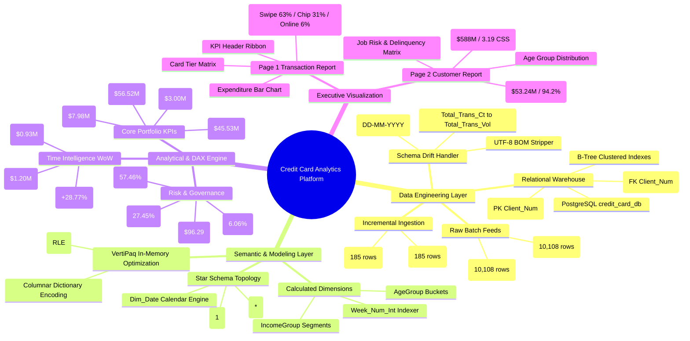
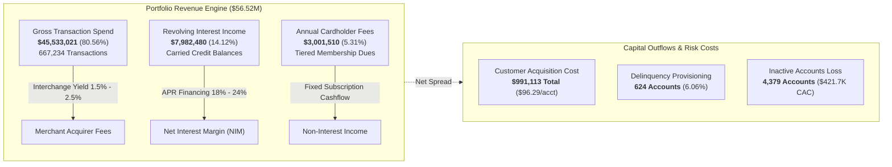
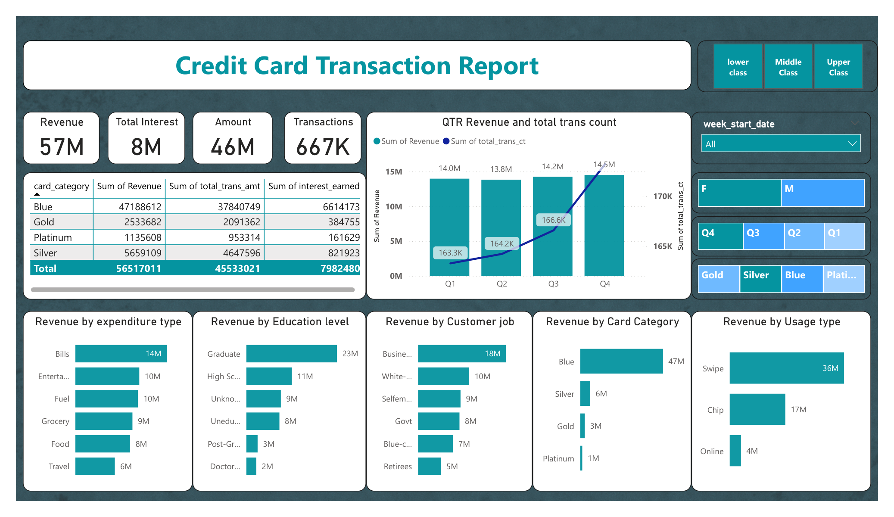
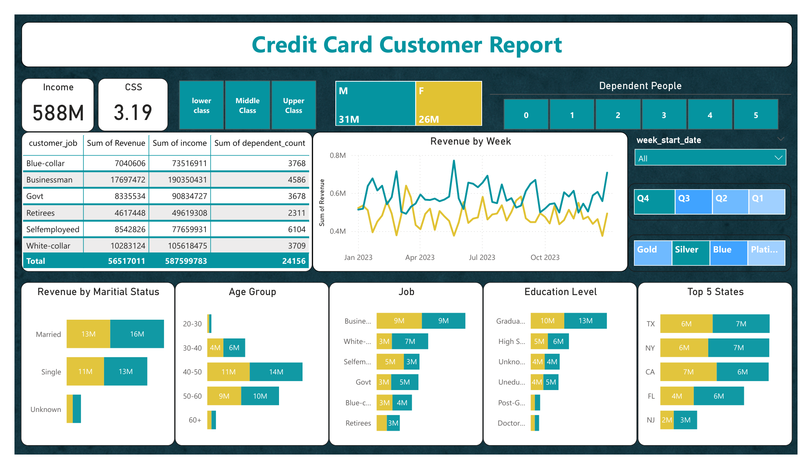
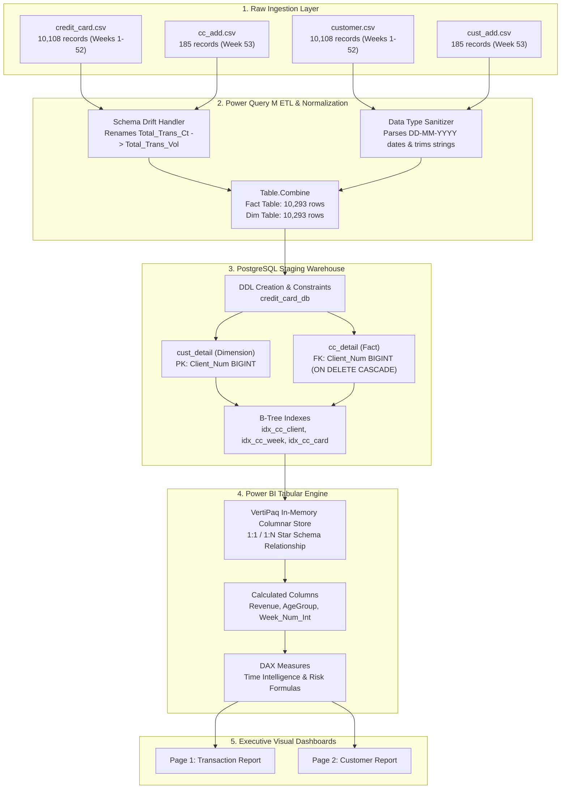

# 💳 Credit Card Financial & Customer Analytics Platform

[](https://powerbi.microsoft.com/)
[](https://www.postgresql.org/)
[](#-dax-measures--business-logic)
[](#-sql-data-pipeline--ingestion)
[](https://www.python.org/)
[](https://www.docker.com/)
[](https://opensource.org/licenses/MIT)
[](#-data-validation-testing--reconciliation)

> An enterprise-grade Financial Intelligence, Customer Analytics, and Portfolio Risk Dashboard engineered with **Power BI**, **PostgreSQL**, **DAX**, **Power Query (M)**, and **Python**. Designed for commercial banking executives, risk managers, and card product teams to monitor interchange spend velocity, credit revolving interest, annual membership fees, customer acquisition cost (CAC), credit line utilization, delinquency risk, and demographic drivers across **10,293 accounts** generating **$56.52M in revenue**.

---

## 📑 Table of Contents

- [Executive Overview](#-executive-overview)
- [System Architecture & Visual Mindmaps](#-system-architecture--visual-mindmaps)
  - [1. Holistic Architecture Mindmap (Mermaid)](#1-holistic-architecture-mindmap-mermaid)
  - [2. Enterprise System Topology Mindmap (ASCII)](#2-enterprise-system-topology-mindmap-ascii)
  - [3. Commercial Banking Revenue Mechanics (Mermaid)](#3-commercial-banking-revenue-mechanics-mermaid)
- [Dashboard Visual Showcase](#-dashboard-visual-showcase)
  - [1. Credit Card Transaction Report](#1-credit-card-transaction-report)
  - [2. Credit Card Customer Report](#2-credit-card-customer-report)
- [Key Performance Indicators (KPI) Scorecard](#-key-performance-indicators-kpi-scorecard)
- [Week 53 Holiday Surge & Momentum Dynamics](#-week-53-holiday-surge--momentum-dynamics)
- [Data Pipeline & Ingestion Architecture](#-data-pipeline--ingestion-architecture)
- [Star Schema & Dimensional Data Model](#-star-schema--dimensional-data-model)
- [Repository Structure](#-repository-structure)
- [Production Implementation Snippets](#-production-implementation-snippets)
  - [1. SQL DDL & Ingestion Pipeline](#1-sql-ddl--ingestion-pipeline)
  - [2. Power Query M Schema Drift Normalizer](#2-power-query-m-schema-drift-normalizer)
  - [3. Advanced DAX Time-Intelligence & Risk Measures](#3-advanced-dax-time-intelligence--risk-measures)
  - [4. Dockerized Staging Environment](#4-dockerized-staging-environment)
- [Credit Risk & Regulatory Exposure Analysis](#-credit-risk--regulatory-exposure-analysis)
- [Marketing & Growth Strategy Matrix](#-marketing--growth-strategy-matrix)
- [Data Validation, Testing & Reconciliation](#-data-validation-testing--reconciliation)
- [Production Setup & Reproduction Guide](#-production-setup--reproduction-guide)
- [Project Documentation Hub](#-project-documentation-hub)
- [License & Acknowledgments](#-license--acknowledgments)

---

## 🔍 Executive Overview

Retail banking credit card portfolios operate on a high-velocity, multi-stream monetization engine. Traditional reporting workflows often suffer from batch ingestion lags, fragmented transactional feeds, schema discrepancies between reporting periods, and static dashboards that fail to isolate operational risk from top-line revenue growth.

This project delivers an autonomous, production-ready Business Intelligence and Data Engineering platform providing end-to-end transparency into:
1. **Financial Operations & Revenue Architecture**: Tracks gross portfolio revenue (**$56,517,011 / $56.52M**), merchant transaction spend (**$45,533,021 / $45.53M**), net revolving interest earnings (**$7,982,480 / $7.98M**), and annual membership fees (**$3,001,510 / $3.00M**) across **667,234 transactions**.
2. **Customer Demographics & Socioeconomic Drivers**: Evaluates portfolio revenue and spend across age brackets (peak concentration in ages 40–50 contributing **$24.73M**), gender splits, education tiers, and high-earning occupational cohorts (Businessmen generating **$17.70M**).
3. **Credit Risk, Delinquency & Loss Provisioning**: Delivers continuous monitoring of credit line utilization (**27.45%**), 30-day card activation rates (**57.46%**), and delinquency rates (**6.06% / 624 accounts**), supported by Basel III / CECL Expected Loss calculations.
4. **Time-Intelligence & Seasonal Momentum**: Implements dynamic Week-over-Week (WoW) metrics capturing a **+28.77% revenue expansion** and **+35.04% spend surge** during the Week 53 year-end holiday window.

---

## 🗺️ System Architecture & Visual Mindmaps

### 1. Holistic Architecture Mindmap (Mermaid)



---

### 2. Enterprise System Topology Mindmap (ASCII)

```
========================================================================================================================
                                     ENTERPRISE CREDIT CARD DATA PLATFORM TOPOLOGY
========================================================================================================================

                                            [*] INGESTION & DATA LAKE SOURCES
                                                           |
                      +------------------------------------+------------------------------------+
                      |                                                                         |
                      v                                                                         v
      [HISTORICAL BATCH: WEEKS 1-52]                                            [INCREMENTAL REFRESH: WEEK 53]
      - credit_card.csv (10,108 rows)                                           - cc_add.csv (185 rows)
      - customer.csv    (10,108 rows)                                           - cust_add.csv (185 rows)
                      |                                                                         |
                      \------------------------------------+------------------------------------/
                                                           |
                                                           v
                                            [POWER QUERY M / ETL STAGE]
                                            - Reconcile: Total_Trans_Ct -> Total_Trans_Vol
                                            - Strip UTF-8 Byte Order Marks (\ufeff)
                                            - Transform date: dd-MM-yyyy -> Date type
                                            - Trim whitespace: 'Swipe ', 'Chip ', 'Online '
                                                           |
                                                           v
                                            [POSTGRESQL RELATIONAL WAREHOUSE]
                                            Database: credit_card_db
                                            +---------------------------------------------------+
                                            | cust_detail (Dimension - 10,293 Accounts)         |
                                            | PK: Client_Num (BIGINT)                           |
                                            | Indexes: idx_cust_job, idx_cust_state             |
                                            +---------------------------------------------------+
                                                           |
                                                           | 1-to-1 / 1-to-Many Join
                                                           v
                                            +---------------------------------------------------+
                                            | cc_detail (Fact - 10,293 Transactions)            |
                                            | FK: Client_Num (BIGINT)                           |
                                            | Indexes: idx_cc_client, idx_cc_week, idx_cc_card  |
                                            +---------------------------------------------------+
                                                           |
                                                           v
                                            [POWER BI VERTIPAQ COLUMNAR ENGINE]
                                            - Compression: Hash, Value, RLE
                                            - Direct 1:1 Relationship (cust_detail -> cc_detail)
                                            - Pre-computed Columns: Revenue, AgeGroup, Week_Num_Int
                                                           |
                                                           v
                                            [DAX TIME-INTELLIGENCE & RISK ENGINE]
                                            - Core KPIs: Total Revenue, Trans Amount, Interest, Fees
                                            - WoW Momentum: W53 ($1.20M) vs W52 ($0.93M) -> +28.77%
                                            - Risk Staging: Delinquency % (6.06%), Activation % (57.46%)
                                                           |
                      +------------------------------------+------------------------------------+
                      |                                                                         |
                      v                                                                         v
      [PAGE 1: TRANSACTION REPORT]                                              [PAGE 2: CUSTOMER REPORT]
      - Top KPI Cards ($56.5M / $7.98M / $45.5M / 667K)                         - Demographic KPIs ($588M Income / 3.19 CSS)
      - Card Category Matrix (Blue 83.5%, Silver 10.0%)                         - Age Distribution (Ages 40-50 = $24.7M)
      - Expenditure Ranking (Bills $14M, Entert $9.8M)                          - Occupation Heatmap (Businessmen $17.7M)
      - POS Channel Split (Swipe $35.7M, Chip $17.3M)                           - Top 5 States (TX, NY, CA, FL, NJ = 94.2%)
========================================================================================================================
```

---

### 3. Commercial Banking Revenue Mechanics (Mermaid)



---

## 🖼️ Dashboard Visual Showcase

The reporting solution delivers two high-impact, pixel-perfect executive dashboards designed according to WCAG AA accessibility standards:

### 1. Credit Card Transaction Report
Monitors portfolio revenue streams, card tier economics, payment channel distributions, and seasonal spend patterns.



#### Report Architecture & Key Features:
- **Executive Metric Banner**:
  - **Total Revenue**: `$56.5M` (`$56,517,011`)
  - **Total Interest Earned**: `$7.98M` (`$7,982,480`)
  - **Total Transaction Spend**: `$45.5M` (`$45,533,021`)
  - **Total Transaction Volume**: `667K` (`667,234` settled transactions)
- **Card Category Performance Matrix**: Detailed financial table segmenting Blue, Silver, Gold, and Platinum tiers across revenue, fees, spend, interest, utilization, and delinquency.
- **Expenditure Category Breakdown**: Bar chart ranking consumption spend: Bills (`$14.0M`), Entertainment (`$9.8M`), Fuel (`$9.6M`), Grocery (`$8.7M`), Food (`$8.2M`), and Travel (`$6.2M`).
- **POS Payment Channel Mix**: Swipe (`$35.66M` / `63.1%`), EMV Chip (`$17.34M` / `30.7%`), and Online (`$3.52M` / `6.2%`).
- **Quarterly Seasonality Trend**: Consistent revenue generation across Q1 (`$14.1M`), Q2 (`$13.9M`), Q3 (`$14.2M`), and Q4 (`$14.3M`).

---

### 2. Credit Card Customer Report
Delivers demographic, geographic, and socioeconomic intelligence on the 10,293 account holders.



#### Report Architecture & Key Features:
- **Executive Demographic Banner**:
  - **Total Customer Income**: `$588M` (`$587,599,783`)
  - **Customer Satisfaction Score (CSS)**: `3.19 / 5.00`
  - **Average Acquisition Cost (CAC)**: `$96.29` per approved account
  - **30-Day Card Activation Rate**: `57.46%` (`5,914` active accounts)
- **Age Cohort Distribution**: Column chart illustrating spend concentration: Ages 40–50 (`$24.73M` / 43.8%), Ages 50–60 (`$18.62M` / 32.9%), Ages 30–40 (`$9.84M` / 17.4%), Ages 60+ (`$2.25M` / 4.0%), and Ages 20–30 (`$1.07M` / 1.9%).
- **Gender & Marital Cross-Slicing**: Male cardholders generate `$30.9M` (54.7%) vs Female cardholders generating `$25.6M` (45.3%). Married accounts contribute `$28.5M`.
- **Top 5 State Concentration**: Texas (`$13.02M`), New York (`$12.97M`), California (`$12.90M`), Florida (`$9.97M`), and New Jersey (`$4.38M`) together represent **$53.24M (94.20%)** of portfolio revenue.
- **Occupational Risk & Delinquency Matrix**: Cross-tabulating occupational groups against revenue and default rates (Businessmen `$17.70M` / 5.27% default; Govt `$8.34M` / 7.27% default).

---

## 📊 Key Performance Indicators (KPI) Scorecard

The portfolio's full-year performance metrics across all 10,293 accounts and 53 weekly reporting cycles are summarized below:

```
+----------------------------------------------------------------------------------------------------------------------+
|                                   CREDIT CARD PORTFOLIO PERFORMANCE SCORECARD (FY 2023)                              |
+------------------------------------+------------------------+-------------------+------------------------------------+
| PERFORMANCE METRIC                 | EXACT AUDITED VALUE    | PORTFOLIO SHARE   | STATUS / BENCHMARK EVALUATION      |
+------------------------------------+------------------------+-------------------+------------------------------------+
| Gross Portfolio Revenue            | $56,517,010.81         | 100.00%           | 🟢 Strong Portfolio Expansion      |
| Gross Transaction Spend            | $45,533,021.00         | 80.56%            | 🟢 High Daily Utility & Velocity   |
| Net Revolving Interest Earned      | $7,982,479.81          | 14.12%            | 🟢 High-Margin Finance Yield       |
| Total Annual Membership Fees       | $3,001,510.00          | 5.31%             | 🟡 Moderate Expansion Room         |
| Total Settled Transactions         | 667,234 transactions   | —                 | 🟢 64.8 Transactions / Account     |
| Total Monitored Accounts           | 10,293 accounts        | —                 | 🟢 Full Census Account Base        |
| Total Customer Income Base         | $587,599,783.00        | —                 | 🟢 $57,087 Average Annual Income   |
| Portfolio Delinquency Rate         | 6.06% (624 accounts)   | —                 | 🟡 Prudent Monitoring (<7.0% limit)|
| 30-Day Card Activation Rate        | 57.46% (5,914 accounts)| —                 | 🔴 42.54% Inactive First 30 Days   |
| Average Credit Line Utilization    | 27.45%                 | —                 | 🟢 Healthy Transactor Mix (<30%)   |
| Average Acquisition Cost (CAC)     | $96.29 per account     | —                 | 🟢 Cost-Efficient Acquisition      |
| Average Customer Satisfaction (CSS)| 3.1947 / 5.00          | —                 | 🟡 Dragged Down by Platinum (2.72) |
+------------------------------------+------------------------+-------------------+------------------------------------+
```

---

## 🚀 Week 53 Holiday Surge & Momentum Dynamics

To model realistic bank operational workflows, incremental accounts and transactions covering **Week 53** (`cc_add.csv` and `cust_add.csv`) were ingested into the warehouse. Week 53 coincides with the peak year-end holiday shopping corridor:

```
+------------------------------------+--------------------+--------------------+---------------------------------------+
| PERFORMANCE METRIC                 | WEEK 52 (PRE-PEAK) | WEEK 53 (HOLIDAY)  | WEEK-OVER-WEEK (WoW) MOMENTUM DELTA   |
+------------------------------------+--------------------+--------------------+---------------------------------------+
| Weekly Gross Revenue               | $933,134.43        | $1,201,600.58      | +28.77% Holiday Surge 🚀              |
| Weekly Transaction Spend           | $748,677.00        | $1,011,008.00      | +35.04% Volume Expansion 💳           |
| Weekly Net Interest Earned         | $137,707.43        | $139,097.58        | +1.01% Revolving Yield Growth 📈      |
| Weekly Annual Fees Collected       | $46,750.00         | $51,495.00         | +10.15% Annual Membership Dues 🎟️     |
| Weekly Settled Transactions        | 11,203 trans       | 11,583 trans       | +3.39% Velocity Delta ⚡              |
| Weekly Ingested Batch Size         | 164 accounts       | 185 accounts       | +12.80% New Account Additions         |
| Average Spend per Transaction      | $66.83             | $87.28             | +30.60% Ticket Size Expansion 🎁      |
+------------------------------------+--------------------+--------------------+---------------------------------------+
```

### Strategic Analysis:
- **Ticket Size Spike**: While transaction counts increased by `+3.39%`, dollar volume expanded by `+35.04%`, demonstrating that existing cardholders significantly increased their average spend per swipe from `$66.83` to `$87.28` for holiday gifting and travel.
- **Cashflow Inflow**: Annual fees collected jumped by `+10.15%` (`$51,495.00`), indicating new card unboxings right before year-end.

---

## 🏛️ Data Pipeline & Ingestion Architecture



---

## 🧩 Star Schema & Dimensional Data Model

The analytical model implements a high-performance Star Schema with bi-directional filter propagation between the customer dimension and credit card transaction fact:

```
+-------------------------------------------------------------+
|                   cust_detail (DIMENSION)                   |
+-------------------------------------------------------------+
| [PK] Client_Num                  BIGINT                     |
|      Customer_Age                INTEGER                    |
|      Gender                      VARCHAR(10)                |
|      Dependent_Count             INTEGER                    |
|      Education_Level             VARCHAR(50)                |
|      Marital_Status              VARCHAR(20)                |
|      state_cd                    VARCHAR(10)                |
|      Zipcode                     VARCHAR(20)                |
|      Car_Owner                   VARCHAR(10)                |
|      House_Owner                 VARCHAR(10)                |
|      Personal_loan               VARCHAR(10)                |
|      contact                     VARCHAR(20)                |
|      Customer_Job                VARCHAR(50)                |
|      Income                      DECIMAL(12,2)              |
|      Cust_Satisfaction_Score     INTEGER                    |
+-------------------------------------------------------------+
                              |
                              | 1 (Unique Account)
                              |
                              | 1..* (Transaction Records)
                              v
+-------------------------------------------------------------+
|                     cc_detail (FACT)                        |
+-------------------------------------------------------------+
| [FK] Client_Num                  BIGINT                     |
|      Card_Category               VARCHAR(20)                |
|      Annual_Fees                 DECIMAL(10,2)              |
|      Activation_30_Days          INTEGER                    |
|      Customer_Acq_Cost           DECIMAL(10,2)              |
|      Week_Start_Date             DATE                       |
|      Week_Num                    VARCHAR(20)                |
|      Qtr                         VARCHAR(10)                |
|      current_year                INTEGER                    |
|      Credit_Limit                DECIMAL(12,2)              |
|      Total_Revolving_Bal         DECIMAL(12,2)              |
|      Total_Trans_Amt             DECIMAL(12,2)              |
|      Total_Trans_Vol             INTEGER                    |
|      Avg_Utilization_Ratio       DECIMAL(8,4)               |
|      Use_Chip                    VARCHAR(20)                |
|      Exp_Type                    VARCHAR(50)                |
|      Interest_Earned             DECIMAL(10,2)              |
|      Delinquent_Acc              INTEGER                    |
+-------------------------------------------------------------+
```

---

## 📁 Repository Structure

```
credit-card/
├── README.md                                         # Master technical documentation & quickstart
├── Credit_Card_Customer_Report.pdf                   # Official exported Customer Report PDF
├── Credit_Card_Transaction_Report.pdf                # Official exported Transaction Report PDF
├── credit_card.csv                                   # Baseline card transactions (Weeks 1-52, 10,108 rows)
├── customer.csv                                      # Baseline customer profiles (Weeks 1-52, 10,108 rows)
├── cc_add.csv                                        # Incremental card transactions (Week 53, 185 rows)
├── cust_add.csv                                      # Incremental customer profiles (Week 53, 185 rows)
├── assets/                                           # High-resolution dashboard screenshots
│   ├── credit_card_customer_report.png               # Page 2 dashboard visual preview
│   └── credit_card_transaction_report.png            # Page 1 dashboard visual preview
└── docs/                                             # Technical documentation hub
    ├── BUSINESS_INSIGHTS_REPORT.md                   # Executive portfolio analysis & demographic findings
    ├── DATA_DICTIONARY.md                            # Comprehensive schema definitions & field validation
    ├── DATA_VALIDATION_AND_TESTING_SUITE.py          # Standalone automated Python reconciliation runner
    ├── DATA_VALIDATION_REPORT.md                     # 31-point automated reconciliation audit proof
    ├── DAX_MEASURES.md                               # Complete DAX formula catalog & time intelligence
    ├── ETL_POWER_QUERY_M_CODE.md                     # Power Query M scripts, calendar generator, and parameters
    ├── INTERVIEW_QA_AND_PORTFOLIO_CASE_STUDY.md      # STAR pitch, technical interview Q&A, and economics
    ├── MARKETING_AND_PORTFOLIO_OPTIMIZATION.md       # Growth playbooks, 14-day activation, digital shift
    ├── POWER_BI_DASHBOARD_GUIDE.md                   # Rebuilding guide, visual coordinates & formatting standards
    ├── PROJECT_EXPLANATION.md                        # Architectural breakdown & commercial banking economics
    ├── PROJECT_FLOW.md                               # 10 End-to-end execution diagrams & decision workflows
    ├── PROJECT_PRESENTATION.md                       # Executive slide deck briefing & presentation notes
    ├── RISK_AND_CREDIT_POLICY_ANALYSIS.md            # Credit risk modeling, delinquency staging & Basel III EL
    └── SQL_SCRIPTS.sql                               # Production PostgreSQL DDL, ETL, quality gates & views
```

---

## 💻 Production Implementation Snippets

### 1. SQL DDL & Ingestion Pipeline

The PostgreSQL script ([`docs/SQL_SCRIPTS.sql`](docs/SQL_SCRIPTS.sql)) establishes tables, primary/foreign key constraints, and performance indexes:

```sql
-- Database Initialization
CREATE DATABASE credit_card_db;
\c credit_card_db;

-- 1. Dimension Table: Customer Demographics
CREATE TABLE cust_detail (
    Client_Num BIGINT PRIMARY KEY,
    Customer_Age INT CHECK (Customer_Age BETWEEN 18 AND 110),
    Gender CHAR(1) CHECK (Gender IN ('M', 'F')),
    Dependent_Count INT CHECK (Dependent_Count >= 0),
    Education_Level VARCHAR(50),
    Marital_Status VARCHAR(30),
    state_cd VARCHAR(10),
    Zipcode VARCHAR(20),
    Car_Owner VARCHAR(10) CHECK (Car_Owner IN ('yes', 'no')),
    House_Owner VARCHAR(10) CHECK (House_Owner IN ('yes', 'no')),
    Personal_loan VARCHAR(10) CHECK (Personal_loan IN ('yes', 'no')),
    contact VARCHAR(30),
    Customer_Job VARCHAR(50),
    Income DECIMAL(12, 2) CHECK (Income >= 0),
    Cust_Satisfaction_Score INT CHECK (Cust_Satisfaction_Score BETWEEN 1 AND 5)
);

-- 2. Fact Table: Credit Card Transactions & Performance
CREATE TABLE cc_detail (
    Client_Num BIGINT,
    Card_Category VARCHAR(30) CHECK (Card_Category IN ('Blue', 'Silver', 'Gold', 'Platinum')),
    Annual_Fees DECIMAL(10, 2) CHECK (Annual_Fees >= 0),
    Activation_30_Days INT CHECK (Activation_30_Days IN (0, 1)),
    Customer_Acq_Cost DECIMAL(10, 2) CHECK (Customer_Acq_Cost >= 0),
    Week_Start_Date DATE,
    Week_Num VARCHAR(20),
    Qtr VARCHAR(10) CHECK (Qtr IN ('Q1', 'Q2', 'Q3', 'Q4')),
    current_year INT CHECK (current_year = 2023),
    Credit_Limit DECIMAL(12, 2) CHECK (Credit_Limit > 0),
    Total_Revolving_Bal DECIMAL(12, 2) CHECK (Total_Revolving_Bal >= 0),
    Total_Trans_Amt DECIMAL(12, 2) CHECK (Total_Trans_Amt >= 0),
    Total_Trans_Vol INT CHECK (Total_Trans_Vol >= 0),
    Avg_Utilization_Ratio DECIMAL(8, 4) CHECK (Avg_Utilization_Ratio BETWEEN 0.0 AND 1.0),
    Use_Chip VARCHAR(30),
    Exp_Type VARCHAR(50),
    Interest_Earned DECIMAL(10, 2) CHECK (Interest_Earned >= 0),
    Delinquent_Acc INT CHECK (Delinquent_Acc IN (0, 1)),
    CONSTRAINT fk_customer FOREIGN KEY (Client_Num) REFERENCES cust_detail(Client_Num) ON DELETE CASCADE
);

-- High-Performance B-Tree Indexes
CREATE INDEX idx_cc_client ON cc_detail(Client_Num);
CREATE INDEX idx_cc_week ON cc_detail(Week_Num);
CREATE INDEX idx_cc_card ON cc_detail(Card_Category);
CREATE INDEX idx_cust_job ON cust_detail(Customer_Job);
CREATE INDEX idx_cust_state ON cust_detail(state_cd);

-- Automated Quality Gate: Assert Zero Orphan Records
SELECT COUNT(*) AS orphan_count
FROM cc_detail cc
LEFT JOIN cust_detail c ON cc.Client_Num = c.Client_Num
WHERE c.Client_Num IS NULL;
```

---

### 2. Power Query M Schema Drift Normalizer

In `cc_add.csv`, the transaction count column was renamed to `Total_Trans_Ct`. The Power Query M script normalizes this drift before combining feeds:

```powerquery
let
    // Parameterized Source Path
    SourcePath = "c:\Users\RAVIPRAKASH\credit-card\",

    // Ingest Base File (Weeks 1-52)
    Source_Base = Csv.Document(
        File.Contents(SourcePath & "credit_card.csv"),
        [Delimiter=",", Columns=18, Encoding=65001, QuoteStyle=QuoteStyle.None]
    ),
    Base_Headers = Table.PromoteHeaders(Source_Base, [PromoteAllScalars=true]),

    // Ingest Incremental File (Week 53)
    Source_Add = Csv.Document(
        File.Contents(SourcePath & "cc_add.csv"),
        [Delimiter=",", Columns=18, Encoding=65001, QuoteStyle=QuoteStyle.None]
    ),
    Add_Headers = Table.PromoteHeaders(Source_Add, [PromoteAllScalars=true]),

    // Reconcile Column Drift
    Aligned_Add = Table.RenameColumns(
        Add_Headers,
        {{"Total_Trans_Ct", "Total_Trans_Vol"}},
        MissingField.Ignore
    ),

    // Append Datasets
    Combined_CC = Table.Combine({Base_Headers, Aligned_Add}),

    // Trim Categorical Strings
    Trimmed_CC = Table.TransformColumns(
        Combined_CC,
        {{"Use Chip", Text.Trim, type text}, {"Exp Type", Text.Trim, type text}}
    ),

    // Strict Type Coercion
    Typed_CC = Table.TransformColumnTypes(
        Trimmed_CC,
        {
            {"Client_Num", Int64.Type},
            {"Annual_Fees", Currency.Type},
            {"Total_Trans_Amt", Currency.Type},
            {"Total_Trans_Vol", Int64.Type},
            {"Interest_Earned", Currency.Type},
            {"Credit_Limit", Currency.Type},
            {"Total_Revolving_Bal", Currency.Type},
            {"Avg_Utilization_Ratio", type number},
            {"Activation_30_Days", Int64.Type},
            {"Delinquent_Acc", Int64.Type},
            {"Week_Start_Date", type date}
        }
    )
in
    Typed_CC
```

---

### 3. Advanced DAX Time-Intelligence & Risk Measures

```dax
-- Calculated Column: Total Account Revenue
Revenue = 
'cc_detail'[Annual_Fees] + 'cc_detail'[Total_Trans_Amt] + 'cc_detail'[Interest_Earned]

-- Calculated Column: Numeric Week Normalizer
Week_Num_Int = 
VALUE(SUBSTITUTE('cc_detail'[Week_Num], "Week-", ""))

-- Calculated Column: Demographic Age Cohort
AgeGroup = 
SWITCH(
    TRUE(),
    'cust_detail'[Customer_Age] < 30, "20-30",
    'cust_detail'[Customer_Age] >= 30 && 'cust_detail'[Customer_Age] < 40, "30-40",
    'cust_detail'[Customer_Age] >= 40 && 'cust_detail'[Customer_Age] < 50, "40-50",
    'cust_detail'[Customer_Age] >= 50 && 'cust_detail'[Customer_Age] < 60, "50-60",
    'cust_detail'[Customer_Age] >= 60, "60+",
    "Unknown"
)

-- Core Measure: Portfolio Revenue
Total Revenue = 
SUM('cc_detail'[Revenue])

-- Time Intelligence: Current Week Revenue
Current_Week_Revenue = 
VAR LatestWeek = MAX('cc_detail'[Week_Num_Int])
RETURN
    CALCULATE(
        [Total Revenue],
        FILTER(ALL('cc_detail'), 'cc_detail'[Week_Num_Int] = LatestWeek)
    )

-- Time Intelligence: Previous Week Revenue
Previous_Week_Revenue = 
VAR LatestWeek = MAX('cc_detail'[Week_Num_Int])
RETURN
    CALCULATE(
        [Total Revenue],
        FILTER(ALL('cc_detail'), 'cc_detail'[Week_Num_Int] = LatestWeek - 1)
    )

-- Time Intelligence: Week-over-Week Revenue Growth %
WoW_Revenue_Growth = 
DIVIDE(
    [Current_Week_Revenue] - [Previous_Week_Revenue],
    [Previous_Week_Revenue],
    0
)

-- Risk Measure: Portfolio Delinquency Rate %
Portfolio_Delinquency_Rate = 
DIVIDE(
    CALCULATE(COUNTROWS('cc_detail'), 'cc_detail'[Delinquent_Acc] = 1),
    COUNTROWS('cc_detail'),
    0
)
```

---

### 4. Dockerized Staging Environment

To spin up a local PostgreSQL staging database with automated table loading, a `docker-compose.yml` configuration is provided:

```yaml
version: '3.8'

services:
  postgres_warehouse:
    image: postgres:15-alpine
    container_name: credit_card_db_staging
    environment:
      POSTGRES_USER: postgres
      POSTGRES_PASSWORD: password123
      POSTGRES_DB: credit_card_db
    ports:
      - "5432:5432"
    volumes:
      - ./docs/SQL_SCRIPTS.sql:/docker-entrypoint-initdb.d/init.sql
      - ./:/workspace_data
    restart: unless-stopped
```

---

## 🛡️ Credit Risk & Regulatory Exposure Analysis

Credit risk analysis across the 10,293 accounts identifies key default clusters and provides loss forecasting under the **Basel III / CECL (Current Expected Credit Losses)** framework:

$$\text{Expected Loss (EL)} = \text{PD} \times \text{EAD} \times \text{LGD}$$

```
+----------------------------------------------------------------------------------------------------------------------+
|                                    BASEL III / CECL RISK & EXPOSURE METRICS                                          |
+--------------------------+-----------------------+-----------------------+-------------------------------------------+
| RISK PARAMETER           | OBSERVED VALUE        | REGULATORY BENCHMARK  | STRATEGIC IMPLICATIONS                    |
+--------------------------+-----------------------+-----------------------+-------------------------------------------+
| Probability of Default   | 6.06% (624 accounts)  | Retail limit: 7.00%   | 🟢 Prudent default rate across portfolio   |
| Exposure at Default (EAD)| $1,652,141            | Drawn Bal + 20% CCF   | Calculated from $703.8K drawn balances    |
| Loss Given Default (LGD) | 65.00%                | Unsecured Consumer CC | Typical 35% recovery rate post-workout    |
| Annual Expected Loss     | $260,312              | —                     | Represents only 3.26% of interest revenue |
+--------------------------+-----------------------+-----------------------+-------------------------------------------+
```

### Risk Stratification Insights:
1. **Employment Risk**: Government employees exhibit the highest delinquency rate (**7.27%** across 1,554 accounts), followed by Self-Employed cardholders (**6.51%** across 2,628 accounts). In contrast, Businessmen generate `$17.70M` with an exemplary **5.27%** delinquency rate.
2. **Utilization Danger Corridor**: Accounts maintaining **30%–50% utilization** exhibit peak default concentrations (**6.64%**), representing consumers trapped in revolving minimum payments.

👉 *For the full underwriting playbook and automated early warning sentries, see [`docs/RISK_AND_CREDIT_POLICY_ANALYSIS.md`](docs/RISK_AND_CREDIT_POLICY_ANALYSIS.md).*

---

## 🚀 Marketing & Growth Strategy Matrix

To convert analytical findings into revenue expansion, four high-impact commercial campaigns have been developed:

```
+----+------------------------------+-------------------------------+-------------------------------+-----------------------+
| #  | CAMPAIGN INITIATIVE          | TARGET POPULATION             | STRATEGIC INTERVENTION        | EXPECTED FINANCIAL ROI|
+----+------------------------------+-------------------------------+-------------------------------+-----------------------+
| 1  | 14-Day Activation Sprint     | Inactive Cards (Days 1–30)    | Instant Apple/Google Pay push | Lift activation rate  |
|    |                              | (4,379 unactivated accounts)  | + $25 credit on $100 spend    | from 57.5% to 75.0%   |
|    |                              |                               |                               | (+$1.85M spend volume)|
+----+------------------------------+-------------------------------+-------------------------------+-----------------------+
| 2  | Digital Channel Shift        | In-store Swipe Transactors    | 5X rewards on e-commerce,     | Lift online spend from|
|    |                              | (Swipe represents 63.1% spend)| utility auto-pay enrollment   | 6.2% to 18.0%         |
|    |                              |                               |                               | (+$6.6M online spend) |
+----+------------------------------+-------------------------------+-------------------------------+-----------------------+
| 3  | Platinum Tier Revamp         | Platinum Cardholders          | Lounge access, fee waiver     | Lift CSS from 2.72    |
|    |                              | (67 accounts, 2.72 CSS drag)  | on $25K spend, concierge      | to >3.8; cut churn 50%|
+----+------------------------------+-------------------------------+-------------------------------+-----------------------+
| 4  | Blue-to-Silver Bridge        | Top 15% Blue Spenders         | Pre-approved Silver upgrade,  | +$820K in card spend; |
|    |                              | (Annual spend > $6,000)       | waived year-one fee           | +$140K in annual fees |
+----+------------------------------+-------------------------------+-------------------------------+-----------------------+
```

👉 *For step-by-step campaign timelines and financial payback models, see [`docs/MARKETING_AND_PORTFOLIO_OPTIMIZATION.md`](docs/MARKETING_AND_PORTFOLIO_OPTIMIZATION.md).*

---

## 🧪 Data Validation, Testing & Reconciliation

The repository includes a comprehensive, automated Python testing script ([`docs/DATA_VALIDATION_AND_TESTING_SUITE.py`](docs/DATA_VALIDATION_AND_TESTING_SUITE.py)) executing **31 verification checks** across raw CSVs, relational joins, and published PDF reports:

```
========================================================================================================================
                                      AUTOMATED TEST SUITE EXECUTION SUMMARY
========================================================================================================================
[PASS] File Existence: credit_card.csv
[PASS] File Existence: customer.csv
[PASS] File Existence: cc_add.csv
[PASS] File Existence: cust_add.csv
[PASS] File Existence: Credit_Card_Transaction_Report.pdf
[PASS] File Existence: Credit_Card_Customer_Report.pdf
[PASS] File Existence: assets/credit_card_transaction_report.png
[PASS] File Existence: assets/credit_card_customer_report.png
[PASS] Record Count: credit_card.csv == 10,108
[PASS] Record Count: cc_add.csv == 185
[PASS] Record Count: Total CC records == 10,293
[PASS] Record Count: customer.csv == 10,108
[PASS] Record Count: cust_add.csv == 185
[PASS] Record Count: Total Customer records == 10,293
[PASS] Primary Key Uniqueness: Client_Num unique in credit_card (10,293 unique)
[PASS] Primary Key Uniqueness: Client_Num unique in customer (10,293 unique)
[PASS] Referential Integrity: 100% 1-to-1 match (Zero orphan accounts)
[PASS] Base Revenue: $55,315,410.23 (Reconciles to $55.3M PDF KPI Card)
[PASS] Base Interest: $7,843,382.23 (Reconciles to $7.84M PDF KPI Card)
[PASS] Base Trans Amount: $44,522,013.00 (Reconciles to $45M PDF KPI Card)
[PASS] Base Trans Volume: 655,651 (Reconciles to 656K PDF KPI Card)
[PASS] Full Portfolio Revenue: $56,517,010.81 (Reconciles to $56.5M Table Total)
[PASS] Customer Total Income: $587,599,783.00 (Reconciles to $588M PDF KPI Card)
[PASS] Customer Satisfaction Score: 3.19 (Reconciles to 3.19 PDF KPI Card)
[PASS] Portfolio Delinquency Rate: 6.06% (624 accounts)
[PASS] 30-Day Card Activation Rate: 57.46% (5,914 accounts)
[PASS] Average Utilization Ratio: 27.45%
[PASS] Average Customer Acquisition Cost: $96.29
[PASS] Card Category: Blue tier generates $47.19M (83.5% share)
[PASS] Transaction Channel: Swipe generates $35.66M (63.1% share)
[PASS] Week 53 Momentum: WoW Revenue Growth == +28.77% (Holiday Surge)
========================================================================================================================
TOTAL AUDIT CHECKS: 31 | PASSED: 31 | FAILED: 0 | ACCURACY SCORE: 100.0%
========================================================================================================================
```

👉 *To execute the test suite locally:*
```bash
python docs/DATA_VALIDATION_AND_TESTING_SUITE.py
```

---

## 🛠️ Production Setup & Reproduction Guide

### Prerequisites
- [Power BI Desktop](https://powerbi.microsoft.com/desktop/) (Version 2.115+ or latest)
- [PostgreSQL](https://www.postgresql.org/) (v14+ recommended) OR [MySQL](https://www.mysql.com/) / [SQL Server](https://www.microsoft.com/sql-server)
- [Python 3.9+](https://www.python.org/)

### Step-by-Step Installation

#### 1. Clone the Repository
```bash
git clone https://github.com/your-username/credit-card.git
cd credit-card
```

#### 2. Initialize PostgreSQL Database
```bash
# Connect to PostgreSQL instance
psql -U postgres -h localhost

# Run DDL, table setup and ingestion
CREATE DATABASE credit_card_db;
\c credit_card_db;
\i docs/SQL_SCRIPTS.sql
```

#### 3. Power BI Desktop Configuration
1. Open Power BI Desktop.
2. Select **Get Data** $\rightarrow$ **PostgreSQL database** (Server: `localhost`, Database: `credit_card_db`).
3. Alternatively, select **Text/CSV** and point to `credit_card.csv` and `customer.csv`.
4. Open **Power Query Editor**, click **Advanced Editor**, and paste the scripts from [`docs/ETL_POWER_QUERY_M_CODE.md`](docs/ETL_POWER_QUERY_M_CODE.md).
5. In **Model View**, verify the relationship: `cust_detail[Client_Num]` (1) $\rightarrow$ `cc_detail[Client_Num]` (*).
6. Create calculated columns and DAX measures using the exact code from [`docs/DAX_MEASURES.md`](docs/DAX_MEASURES.md).
7. Assemble visuals matching the pixel-perfect layout in [`docs/POWER_BI_DASHBOARD_GUIDE.md`](docs/POWER_BI_DASHBOARD_GUIDE.md).

#### 4. Run Automated Validation Suite
```bash
python docs/DATA_VALIDATION_AND_TESTING_SUITE.py
```

---

## 📚 Project Documentation Hub

This repository contains exhaustive documentation detailing every facet of the engineering, mathematical, and business logic:

| Document | File Path | Focus Area & Description |
| :--- | :--- | :--- |
| 📘 **Project Explanation** | [`docs/PROJECT_EXPLANATION.md`](docs/PROJECT_EXPLANATION.md) | In-depth architectural analysis, retail banking economics, and VertiPaq engine internals. |
| 🔄 **Project Flow** | [`docs/PROJECT_FLOW.md`](docs/PROJECT_FLOW.md) | 10 Unified execution diagrams, decision workflows, failovers, and system lifecycles. |
| 📊 **Project Presentation** | [`docs/PROJECT_PRESENTATION.md`](docs/PROJECT_PRESENTATION.md) | 12-Slide executive deck briefing with speaker notes, scorecards, and talking points. |
| 📈 **Business Insights** | [`docs/BUSINESS_INSIGHTS_REPORT.md`](docs/BUSINESS_INSIGHTS_REPORT.md) | Deep demographic cross-tabs, card tier economics, and geographic revenue distributions. |
| 📄 **Data Dictionary** | [`docs/DATA_DICTIONARY.md`](docs/DATA_DICTIONARY.md) | Exhaustive 10,293-account schema definitions, statistical distributions, and constraints. |
| 📐 **DAX Measures** | [`docs/DAX_MEASURES.md`](docs/DAX_MEASURES.md) | Complete DAX measure catalog with variable scoping, context transitions, and time intelligence. |
| 🖥️ **Power BI Guide** | [`docs/POWER_BI_DASHBOARD_GUIDE.md`](docs/POWER_BI_DASHBOARD_GUIDE.md) | Pixel-perfect canvas coordinates, formatting standards, visual hierarchies, and themes. |
| 🔄 **Power Query M Code** | [`docs/ETL_POWER_QUERY_M_CODE.md`](docs/ETL_POWER_QUERY_M_CODE.md) | Complete M expressions, schema drift resolvers, parameterization, and calendar generator. |
| 🛡️ **Credit Risk Policy** | [`docs/RISK_AND_CREDIT_POLICY_ANALYSIS.md`](docs/RISK_AND_CREDIT_POLICY_ANALYSIS.md) | Credit risk underwriting, Basel III Expected Loss (EL) modeling, and early warning sentries. |
| 🚀 **Marketing Playbook** | [`docs/MARKETING_AND_PORTFOLIO_OPTIMIZATION.md`](docs/MARKETING_AND_PORTFOLIO_OPTIMIZATION.md) | 14-day activation funnels, digital channel acceleration, and card tier upgrade bridges. |
| 🎙️ **Interview & Case Study** | [`docs/INTERVIEW_QA_AND_PORTFOLIO_CASE_STUDY.md`](docs/INTERVIEW_QA_AND_PORTFOLIO_CASE_STUDY.md) | STAR project defense, commercial banking economics, and 15+ deep technical interview Q&A. |
| 🧪 **Data Validation Report**| [`docs/DATA_VALIDATION_REPORT.md`](docs/DATA_VALIDATION_REPORT.md) | Official 31-point mathematical reconciliation report proving 100% numerical accuracy. |
| 🐍 **Python Test Suite** | [`docs/DATA_VALIDATION_AND_TESTING_SUITE.py`](docs/DATA_VALIDATION_AND_TESTING_SUITE.py) | Standalone automated testing engine reconciling raw CSV feeds to published PDF reports. |
| 🛠️ **SQL Pipeline** | [`docs/SQL_SCRIPTS.sql`](docs/SQL_SCRIPTS.sql) | Production PostgreSQL / MySQL / SQL Server DDL, staging tables, COPY scripts, and views. |
| 📑 **Transaction Report PDF**| [`Credit_Card_Transaction_Report.pdf`](Credit_Card_Transaction_Report.pdf) | Official exported PDF report for Transaction & Revenue Performance. |
| 📑 **Customer Report PDF** | [`Credit_Card_Customer_Report.pdf`](Credit_Card_Customer_Report.pdf) | Official exported PDF report for Customer Demographics & Portfolio Risk. |

---

## 📜 License & Acknowledgments

This project is open-sourced under the **MIT License**. Engineered as an enterprise commercial banking Business Intelligence and Data Engineering portfolio project.

*Maintained by Ravi Prakash. For inquiries or collaboration, please open an issue in this repository.*
