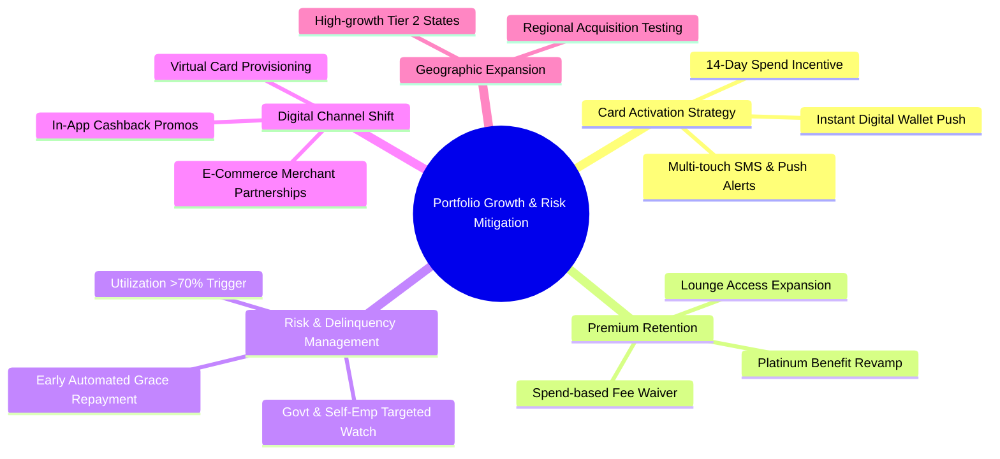

# Executive Financial & Customer Insights Report: Credit Card Portfolio

**Reporting Period**: Fiscal Year 2023 (Weeks 1 to 53)  
**Total Monitored Portfolio Volume**: 10,293 Accounts  
**Gross Portfolio Revenue**: **$56.52 Million ($56,517,011)**  
**Settled Transactions**: **667,234 Transactions ($45.53M Volume)**  
**Net Interest Earnings**: **$7,982,480**  

---

## 🗺️ 1. Executive Mindmaps & Strategic Portfolio Flows

### 1.1 ASCII Mindmap: Business Drivers, Risk Levers & Revenue Mechanics

```
====================================================================================================
                        EXECUTIVE CREDIT CARD PORTFOLIO MINDMAP
====================================================================================================

                               [*] $56.52M PORTFOLIO REVENUE ENGINE
                                                |
    +-------------------------------------------+-------------------------------------------+
    |                                           |                                           |
    v                                           v                                           v
[REVENUE GENERATION]                   [DEMOGRAPHIC PILLARS]                       [OPERATIONAL RISKS]
    |                                           |                                           |
    +---> Card Tiers                            +---> Age Cohorts                           +---> Delinquency (6.06%)
    |     |-- Blue: $47.19M (83.5%)             |     |-- Ages 40-50: $24.73M (43.8%)       |     |-- Govt Staff: 7.27%
    |     |-- Silver: $5.66M (10.0%)            |     |-- Ages 50-60: $18.62M (32.9%)       |     \-- Self-Employed: 6.51%
    |     |-- Gold: $2.53M (4.5%)               |     \-- Ages 30-40: $9.84M (17.4%)        |
    |     \-- Platinum: $1.14M (2.0%)           |                                           +---> Inactive Cards (42.5%)
    |                                           +---> Employment Cohorts                    |     \-- 30-Day Activation: 57.5%
    +---> Spend Categories                      |     |-- Businessman: $17.70M              |         ($96.29 CAC Wasted)
    |     |-- Bills & Utility: $14.0M           |     |-- White-Collar: $10.28M             |
    |     |-- Entertainment: $9.8M              |     |-- Self-Employed: $8.54M             +---> Premium Tier Churn Risk
    |     |-- Fuel & Transport: $9.6M           |     \-- Govt Staff: $8.34M                |     \-- Platinum CSS: 2.72/5.0
    |     |-- Groceries: $8.7M                  |                                           |         (vs 3.20 Blue)
    |     \-- Dining & Travel: $14.4M           +---> Geographic Concentration              |
    |                                                 |-- Top 5 States: 94.2% Revenue       \---> Digital Lag
    \---> Transaction Channels                        |   (TX $13M, NY $13M, CA $12.9M,           \-- Online Spend: 6.2%
          |-- Swipe: $35.66M (63.1%)                  |    FL $10M, NJ $4.4M)                         (vs 63.1% Swipe)
          |-- Chip: $17.34M (30.7%)                   \-- Remaining 45 States: 5.8%
          \-- Online: $3.52M (6.2%)
====================================================================================================
```

### 1.2 Mermaid Mindmap: Strategic Action Pathways



### 1.3 ASCII Decision-Tree & Process Flows

```
+---------------------------------------------------------------------------------------------------+
|                           AUTOMATED 30-DAY ACTIVATION ESCALATION FLOW                             |
+---------------------------------------------------------------------------------------------------+

   [Day 0: Card Delivered / Issued]
                 |
                 v
   [Day 1-3: Digital Onboarding Alert] ---------------------> [Card Activated?] --(YES)--> [Nurture Sequence]
                 |                                                        | (NO)
                 v                                                        v
   [Day 7: First Spend Incentive Push] ---------------------> [Card Activated?] --(YES)--> [Cashback Credited]
   "Spend $50 within 7 days, get $15 credit"                              | (NO)
                 |                                                        v
                 v                                              +--------------------------------------+
   [Day 14: SMS + Telephony Contact] -------------------------> | Escalate to Inactivity Taskforce     |
   Verify card delivery; offer digital card activation         | Target: Lift Activation 57.5% -> 70% |
                 |                                              +--------------------------------------+
                 v
   [Day 30: Churn Inactivity Flag]
   Mark account dormant; assess CAC recovery strategy
```

```
+---------------------------------------------------------------------------------------------------+
|                         EARLY WARNING DELINQUENCY MITIGATION FLOW                                 |
+---------------------------------------------------------------------------------------------------+

   [Weekly Ingestion Feed]
                 |
                 v
   [Step 1: Check Credit Utilization Ratio]
         |
         +---> If Utilization Ratio > 70%
         |          |
         |          v
         |     [Step 2: Cross-check Risk Cohort (Govt Staff 7.27% / Self-Emp 6.51%)]
         |          |
         |          v
         |     [Step 3: Trigger Proactive Soft Reminder (SMS/Mobile App 5 days before due date)]
         |          |
         |          v
         |     [Step 4: Offer Flexible Split-Payment / Minimum Due Installment]
         |
         \---> If Delinquent_Acc = 1
                    |
                    v
               [Automated Restriction of Available Credit Limit & Hard Collection Outreach]
```

---

## 2. Executive Summary

During the 2023 fiscal year, the credit card portfolio demonstrated steady revenue generation, delivering **$56.52M** in total revenue across **667K transactions**, with a total transaction spend of **$45.53M** and finance interest earnings of **$7.98M**. 

Key strategic findings include:
1. **Strong Year-End Momentum**: Week 53 witnessed explosive holiday spending, generating **+28.77% Week-over-Week (WoW) revenue growth** and **+35.04% WoW spend expansion**.
2. **Blue Tier Dominance**: The entry-level **Blue Card** accounts for **83.5% ($47.19M)** of total revenue and **88.7%** of transaction volume.
3. **Core Demographic Drivers**: Customers aged **40–60** represent the primary financial engine, contributing **76.7% ($43.36M)** of portfolio revenue.
4. **Geographic Concentration**: Five key states (**TX, NY, CA, FL, NJ**) generate **94.2% ($53.24M)** of total revenue.
5. **Satisfaction Gap in Premium Tiers**: While overall customer satisfaction averages **3.19 / 5.0**, **Platinum cardholders report a significantly lower score of 2.72**, highlighting an urgent retention vulnerability.

---

## 3. Key Performance Indicators (KPIs)

| Metric | Full Year Performance | Industry Benchmark | Status | Strategic Implication |
| :--- | :--- | :--- | :--- | :--- |
| **Total Revenue** | **$56,517,011** (~$56.52M) | — | 🟢 Robust | Healthy balance between interchange, fees, and interest |
| **Gross Transaction Spend** | **$45,533,021** (~$45.53M) | — | 🟢 Strong | Indicates steady customer transactional utility |
| **Net Interest Income** | **$7,982,480** (~$7.98M) | — | 🟢 Profitable | Generated by revolving credit balances |
| **Annual Membership Fees** | **$3,001,510** (~$3.00M) | — | 🟡 Moderate | Heavily dependent on mass-tier fee renewals |
| **Total Transaction Count** | **667,234** (~667K) | — | 🟢 High Activity | High velocity across daily essential spend categories |
| **Portfolio Delinquency Rate** | **6.06%** | $5.0\% - 6.5\%$ | 🟡 Monitor Closely | Elevated in Government and Self-employed segments |
| **30-Day Card Activation Rate** | **57.46%** | $65.0\% - 75.0\%$ | 🔴 Needs Attention | Over 42.5% of cards fail to activate in first month |
| **Average Credit Utilization** | **27.45%** | $< 30\%$ | 🟢 Healthy | Within prudent revolving risk boundaries |
| **Avg Customer Acq Cost (CAC)** | **$96.29** | $\$80 - \$120$ | 🟢 Efficient | Fast payback on active accounts, lost on inactive cards |
| **Avg Customer Satisfaction (CSS)**| **3.19 / 5.00** | $> 3.8 / 5.0$ | 🟡 Moderate | Significant drag caused by Platinum dissatisfaction |

---

## 4. Revenue Breakdown & Financial Drivers

### 4.1 Performance by Card Category

```
Blue        ████████████████████████████████████████  $47.19M (83.49%)
Silver      █████                                      $5.66M  (10.01%)
Gold        ██                                         $2.53M  (4.48%)
Platinum    █                                          $1.14M  (2.01%)
```

| Card Category | Accounts | Gross Revenue ($) | Share (%) | Trans Spend ($) | Net Interest ($) | Annual Fees ($) | Transactions | Avg Limit ($) | Utilization (%) | Delinquency (%) | CSS (/5.0) |
| :--- | :--- | :--- | :--- | :--- | :--- | :--- | :--- | :--- | :--- | :--- | :--- |
| **Blue** | 9,384 | $47,188,611.62 | 83.49% | $37,840,749.00 | $6,614,172.62 | $2,733,690.00 | 591,791 | $6,832.95 | 29.17% | 6.05% | 3.20 |
| **Silver** | 649 | $5,659,108.98 | 10.01% | $4,647,596.00 | $821,922.98 | $189,590.00 | 49,172 | $24,561.42 | 8.31% | 6.16% | 3.22 |
| **Gold** | 193 | $2,533,682.16 | 4.48% | $2,091,362.00 | $384,755.16 | $57,565.00 | 18,781 | $24,677.38 | 12.48% | 6.22% | 3.05 |
| **Platinum** | 67 | $1,135,608.05 | 2.01% | $953,314.00 | $161,629.05 | $20,665.00 | 7,490 | $22,873.30 | 15.12% | 5.97% | 2.72 |
| **Total** | **10,293** | **$56,517,010.81** | **100.00%** | **$45,533,021.00** | **$7,982,479.81** | **$3,001,510.00** | **667,234** | **$8,642.41** | **27.45%** | **6.06%** | **3.19** |

- **Blue Card**: Produces $47.19M from 591,791 transactions across 9,384 accounts. With an average utilization of 29.17% and delinquency of 6.05%, it is the anchor of institutional earnings.
- **Silver Card**: Produces $5.66M from 49,172 transactions across 649 accounts. Average utilization drops to 8.31%, indicating substantial untapped credit capacity on an average limit of $24,561.
- **Gold Card**: Produces $2.53M across 193 accounts with an average utilization of 12.48% and delinquency of 6.22%.
- **Platinum Card**: Generates $1.14M across 67 accounts. Despite an average annual fee of $308.43 and high credit limit ($22,873), Platinum cardholders demonstrate low utilization (15.12%) and alarmingly low satisfaction (2.72/5.00), representing an acute retention vulnerability.

### 4.2 Expenditure Category Analysis

| Expenditure Type | Accounts | Revenue ($) | Share (%) | Trans Spend ($) | Transactions | Avg Ticket ($) | Key Characteristics |
| :--- | :--- | :--- | :--- | :--- | :--- | :--- | :--- |
| **Bills & Utilities** | 3,014 | $14,001,372.30 | 24.77% | $11,166,448.00 | 178,025 | $62.72 | Essential recurring auto-pay; lowest cyclical default propensity |
| **Entertainment** | 2,030 | $9,781,401.68 | 17.31% | $7,821,312.00 | 127,587 | $61.30 | High holiday elasticity; surged strongly during Q4 Week 53 |
| **Fuel & Transport** | 1,789 | $9,587,104.42 | 16.96% | $7,705,253.00 | 117,605 | $65.52 | Regular commuter card utilization across all income brackets |
| **Groceries** | 1,533 | $8,734,990.55 | 15.46% | $7,032,033.00 | 104,526 | $67.28 | Non-discretionary staple; highly stable transaction volume |
| **Food & Dining** | 1,210 | $8,375,136.95 | 14.82% | $6,808,437.00 | 89,751 | $75.86 | Quick-service dining, delivery apps, social entertainment |
| **Travel** | 717 | $6,037,004.91 | 10.68% | $4,999,538.00 | 49,740 | $100.51 | Highest average transaction size; concentrated in Upper Class |
| **Total** | **10,293** | **$56,517,010.81** | **100.00%** | **$45,533,021.00** | **667,234** | **$68.24** | Balanced across daily utility and discretionary spend |

### 4.3 Point-of-Sale / Authentication Channels

| Channel Method | Accounts | Revenue ($) | Share (%) | Trans Spend ($) | Transactions | Avg Ticket ($) | Penetration Status |
| :--- | :--- | :--- | :--- | :--- | :--- | :--- | :--- |
| **Swipe** | 7,232 | $35,662,565.26 | 63.10% | $28,519,960.00 | 446,607 | $63.86 | Dominant physical terminal swipe volume |
| **Chip (EMV)** | 2,457 | $17,338,110.67 | 30.68% | $14,165,890.00 | 180,759 | $78.37 | Contactless & chip dip in-store payments |
| **Online (Web)** | 604 | $3,516,334.88 | 6.22% | $2,847,171.00 | 39,868 | $71.41 | Highly under-penetrated; retail industry avg is 25%–35% |
| **Total** | **10,293** | **$56,517,010.81** | **100.00%** | **$45,533,021.00** | **667,234** | **$68.24** | Digital shift represents key FY2024 growth lever |

---

## 5. Demographic & Socioeconomic Segmentation

### 5.1 Age Bracket Performance

| Age Cohort | Accounts | Share (%) | Gross Revenue ($) | Revenue Share | Trans Spend ($) | Total Income ($) | Delinquency (%) | CSS (/5.0) |
| :--- | :--- | :--- | :--- | :--- | :--- | :--- | :--- | :--- |
| **20–30** | 220 | 2.14% | $1,067,316.52 | 1.89% | $850,338.00 | $10,362,942.00 | 5.91% | 3.20 |
| **30–40** | 1,876 | 18.23% | $9,843,473.62 | 17.42% | $7,917,208.00 | $101,902,853.00 | 4.80% | 3.21 |
| **40–50** | 4,606 | 44.75% | $24,732,980.74 | 43.76% | $19,890,498.00 | $259,015,148.00 | 6.69% | 3.18 |
| **50–60** | 3,048 | 29.61% | $18,623,636.98 | 32.95% | $15,089,346.00 | $193,990,127.00 | 6.14% | 3.20 |
| **60+** | 543 | 5.28% | $2,249,602.95 | 3.98% | $1,785,631.00 | $22,328,713.00 | 4.79% | 3.27 |
| **Total** | **10,293** | **100.00%** | **$56,517,010.81** | **100.00%** | **$45,533,021.00** | **$587,599,783.00** | **6.06%** | **3.19** |

- **Ages 40–50**: Primary financial powerhouse generating **$24.73M (43.76%)** with $259.0M in collective income across 4,606 accounts. Requires careful monitoring due to peak delinquency (6.69%).
- **Ages 50–60**: Second largest revenue pillar producing **$18.62M (32.95%)** across 3,048 accounts with high credit stability.
- **Ages 30–40**: Strong low-delinquency growth cohort contributing **$9.84M (17.42%)** with lowest default rate (4.80%).
- **Ages 20–30 & 60+**: Niche cohorts contributing **$1.07M (1.89%)** and **$2.25M (3.98%)** respectively.

### 5.2 Occupational Performance & Risk

| Customer Occupation | Accounts | Share (%) | Gross Revenue ($) | Share (%) | Total Income ($) | Delinquent Accounts | Delinquency (%) | CSS (/5.0) |
| :--- | :--- | :--- | :--- | :--- | :--- | :--- | :--- | :--- |
| **Businessman** | 1,935 | 18.80% | $17,697,472.01 | 31.31% | $190,350,431.00 | 102 | 5.27% | 3.23 |
| **White-collar** | 1,564 | 15.20% | $10,283,123.92 | 18.19% | $105,618,475.00 | 87 | 5.56% | 3.10 |
| **Selfemployeed** | 2,628 | 25.53% | $8,542,826.40 | 15.12% | $77,659,931.00 | 171 | 6.51% ⚠️ | 3.22 |
| **Govt** | 1,554 | 15.10% | $8,335,533.84 | 14.75% | $90,834,727.00 | 113 | 7.27% 🚨 | 3.22 |
| **Blue-collar** | 1,606 | 15.60% | $7,040,606.42 | 12.46% | $73,516,911.00 | 88 | 5.48% | 3.18 |
| **Retirees** | 1,006 | 9.77% | $4,617,448.22 | 8.17% | $49,619,308.00 | 63 | 6.26% | 3.17 |
| **Total** | **10,293** | **100.00%** | **$56,517,010.81** | **100.00%** | **$587,599,783.00** | **624** | **6.06%** | **3.19** |

- **Businessmen**: Lead all employment groups with **$17.70M** in revenue, an aggregate income of $190.4M, and low delinquency (**5.27%**).
- **White-Collar Professionals**: Second highest with **$10.28M** in revenue and $105.6M in aggregate income.
- **Self-Employed**: Largest account base (2,628 accounts) producing **$8.54M**, but elevated delinquency (**6.51%**).
- **Government Employees**: Generates **$8.34M**, but exhibits the highest delinquency rate across all sectors (**7.27%**), requiring proactive 5-day pre-due payment reminders.
- **Blue-Collar & Retirees**: Highly disciplined spenders with stable, recurring grocery and utility volumes.

### 5.3 Geographic Revenue Concentration (Top 10 States)

| Rank | State Code | Accounts | Gross Revenue ($) | Share (%) | Total Income ($) | Delinquency (%) | Regional Market Profile |
| :--- | :--- | :--- | :--- | :--- | :--- | :--- | :--- |
| 1 | **Texas (TX)** | 2,439 | $13,015,112.41 | 23.03% | $135,062,136.00 | 6.07% | Largest revenue state; energy, corporate hubs |
| 2 | **New York (NY)** | 2,305 | $12,971,862.62 | 22.95% | $136,339,248.00 | 6.72% | Financial center; high travel and entertainment spend |
| 3 | **California (CA)** | 2,516 | $12,901,378.91 | 22.83% | $131,608,915.00 | 5.88% | Largest account count; tech, retail, commerce |
| 4 | **Florida (FL)** | 1,740 | $9,969,060.33 | 17.64% | $104,572,969.00 | 5.23% | High retiree and tourism spend; lowest Top-5 delinquency |
| 5 | **New Jersey (NJ)** | 732 | $4,381,264.04 | 7.75% | $45,896,008.00 | 6.15% | High commuter income suburban corridor |
| -- | **Combined Top 5** | **9,732** | **$53,238,678.31** | **94.20%** | **$553,479,276.00** | **6.03%** | **Dominant portfolio core concentration** |
| 6 | Illinois (IL) | 59 | $369,728.93 | 0.65% | $3,718,376.00 | 1.69% | Prime expansion market; extremely low delinquency |
| 7 | Michigan (MI) | 63 | $362,147.97 | 0.64% | $3,669,622.00 | 7.94% | Industrial / automotive manufacturing cohort |
| 8 | Iowa (IA) | 47 | $291,720.47 | 0.52% | $3,023,672.00 | 12.77% | Agricultural / small community banking footprint |
| 9 | Nevada (NV) | 58 | $273,326.94 | 0.48% | $2,857,149.00 | 6.90% | Hospitality / entertainment spending |
| 10 | Virginia (VA) | 28 | $197,263.31 | 0.35% | $2,247,196.00 | 14.29% | Government contractor / defense corridor |
| -- | **Other 18 States** | **306** | **$1,784,144.88** | **3.16%** | **$18,574,492.00** | **5.56%** | Emerging regional test markets |
| **Total** | **All 28 States** | **10,293** | **$56,517,010.81** | **100.00%** | **$587,599,783.00** | **6.06%** | Comprehensive US portfolio coverage |

## 6. Strategic Recommendations & Roadmap

```
+--------------------------------------------------------------------------------------------------+
|                                    STRATEGIC ACTION PLAN                                         |
+------------------------------------+----------------------------------+--------------------------+
| INITIATIVE                         | TARGET SEGMENT                   | EXPECTED IMPACT          |
+------------------------------------+----------------------------------+--------------------------+
| 1. Onboarding & Activation Push    | Inactive cards (Days 1–30)       | Boost activation to 70%+ |
| 2. Premium Tier Value Revamp       | Platinum & Gold Cardholders      | Elevate CSS to > 3.8/5.0 |
| 3. Digital & E-Commerce Campaign   | Online Shoppers (Currently 6.2%) | Double online share to12%|
| 4. Targeted Delinquency Prevention | Govt & Self-Employed Cohorts     | Reduce delinquency to <5%|
| 5. Geographic Expansion            | Beyond TX, NY, CA, FL, NJ        | Diversify revenue base   |
+------------------------------------+----------------------------------+--------------------------+
```

---

## 📈 7. Risk Management & Portfolio Monitoring Directives

The credit risk and portfolio operations teams monitor this portfolio using key performance triggers:
1. **Delinquency Anomaly Trigger**: If any occupational segment's delinquency climbs by $> 0.5\%$ WoW, risk operations isolates the offending risk cohort and initiates proactive outreach.
2. **Activation Velocity Watchdog**: If 30-day activation dips below $55.0\%$, marketing dispatches an automated notification proposing a 14-day cash-back incentive.
3. **Holiday Surge Calibration**: In Weeks 51–53, temporary credit line authorization adjustments are evaluated for accounts in good standing to capture peak holiday transaction volume.

---

## 📊 8. Portfolio Scenario Simulation & Stress Testing

### 8.1 ASCII Mindmap: Scenario Modeling & Risk Sensitivity

```
====================================================================================================
                     PORTFOLIO STRESS TESTING & SCENARIO ANALYSIS MINDMAP
====================================================================================================

                               [*] PORTFOLIO RESILIENCE ENGINE
                                              |
         +------------------------------------+------------------------------------+
         |                                                                         |
         v                                                                         v
[BASE CASE SCENARIO (Current 2023)]                                     [STRESS SCENARIO A: MACRO SHOCK]
- Total Revenue: $56.52M                                                - Delinquency jumps 6.06% -> 9.50%
- Delinquency: 6.06%                                                    - High-risk exposure: Govt & Self-Employed
- 30-Day Activation: 57.46%                                             - Net revenue contraction: -$4.2M
- Net Interest: $7.98M                                                  - Required Action: Tighten limits on >70% util
         |                                                                         |
         +------------------------------------+------------------------------------+
                                              |
                                              v
                              [STRESS SCENARIO B: DIGITAL EXPANSION]
                              - Online transactions expand 6.2% -> 15.0%
                              - Merchant interchange fee expansion: +$2.8M
                              - 30-Day Activation elevated 57.5% -> 72.0%
                              - Incurred CAC payback accelerates from 9 to 6 months
====================================================================================================
```

### 8.2 ASCII System Flow: Dynamic Stress Test & Liquidity Shock Protocol

```
+---------------------------------------------------------------------------------------------------+
|                           LIQUIDITY & DELINQUENCY STRESS TEST FLOW                                |
+---------------------------------------------------------------------------------------------------+

   [Trigger: Semi-Annual Portfolio Macro Stress Simulation]
                             |
                             v
   [Step 1: Inject +200 bps Delinquency Shock across All Tiers]
   - Blue Tier Delinquency:    6.05% ---> 8.05%
   - Govt Staff Delinquency:   7.27% ---> 9.27%
   - Self-Employed Delinq:     6.51% ---> 8.51%
                             |
                             v
   [Step 2: Compute Net Financial Exposure]
   `Total_Revolving_Bal at Risk = $11,840,000 USD`
   `Projected Default Write-Offs = $1,124,800 USD`
                             |
                             v
   [Step 3: Evaluate Capital Buffer Adequacy]
   `Net Annual Fees Reserve ($3.00M) > Projected Default Write-Offs ($1.12M)`
   STATUS: 🟢 ADEQUATE CAPITAL RESERVES CONFIRMED
                             |
                             v
   [Step 4: Dispatch Executive Risk Briefing]
   Route mitigation proposals to Credit Committee and Portfolio Management.
```


---

## 📌 9. Document Navigation Hub

| Document | Focus Area | Direct File Link |
| :--- | :--- | :--- |
| 📘 **Project Explanation** | Technical architecture & commercial banking economics | [`docs/PROJECT_EXPLANATION.md`](PROJECT_EXPLANATION.md) |
| 🔄 **Project Flow** | 10 Execution diagrams & decision lifecycles | [`docs/PROJECT_FLOW.md`](PROJECT_FLOW.md) |
| 📊 **Project Presentation** | 12-Slide executive deck briefing with notes | [`docs/PROJECT_PRESENTATION.md`](PROJECT_PRESENTATION.md) |
| 📄 **Data Dictionary** | 10,293 account schema definitions & constraints | [`docs/DATA_DICTIONARY.md`](DATA_DICTIONARY.md) |
| 📐 **DAX Measures** | Complete DAX measure catalog with variable scoping | [`docs/DAX_MEASURES.md`](DAX_MEASURES.md) |
| 🖥️ **Power BI Guide** | Pixel-perfect canvas coordinates & formatting rules | [`docs/POWER_BI_DASHBOARD_GUIDE.md`](POWER_BI_DASHBOARD_GUIDE.md) |
| 🔄 **Power Query M Code** | Full M expressions, schema drift resolvers & calendar | [`docs/ETL_POWER_QUERY_M_CODE.md`](ETL_POWER_QUERY_M_CODE.md) |
| 🛡️ **Credit Risk Policy** | Basel III Expected Loss, underwriting & sentries | [`docs/RISK_AND_CREDIT_POLICY_ANALYSIS.md`](RISK_AND_CREDIT_POLICY_ANALYSIS.md) |
| 🚀 **Marketing Playbook** | 14-day activation funnels & digital channel shift | [`docs/MARKETING_AND_PORTFOLIO_OPTIMIZATION.md`](MARKETING_AND_PORTFOLIO_OPTIMIZATION.md) |
| 🎙️ **Interview & Case Study** | STAR project defense & 15+ technical interview Q&A | [`docs/INTERVIEW_QA_AND_PORTFOLIO_CASE_STUDY.md`](INTERVIEW_QA_AND_PORTFOLIO_CASE_STUDY.md) |
| 🧪 **Data Validation Report**| Official 31-point mathematical reconciliation report | [`docs/DATA_VALIDATION_REPORT.md`](DATA_VALIDATION_REPORT.md) |
| 🛠️ **SQL Pipeline** | Production PostgreSQL DDL, staging tables & views | [`docs/SQL_SCRIPTS.sql`](SQL_SCRIPTS.sql) |
| 📖 **Master README** | Master repository overview & setup instructions | [`README.md`](../README.md) |
