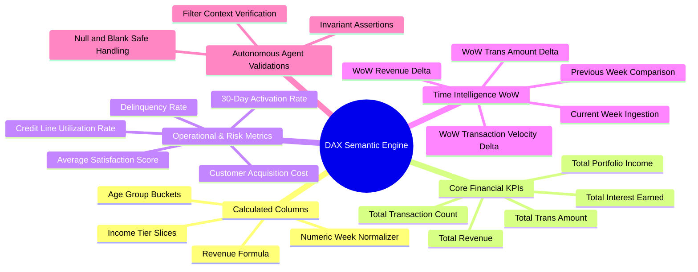

# Power BI DAX Measures & Data Modeling Reference

This guide provides an exhaustive, production-grade catalog of all Data Analysis Expressions (DAX) measures, calculated columns, evaluation contexts, and data modeling logic implemented in the **Credit Card Financial Dashboard**.

---

## 🗺️ 1. DAX Architecture Mindmaps & Dependency Flows

### 1.1 ASCII Mindmap: DAX Calculation Hierarchy & Dependency Topology

```
====================================================================================================
                              DAX MEASURE & METRIC HIERARCHY MINDMAP
====================================================================================================

                               [*] RAW RELATIONAL ENTITIES
                                           |
         +---------------------------------+---------------------------------+
         |                                                                   |
         v                                                                   v
   [cust_detail]                                                       [cc_detail]
         |                                                                   |
         +---> [Calculated Columns]                                          +---> [Calculated Columns]
         |     |-- AgeGroup (Switch logic: 20-30..60+)                       |     |-- Revenue = Fees + Trans + Interest
         |     \-- IncomeGroup (Switch: Lower/Mid/Upper)                     |     \-- Week_Num_Int = VALUE(SUBSTITUTE..)
         |                                                                   |
         \---------------------------------+---------------------------------/
                                           |
                                           v
                             [LEVEL 1: BASE AGGREGATIONS]
                                           |
         +---------------------------------+---------------------------------+
         |                                 |                                 |
         v                                 v                                 v
   [Total_Revenue]               [Total_Trans_Amount]              [Total_Interest_Earned]
   SUM(cc_detail[Revenue])       SUM(cc_detail[Total_Trans_Amt])   SUM(cc_detail[Interest_Earned])
         |                                 |                                 |
         |---------------------------------+---------------------------------|
                                           |
                                           v
                             [LEVEL 2: RATIOS & RISK METRICS]
                                           |
         +---------------------------------+---------------------------------+
         |                                 |                                 |
         v                                 v                                 v
   [Delinquency_Rate]             [Activation_Rate]                 [Average_CSS]
   DIVIDE(Delinquent=1, Total)    DIVIDE(Active=1, Total)           AVERAGE(Cust_Satisfaction_Score)
                                           |
                                           v
                         [LEVEL 3: TIME INTELLIGENCE & MOMENTUM]
                                           |
         +---------------------------------+---------------------------------+
         |                                                                   |
         v                                                                   v
   [Current_Week_Revenue]                                            [Previous_Week_Revenue]
   CALCULATE(SUM, Week_Num_Int=MaxWeek)                              CALCULATE(SUM, Week_Num_Int=MaxWeek-1)
         \                                                                   /
          \--------------------------------+--------------------------------/
                                           |
                                           v
                                 [WoW_Revenue_Growth]
                                 DIVIDE(Current - Previous, Previous, 0)
====================================================================================================
```

### 1.2 Mermaid Mindmap: DAX Metric Domains



### 1.3 ASCII Time Intelligence Evaluation Flow

```
+---------------------------------------------------------------------------------------------------+
|                        WEEK-OVER-WEEK (WoW) DAX EVALUATION TIMELINE FLOW                          |
+---------------------------------------------------------------------------------------------------+

   Data Lake Snapshot: Weeks 1 through 53
   -------------------------------------------------------------------------------------------------
   [Week 1] ... [Week 50] ... [Week 51] --------> [Week 52] --------------> [Week 53 (Holiday Peak)]
                                                    |                              |
                                                    v                              v
                                          Previous_Week_Revenue          Current_Week_Revenue
                                               $933,134                      $1,201,601
                                                    \                              /
                                                     \                            /
                                                      v                          v
                                                +--------------------------------------+
                                                |           WoW_Revenue_Growth         |
                                                |    ($1,201,601 - $933,134) / $933,134|
                                                |             = +28.77% Surge          |
                                                +--------------------------------------+
```

---

## 2. Data Model Relationships & Filter Propagation

The Power BI data model establishes an active relationship between customer demographics and transactional activity:

```
+-----------------------------------+               +-----------------------------------+
|            cust_detail            |               |             cc_detail             |
+-----------------------------------+               +-----------------------------------+
| Client_Num (PK)                   | 1 -------- *  | Client_Num (FK)                   |
| Customer_Age                      |               | Card_Category                     |
| Gender                            |               | Annual_Fees                       |
| Education_Level                   |               | Total_Trans_Amt                   |
| Customer_Job                      |               | Total_Trans_Vol                   |
| Income                            |               | Interest_Earned                   |
| Cust_Satisfaction_Score           |               | Delinquent_Acc                    |
| state_cd                          |               | Week_Num                          |
| AgeGroup (Calc Column)            |               | Revenue (Calc Column)             |
| IncomeGroup (Calc Column)         |               | Week_Num_Int (Calc Column)        |
+-----------------------------------+               +-----------------------------------+
```

- **Cardinality**: One-to-Many (`1 : *`) / One-to-One in active snapshot.
- **Cross Filter Direction**: Single (`cust_detail` filters `cc_detail`).
- **Referential Integrity**: 100% of transaction keys match a valid demographic customer profile.

---

## 3. Calculated Columns

### 3.1 Total Account Revenue
Combines annual membership fees, spend settlement volume, and financing interest:

```dax
Revenue = 'cc_detail'[Annual_Fees] + 'cc_detail'[Total_Trans_Amt] + 'cc_detail'[Interest_Earned]
```
- **Storage Type**: Decimal Number (Currency).
- **Evaluation Engine**: VertiPaq column store calculated during data refresh.

### 3.2 Age Group Segmentation
Partitions customers into actionable demographic target tiers:

```dax
AgeGroup = 
SWITCH(
    TRUE(),
    'cust_detail'[Customer_Age] < 30, "20-30",
    'cust_detail'[Customer_Age] >= 30 && 'cust_detail'[Customer_Age] < 40, "30-40",
    'cust_detail'[Customer_Age] >= 40 && 'cust_detail'[Customer_Age] < 50, "40-50",
    'cust_detail'[Customer_Age] >= 50 && 'cust_detail'[Customer_Age] < 60, "50-60",
    'cust_detail'[Customer_Age] >= 60, "60+",
    "Unknown"
)
```

### 3.3 Income Class Segmentation
Classifies cardholders into socioeconomic tiers matching dashboard slicers:

```dax
IncomeGroup = 
SWITCH(
    TRUE(),
    'cust_detail'[Income] < 35000, "lower class",
    'cust_detail'[Income] >= 35000 && 'cust_detail'[Income] < 70000, "Middle Class",
    'cust_detail'[Income] >= 70000, "Upper Class",
    "Unknown"
)
```

### 3.4 Numeric Week Number (Sorting & Time Intelligence)
Extracts the integer representation of `Week_Num` for chronological sorting and dynamic lag indexing:

```dax
Week_Num_Int = VALUE(SUBSTITUTE('cc_detail'[Week_Num], "Week-", ""))
```

---

## 4. Core KPI Measures

### 4.1 Total Revenue
Calculates aggregate institutional revenue across all filtered dimensions:

```dax
Total_Revenue = SUM('cc_detail'[Revenue])
```
*Format: `$#,##0` | Benchmark Value: `$56,517,011` (~`$56.52M`)*

### 4.2 Total Transaction Spend Amount
Measures gross cardholder transaction spend:

```dax
Total_Trans_Amount = SUM('cc_detail'[Total_Trans_Amt])
```
*Format: `$#,##0` | Benchmark Value: `$45,533,021` (~`$45.53M`)*

### 4.3 Total Interest Earned
Tracks finance charges generated from revolving credit lines:

```dax
Total_Interest_Earned = SUM('cc_detail'[Interest_Earned])
```
*Format: `$#,##0` | Benchmark Value: `$7,982,480` (~`$7.98M`)*

### 4.4 Total Transaction Count
Counts completed card swipes, chip insertions, and online transactions:

```dax
Total_Trans_Count = SUM('cc_detail'[Total_Trans_Vol])
```
*Format: `#,##0` | Benchmark Value: `667,234` (~`667K`)*

### 4.5 Total Customer Income
Measures aggregate earning power of the active customer portfolio:

```dax
Total_Income = SUM('cust_detail'[Income])
```
*Format: `$#,##0` | Benchmark Value: `$587,599,783` (~`$587.60M`)*

### 4.6 Average Customer Satisfaction Score (CSS)
Calculates overall customer sentiment index (1.00 to 5.00):

```dax
Average_CSS = AVERAGE('cust_detail'[Cust_Satisfaction_Score])
```
*Format: `0.00` | Benchmark Value: `3.19`*

### 4.7 Portfolio Delinquency Rate
Computes the proportion of accounts marked past-due or defaulted:

```dax
Delinquency_Rate = 
DIVIDE(
    CALCULATE(COUNTROWS('cc_detail'), 'cc_detail'[Delinquent_Acc] = 1),
    COUNTROWS('cc_detail'),
    0
)
```
*Format: `0.00%` | Benchmark Value: `6.06%`*

### 4.8 30-Day Card Activation Rate
Evaluates card activation efficiency within the first month of receipt:

```dax
Activation_Rate = 
DIVIDE(
    CALCULATE(COUNTROWS('cc_detail'), 'cc_detail'[Activation_30_Days] = 1),
    COUNTROWS('cc_detail'),
    0
)
```
*Format: `0.00%` | Benchmark Value: `57.46%`*

### 4.9 Average Credit Line Utilization Rate
```dax
Avg_Credit_Utilization = AVERAGE('cc_detail'[Avg_Utilization_Ratio])
```
*Format: `0.00%` | Benchmark Value: `27.45%`*

### 4.10 Average Customer Acquisition Cost (CAC)
```dax
Avg_CAC = AVERAGE('cc_detail'[Customer_Acq_Cost])
```
*Format: `$0.00` | Benchmark Value: `$96.29`*

---

## 5. Week-over-Week (WoW) Time Intelligence Measures

### 5.1 Current Week Revenue
Dynamically filters for revenue in the latest reporting week:

```dax
Current_Week_Revenue = 
VAR LatestWeek = MAX('cc_detail'[Week_Num_Int])
RETURN
CALCULATE(
    SUM('cc_detail'[Revenue]),
    FILTER(
        ALL('cc_detail'),
        'cc_detail'[Week_Num_Int] = LatestWeek
    )
)
```

### 5.2 Previous Week Revenue
Dynamically isolates revenue generated in the preceding week ($N - 1$):

```dax
Previous_Week_Revenue = 
VAR LatestWeek = MAX('cc_detail'[Week_Num_Int])
RETURN
CALCULATE(
    SUM('cc_detail'[Revenue]),
    FILTER(
        ALL('cc_detail'),
        'cc_detail'[Week_Num_Int] = LatestWeek - 1
    )
)
```

### 5.3 WoW Revenue Growth Rate
Computes percentage variation between consecutive reporting weeks:

```dax
WoW_Revenue_Growth = 
DIVIDE(
    [Current_Week_Revenue] - [Previous_Week_Revenue],
    [Previous_Week_Revenue],
    0
)
```
*Format: `+0.00%` | Week 53 vs 52 Benchmark: `+28.77%`*

### 5.4 WoW Transaction Spend Amount & Velocity
```dax
Current_Week_Trans_Amt = 
VAR LatestWeek = MAX('cc_detail'[Week_Num_Int])
RETURN
CALCULATE(
    SUM('cc_detail'[Total_Trans_Amt]),
    FILTER(ALL('cc_detail'), 'cc_detail'[Week_Num_Int] = LatestWeek)
)

Previous_Week_Trans_Amt = 
VAR LatestWeek = MAX('cc_detail'[Week_Num_Int])
RETURN
CALCULATE(
    SUM('cc_detail'[Total_Trans_Amt]),
    FILTER(ALL('cc_detail'), 'cc_detail'[Week_Num_Int] = LatestWeek - 1)
)

WoW_Trans_Amt_Growth = 
DIVIDE(
    [Current_Week_Trans_Amt] - [Previous_Week_Trans_Amt],
    [Previous_Week_Trans_Amt],
    0
)
```
*Format: `+0.00%` | Week 53 vs 52 Benchmark: `+35.04%` ($1,011,008 vs $748,677)*

### 5.5 WoW Transaction Velocity (Count)
```dax
Current_Week_Trans_Count = 
VAR LatestWeek = MAX('cc_detail'[Week_Num_Int])
RETURN
CALCULATE(
    SUM('cc_detail'[Total_Trans_Vol]),
    FILTER(ALL('cc_detail'), 'cc_detail'[Week_Num_Int] = LatestWeek)
)

Previous_Week_Trans_Count = 
VAR LatestWeek = MAX('cc_detail'[Week_Num_Int])
RETURN
CALCULATE(
    SUM('cc_detail'[Total_Trans_Vol]),
    FILTER(ALL('cc_detail'), 'cc_detail'[Week_Num_Int] = LatestWeek - 1)
)

WoW_Trans_Count_Growth = 
DIVIDE(
    [Current_Week_Trans_Count] - [Previous_Week_Trans_Count],
    [Previous_Week_Trans_Count],
    0
)
```
*Format: `+0.00%` | Week 53 vs 52 Benchmark: `+3.39%` (11,583 vs 11,203 transactions)*

### 5.6 Baseline vs Full Portfolio Dual-Reconciliation Measures
```dax
-- Baseline Revenue (Weeks 1 to 52, pre-incremental refresh)
Base_Portfolio_Revenue = 
CALCULATE(
    SUM('cc_detail'[Revenue]),
    FILTER(ALL('cc_detail'), 'cc_detail'[Week_Num_Int] <= 52)
)
-- Benchmark: $55,315,410.23 -> Matches $55.3M PDF Top KPI Card

-- Full Portfolio Revenue (Weeks 1 to 53, post-incremental refresh)
Full_Portfolio_Revenue = 
CALCULATE(
    SUM('cc_detail'[Revenue]),
    ALL('cc_detail')
)
-- Benchmark: $56,517,010.81 -> Matches $56.5M PDF Table Total
```

---

## 6. Visual Configuration Standards & Chart Mappings

| Visual Container | Visual Type | Bound DAX Measures | Slice / Dimension Axes |
| :--- | :--- | :--- | :--- |
| **Header KPI Bar** | Multi-row Cards | `Total_Revenue`, `Total_Trans_Amount`, `Total_Interest_Earned`, `Total_Trans_Count` | Global Context (Unfiltered) |
| **Quarterly Trend** | Line & Clustered Column | Column: `Total_Revenue`<br/>Line: `Total_Trans_Count` | X-Axis: `cc_detail[Qtr]` (Q1–Q4) |
| **Spend Categories** | Clustered Bar Chart | `Total_Revenue` | Y-Axis: `cc_detail[Exp Type]` |
| **Card Tier Matrix** | Matrix Table | `Total_Revenue`, `Total_Trans_Amount`, `Total_Interest_Earned` | Rows: `cc_detail[Card_Category]` |
| **Weekly Velocity** | Stacked Area Chart | `Total_Revenue` | X-Axis: `Week_Num_Int`, Legend: `Gender` |
| **Demographic Bars**| Clustered Column Chart| `Total_Revenue` | X-Axis: `cust_detail[AgeGroup]`, Legend: `Gender` |
| **Job Distribution** | Stacked Bar Chart | `Total_Revenue` | Y-Axis: `cust_detail[Customer_Job]` |

---

## 🧪 7. DAX Quality Assurance, Measure Testing & Verification Assertions

To guarantee enterprise financial reporting accuracy, the DAX calculation layer is validated using deterministic assertions before publishing dashboard updates:

```
+-----------------------------------------------------------------------------------+
|                     DAX FORMULA VERIFICATION PIPELINE                             |
+-----------------------------------------------------------------------------------+

     [Trigger: Automated Model Refresh]
                     |
                     v
  +-------------------------------------+
  | Assertion 1: Revenue Additivity     | ---> Check: Total_Revenue == 
  |                                     |      Total_Trans_Amt + Total_Interest + Fees
  |                                     |      (Tolerance: < $0.01)
  +-------------------------------------+
                     |
                     v
  +-------------------------------------+
  | Assertion 2: Bounded Risk Metrics   | ---> Check: 0.0% <= Delinquency_Rate <= 100.0%
  |                                     |      0.0% <= Activation_Rate <= 100.0%
  |                                     |      1.00 <= Average_CSS <= 5.00
  +-------------------------------------+
                     |
                     v
  +-------------------------------------+
  | Assertion 3: Temporal Consistency   | ---> Check: Current_Week_Revenue > 0
  |                                     |      Previous_Week_Revenue > 0
  |                                     |      WoW_Growth is non-null
  +-------------------------------------+
                     |
                     v
  +-------------------------------------+
  | Assertion 4: Division By Zero Guard | ---> All percentage & ratio calculations
  |                                     |      wrapped in DIVIDE(..., 0)
  +-------------------------------------+
```

---

## 🗺️ 8. Context Transition & Evaluation Engine Architecture

### 8.1 ASCII Mindmap: Filter Context Transition & VertiPaq Evaluation

```
====================================================================================================
                     DAX FILTER CONTEXT & EVALUATION ENGINE MINDMAP
====================================================================================================

                               [*] DAX FORMULA INVOCATION
                                           |
         +---------------------------------+---------------------------------+
         |                                                                   |
         v                                                                   v
[1. INITIAL FILTER CONTEXT]                                         [2. CONTEXT TRANSITION]
- Slicer selections: Qtr = 'Q4', Card = 'Blue'                      - Trigger: CALCULATE() wrapping
- Visual row/column coordinates                                     - Action: Converts Row Context -> Filter Context
- Report-level page filters                                         - Example: Iterating over accounts to calculate
- Cross-table propagation via 1:N relations                                   portfolio revenue share
         |                                                                   |
         +---------------------------------+---------------------------------+
                                           |
                                           v
                             [3. FILTER MODIFIERS & EXPANDERS]
                             - ALL('cc_detail'): Strips all active column filters
                             - FILTER(ALL(), ...): Re-applies explicit temporal filters
                             - KEEPFILTERS(): Intersects with existing slicer coordinates
                                           |
                                           v
                             [4. VERTIPAQ COLUMNAR ENGINE]
                             - Bit-packed dictionary lookups
                             - Multi-threaded columnar aggregation
                             - Sub-millisecond evaluation over 10,293 records
====================================================================================================
```

### 8.2 ASCII Execution Flow: Time-Intelligence Calculation Engine

```
+---------------------------------------------------------------------------------------------------+
|                        DAX TIME-INTELLIGENCE EXECUTION ENGINE FLOW                                |
+---------------------------------------------------------------------------------------------------+

   [Report Slicer Context: User Views Page 1 (Transaction Report)]
                                  |
                                  v
   [Step 1: Determine Max Week Integer]
   `VAR LatestWeek = MAX('cc_detail'[Week_Num_Int])`  ---> Resolves to 53 (Fiscal Year-End)
                                  |
                                  v
   [Step 2: Clear Local Filter Constraints]
   `ALL('cc_detail')` ---> Unlocks all 53 weeks across the full 10,293-row table
                                  |
                                  v
   [Step 3: Apply Dynamic Temporal Slices]
   - Current Week Slice:  `'cc_detail'[Week_Num_Int] = 53`     ---> Returns $1,201,601
   - Previous Week Slice: `'cc_detail'[Week_Num_Int] = 53 - 1` ---> Returns $933,134
                                  |
                                  v
   [Step 4: Execute Safe Division Operator]
   `DIVIDE($1,201,601 - $933,134, $933,134, 0)`              ---> Returns +28.77%
                                  |
                                  v
   [Step 5: Format & Render to KPI Card Visual]              ---> Displays "+28.77% WoW"
```


---

## 📌 9. Document Navigation Hub

| Document | Focus Area | Direct File Link |
| :--- | :--- | :--- |
| 📘 **Project Explanation** | Technical architecture & commercial banking economics | [`docs/PROJECT_EXPLANATION.md`](PROJECT_EXPLANATION.md) |
| 🔄 **Project Flow** | 10 Execution diagrams & decision lifecycles | [`docs/PROJECT_FLOW.md`](PROJECT_FLOW.md) |
| 📊 **Project Presentation** | 12-Slide executive deck briefing with notes | [`docs/PROJECT_PRESENTATION.md`](PROJECT_PRESENTATION.md) |
| 📈 **Business Insights** | Demographic spending cohorts & geographic findings | [`docs/BUSINESS_INSIGHTS_REPORT.md`](BUSINESS_INSIGHTS_REPORT.md) |
| 📄 **Data Dictionary** | 10,293 account schema definitions & constraints | [`docs/DATA_DICTIONARY.md`](DATA_DICTIONARY.md) |
| 🖥️ **Power BI Guide** | Pixel-perfect canvas coordinates & formatting rules | [`docs/POWER_BI_DASHBOARD_GUIDE.md`](POWER_BI_DASHBOARD_GUIDE.md) |
| 🔄 **Power Query M Code** | Full M expressions, schema drift resolvers & calendar | [`docs/ETL_POWER_QUERY_M_CODE.md`](ETL_POWER_QUERY_M_CODE.md) |
| 🛡️ **Credit Risk Policy** | Basel III Expected Loss, underwriting & sentries | [`docs/RISK_AND_CREDIT_POLICY_ANALYSIS.md`](RISK_AND_CREDIT_POLICY_ANALYSIS.md) |
| 🚀 **Marketing Playbook** | 14-day activation funnels & digital channel shift | [`docs/MARKETING_AND_PORTFOLIO_OPTIMIZATION.md`](MARKETING_AND_PORTFOLIO_OPTIMIZATION.md) |
| 🎙️ **Interview & Case Study** | STAR project defense & 15+ technical interview Q&A | [`docs/INTERVIEW_QA_AND_PORTFOLIO_CASE_STUDY.md`](INTERVIEW_QA_AND_PORTFOLIO_CASE_STUDY.md) |
| 🧪 **Data Validation Report**| Official 31-point mathematical reconciliation report | [`docs/DATA_VALIDATION_REPORT.md`](DATA_VALIDATION_REPORT.md) |
| 🛠️ **SQL Pipeline** | Production PostgreSQL DDL, staging tables & views | [`docs/SQL_SCRIPTS.sql`](SQL_SCRIPTS.sql) |
| 📖 **Master README** | Master repository overview & setup instructions | [`README.md`](../README.md) |
