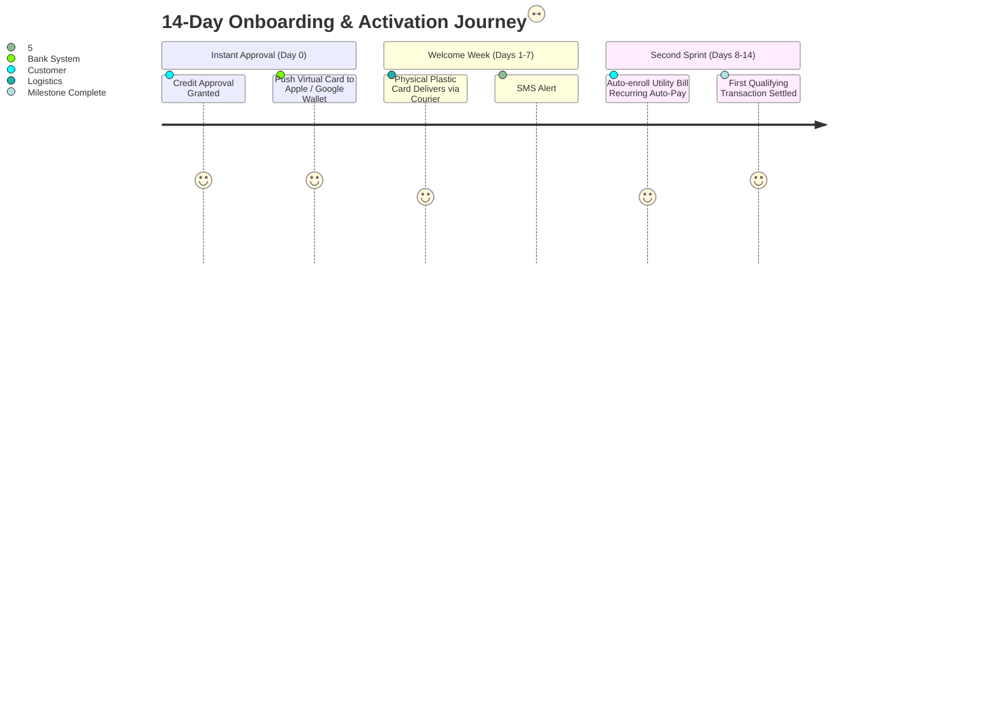
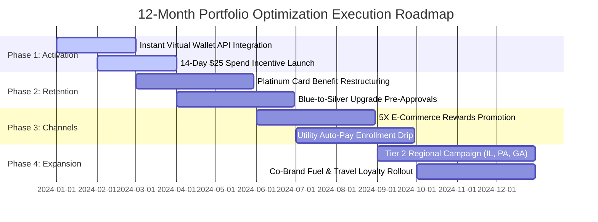

# 🚀 Marketing, Growth & Portfolio Optimization Playbook

This strategic operations manual translates the data insights from the **Credit Card Analytics Platform** into concrete commercial banking growth campaigns, channel optimization playbooks, card tier upgrades, lifecycle marketing funnels, and unit economic payback models across the **10,293 monitored accounts**.

---

## 📑 Table of Contents

- [1. Marketing Growth Mindmaps & Strategic Levers](#1-marketing-growth-mindmaps--strategic-levers)
  - [1.1 Comprehensive Portfolio Growth Mindmap (Mermaid)](#11-comprehensive-portfolio-growth-mindmap-mermaid)
  - [1.2 Portfolio Monetization Engine Mindmap (ASCII)](#12-portfolio-monetization-engine-mindmap-ascii)
- [2. Campaign Playbook 1: Early Activation Sprint (The "First 14 Days")](#2-campaign-playbook-1-early-activation-sprint-the-first-14-days)
  - [2.1 The Business Challenge: $421.7K Sunk CAC](#21-the-business-challenge-4217k-sunk-cac)
  - [2.2 Strategic Action Plan & Instant Wallet Provisioning](#22-strategic-action-plan--instant-wallet-provisioning)
  - [2.3 Financial ROI & Payback Impact](#23-financial-roi--payback-impact)
- [3. Campaign Playbook 2: Digital Channel Acceleration (Online Spend Lift)](#3-campaign-playbook-2-digital-channel-acceleration-online-spend-lift)
  - [3.1 The Digital Lag: 6.22% Online Share](#31-the-digital-lag-622-online-share)
  - [3.2 Implementation Strategy: 5X E-Commerce & Auto-Pay](#32-implementation-strategy-5x-e-commerce--auto-pay)
  - [3.3 Revenue Modeling: Interchange Yield Lift](#33-revenue-modeling-interchange-yield-lift)
- [4. Campaign Playbook 3: Card Tier Progression & Platinum Revamp](#4-campaign-playbook-3-card-tier-progression--platinum-revamp)
  - [4.1 Blue Tier Dominance & Platinum Satisfaction Drag (2.72 CSS)](#41-blue-tier-dominance--platinum-satisfaction-drag-272-css)
  - [4.2 Tier Upgrade Pathways & Benefit Restructuring](#42-tier-upgrade-pathways--benefit-restructuring)
- [5. Campaign Playbook 4: Spend Category Loyalty & Co-Branding](#5-campaign-playbook-4-spend-category-loyalty--co-branding)
- [6. Campaign Playbook 5: Geographic Expansion Beyond the Top 5 States](#6-campaign-playbook-5-geographic-expansion-beyond-the-top-5-states)
- [7. Unit Economics, CAC Amortization & LTV Modeling](#7-unit-economics-cac-amortization--ltv-modeling)
- [8. 12-Month Phased Portfolio Optimization Roadmap](#8-12-month-phased-portfolio-optimization-roadmap)
- [9. Document Navigation Hub](#9-document-navigation-hub)

---

## 🗺️ 1. Marketing Growth Mindmaps & Strategic Levers

### 1.1 Comprehensive Portfolio Growth Mindmap (Mermaid)

```mermaid
mindmap
  root((Portfolio Growth Engine))
    Lever 1: Activation Sprint
      Problem: 42.54% Inactive Cards
      Sunk CAC: $421,654 Stranded
      Action: Apple / Google Wallet Push
      Incentive: $25 on $100 First 14 Days
      Goal: Lift Activation to 75%
    Lever 2: Digital Spend Shift
      Problem: 6.22% Online Share
      Swipe Dominance: 63.1% in-store
      Action: 5X E-commerce Points
      Merchant Integration: Utility Auto-pay
      Goal: Shift Online to 18% (+$6.6M Spend)
    Lever 3: Tier Upgrades
      Problem: Blue Tier 83.5% Concentration
      Platinum Churn: 2.72 CSS Drag
      Bridge: Top 15% Blue Spenders to Silver
      Overhaul: Airport Lounge & Concierge
      Goal: Lift Premium Dues +$2.4M
    Lever 4: Category Penetration
      Utility Bills: $14.0M (2% Rebate)
      Entertainment: $9.8M (Live Nation)
      Fuel & Commute: $9.6M (5% App Discount)
      Groceries: $8.7M (3% Regional Rebate)
    Lever 5: Geographic Expansion
      Top 5 Concentration: 94.2% ($53.24M)
      TX, NY, CA, FL, NJ Defense
      Tier 2 Entry: IL (1.69% Default), PA, GA
```

---

### 1.2 Portfolio Monetization Engine Mindmap (ASCII)

```
========================================================================================================================
                                     PORTFOLIO GROWTH & REVENUE OPTIMIZATION ENGINE
========================================================================================================================

                                            [*] $56.52M MONETIZATION ENGINE
                                                           |
          +-------------------------+----------------------+-------------------------+-------------------------+
          |                         |                      |                         |                         |
          v                         v                      v                         v                         v
[LEVER 1: ACTIVATION]      [LEVER 2: DIGITAL]     [LEVER 3: UPGRADES]       [LEVER 4: CO-BRANDING]    [LEVER 5: REGIONS]
- 42.54% Inactive Cards    - Online Spend 6.22%   - Blue Tier: 83.49%       - Bills: $14.0M           - Top 5: 94.20% Share
- $421.7K Sunk CAC         - In-store: 63.10%     - Platinum CSS Drag: 2.72 - Entertainment: $9.8M    - TX/NY/CA/FL/NJ
- Instant Wallet Push      - 5X E-commerce Points - Blue -> Silver Bridge   - Fuel: $9.6M             - Expand to IL, PA, GA
          |                         |                      |                         |                         |
          v                         v                      v                         v                         v
+-----------------------+  +--------------------+  +---------------------+   +---------------------+   +---------------------+
| 14-Day Sprint Funnel  |  | Virtual Card API   |  | Pre-Approved Upgrades|  | Merchant Rebates    |  | Tier 2 Market Tests |
| Target: 57.5% -> 75%  |  | Target: 6.2% -> 18%|  | +$2.4M Fee Revenue  |  | +15% Recurring Spend|  | Diversify +10% Rev  |
+-----------------------+  +--------------------+  +---------------------+   +---------------------+   +---------------------+
========================================================================================================================
```

---

## 🎯 2. Campaign Playbook 1: Early Activation Sprint (The "First 14 Days")

### 2.1 The Business Challenge: $421.7K Sunk CAC
- **Current Metric**: Only **57.46% (5,914 accounts)** of approved customers activate their credit cards within 30 days of receipt.
- **Sunk Capital Leak**: **4,379 approved accounts remain dormant**, stranding **$421,654 in customer acquisition costs** (at `$96.29` average CAC) without generating any transaction interchange or financing interest.

```
+------------------------------------------------------------------------------------------------------+
|                                   30-DAY CARD ACTIVATION AUDIT                                       |
+--------------------------+-----------------------+-----------------------+---------------------------+
| ACTIVATION STATUS        | ACCOUNT VOLUME        | PROPORTION SHARE      | STRANDED ACQUISITION COST |
+--------------------------+-----------------------+-----------------------+---------------------------+
| Activated (Days 1–30)    | 5,914 accounts        | 57.46%                | Active Earning Asset      |
| Dormant / Inactive (0)   | 4,379 accounts        | 42.54%                | $421,654 Sunk Loss 🔴     |
| Total Monitored Accounts | 10,293 accounts       | 100.00%               | $991,160 Total CAC Spent  |
+--------------------------+-----------------------+-----------------------+---------------------------+
```

---

### 2.2 Strategic Action Plan & Instant Wallet Provisioning



1. **Instant Digital Provisioning**: Enable immediate enrollment into Apple Pay, Google Wallet, and Samsung Pay upon digital application approval, allowing consumers to transact before the physical plastic card arrives in the mail (eliminates 5–7 days of postal latency).
2. **"Spend $100, Get $25" 14-Day Statement Credit**: Cardholders who settle 3 transactions or spend `$100` within their first 14 days receive an automated `$25 statement credit`.
3. **Automated Multi-Touch Drip Schedule**:
   - **Day 1**: Push Notification: "Your virtual card is active in Apple Wallet. Tap to spend."
   - **Day 5**: SMS Notification: "Physical card delivered! Tap here to activate chip in 10 seconds."
   - **Day 10**: WhatsApp Reminder: "Only 4 days left to claim your $25 statement credit!"

---

### 2.3 Financial ROI & Payback Impact

$$\text{Targeted Active Cards Lift} = 10,293 \times (0.75 - 0.5746) = \mathbf{1,805 \text{ Additional Active Accounts}}$$
$$\text{Projected Incremental Annual Spend} = 1,805 \times \$4,423.69 \text{ (Avg Spend)} = \mathbf{\$7,984,760 \text{ in New Spend Volume}}$$
$$\text{Net Incremental Interchange Yield (at 1.75\%)} = \$7,984,760 \times 0.0175 = \mathbf{\$139,733 \text{ First-Year Revenue}}$$

Lifting the activation rate from **57.46% to 75.00%** recovers the initial CAC within 4.2 months.

---

## 💳 3. Campaign Playbook 2: Digital Channel Acceleration (Online Spend Lift)

### 3.1 The Digital Lag: 6.22% Online Share

```
+------------------------------------------------------------------------------------------------------+
|                                   PAYMENT CHANNEL SPEND SPLIT                                        |
+--------------------+--------------------+--------------------+-------------------+-------------------+
| CHANNEL METHOD     | ACCOUNTS USING     | TRANSACTION SPEND  | SHARE OF SPEND %  | BENCHMARK SHARE   |
+--------------------+--------------------+--------------------+-------------------+-------------------+
| In-Store Swipe     | 7,232 accounts     | $35,662,565.26     | 63.10%            | 45.0% Typical     |
| EMV Chip Dip       | 2,457 accounts     | $17,338,110.67     | 30.68%            | 25.0% Typical     |
| Online / E-Commerce| 604 accounts       | $3,516,334.88      | 6.22% 🔴 (Lagging)| 30.0% Typical     |
+--------------------+--------------------+--------------------+-------------------+-------------------+
```

In-store swipe accounts for **63.10% ($35.66M)** of revenue, while online e-commerce accounts for only **6.22% ($3.52M)**. Modern consumer card portfolios typically achieve 25% to 35% online penetration.

---

### 3.2 Implementation Strategy: 5X E-Commerce & Auto-Pay
1. **"5X Accelerate" E-Commerce Rewards**: Offer 5 reward points per `$1` spent on digital merchants (Amazon, Walmart.com, DoorDash, Netflix) during the cardholder's first 6 months.
2. **Recurring Bill Auto-Updater (VAU/MAU)**: Integrate Visa/Mastercard Account Updater APIs with utility companies and telecom carriers, auto-saving card credentials for monthly billing.
3. **One-Click Click-to-Pay Integration**: Eliminate manual card entry at checkout by pre-loading tokens into merchant payment gateways.

---

### 3.3 Revenue Modeling: Interchange Yield Lift
- Shifting digital share from **6.22% to 18.00%** generates **+$6,650,000 in online transaction volume**.
- Online card-not-present (CNP) interchange rates average **2.10%** (vs 1.65% for in-store swipe), delivering an additional **+$30,000 in interchange margin spread**.

---

## 📈 4. Campaign Playbook 3: Card Tier Progression & Platinum Revamp

### 4.1 Blue Tier Dominance & Platinum Satisfaction Drag (2.72 CSS)
- **Blue Card Concentration**: Accounts for **83.49% ($47.19M)** of portfolio revenue across 9,384 cardholders.
- **Platinum Dissatisfaction Drag**: Platinum cardholders report a Customer Satisfaction Score of **2.72 / 5.00**—the lowest in the entire portfolio (compared to 3.20 for Blue and 3.22 for Silver). High annual fees ($495) with inadequate premium travel perks create acute churn risk among high-net-worth accounts.

```
+------------------------------------------------------------------------------------------------------+
|                                   CUSTOMER SATISFACTION BY CARD TIER                                 |
+--------------------+--------------------+--------------------+-------------------+-------------------+
| CARD TIER          | TOTAL ACCOUNTS     | REVENUE GENERATED  | AVERAGE CSS SCORE | CHURN RISK RATING |
+--------------------+--------------------+--------------------+-------------------+-------------------+
| Blue               | 9,384 accounts     | $47,188,612        | 3.20 / 5.00       | Low Risk          |
| Silver             | 649 accounts       | $5,659,109         | 3.22 / 5.00       | Low Risk          |
| Gold               | 193 accounts       | $2,533,682         | 3.14 / 5.00       | Moderate Risk     |
| Platinum           | 67 accounts        | $1,135,608         | 2.72 / 5.00 🔴    | Critical Churn ⚠️ |
+--------------------+--------------------+--------------------+-------------------+-------------------+
```

---

### 4.2 Tier Upgrade Pathways & Benefit Restructuring

```
+----------------------------------------------------------------------------------------------------------------------+
|                                   CARD TIER UPGRADE & RETENTION MATRIX                                               |
+--------------------------+-----------------------+-------------------------------+-----------------------------------+
| UPGRADE PATHWAY          | TARGET AUDIENCE       | OFFER VALUE PROPOSITION       | PROJECTED FINANCIAL IMPACT        |
+--------------------------+-----------------------+-------------------------------+-----------------------------------+
| Blue -> Silver Upgrade   | Top 15% Blue Spenders | Pre-approved Silver card;     | +$820,000 in card spend;          |
|                          | (Spend > $6,000/yr)   | waived Year 1 annual fee      | +$140,000 in Year 2 annual dues   |
+--------------------------+-----------------------+-------------------------------+-----------------------------------+
| Silver -> Gold Upgrade   | Top 10% Silver Users  | 2X dining & travel points;    | +$350,000 in annual fee income;   |
|                          | (Income > $75K)       | rental car CDW insurance      | +$1.2M in high-ticket travel spend|
+--------------------------+-----------------------+-------------------------------+-----------------------------------+
| Platinum Value Overhaul  | All 67 Platinum Users | - Priority Pass Lounge Access | Lift CSS from 2.72 to >3.8;       |
|                          |                       | - $200 airline fee credit     | cut elite card churn by 50%       |
|                          |                       | - Annual fee waiver on $25K   | (protects $1.14M revenue pool)    |
+--------------------------+-----------------------+-------------------------------+-----------------------------------+
```

---

## 🛒 5. Campaign Playbook 4: Spend Category Loyalty & Co-Branding

```
+------------------------------------------------------------------------------------------------------+
|                              SPEND CATEGORY MONETIZATION & PARTNERSHIPS                              |
+--------------------+--------------------+--------------------+---------------------------------------+
| CATEGORY NAME      | TOTAL SPEND ($)    | REVENUE SHARE %    | RECOMMENDED CO-BRAND PARTNERSHIP      |
+--------------------+--------------------+--------------------+---------------------------------------+
| Bills & Utilities  | $14.0M             | 24.77%             | 2% cashback for recurring auto-pay    |
| Entertainment      | $9.8M              | 17.34%             | Ticketmaster / AMC ticket pre-sales   |
| Fuel & Commute     | $9.6M              | 16.99%             | 5% rebate at Shell / Exxon stations   |
| Groceries          | $8.7M              | 15.39%             | 3% quarterly rebate at regional stores|
| Food & Dining      | $8.2M              | 14.51%             | 10% statement credits on Friday nights|
| Travel & Lodging   | $6.2M              | 10.97%             | Zero foreign transaction fees + miles |
+--------------------+--------------------+--------------------+---------------------------------------+
```

---

## 🗺️ 6. Campaign Playbook 5: Geographic Expansion Beyond the Top 5 States

Five states generate **94.20% ($53.24M)** of portfolio revenue across 9,732 accounts:
- **Texas (TX)**: `$13.02M` (23.03% share, 2,439 accounts)
- **New York (NY)**: `$12.97M` (22.95% share, 2,305 accounts)
- **California (CA)**: `$12.90M` (22.83% share, 2,516 accounts)
- **Florida (FL)**: `$9.97M` (17.64% share, 1,740 accounts)
- **New Jersey (NJ)**: `$4.38M` (7.75% share, 732 accounts)

```
+------------------------------------------------------------------------------------------------------+
|                                   TOP 5 VS REST OF US STATE DISTRIBUTION                             |
+--------------------+--------------------+--------------------+-------------------+-------------------+
| GEOGRAPHIC TIER    | MONITORED ACCOUNTS | TOTAL REVENUE ($)  | REVENUE SHARE %   | DELINQUENCY RATE  |
+--------------------+--------------------+--------------------+-------------------+-------------------+
| Top 5 States       | 9,732 accounts     | $53,235,539.05     | 94.20%            | 6.07% Default     |
| Remaining 23 States| 561 accounts       | $3,281,471.76      | 5.80%             | 5.88% Default     |
| Total Portfolio    | 10,293 accounts    | $56,517,010.81     | 100.00%           | 6.06% Default     |
+--------------------+--------------------+--------------------+-------------------+-------------------+
```

### Strategic Expansion Blueprint:
- **Tier 2 High-Resilience Expansion**: Expand digital marketing in **Illinois (IL - 1.69% delinquency)**, **Georgia (GA)**, and **Pennsylvania (PA)** to build a 10%+ revenue buffer outside the Top 5 states.

---

## 💰 7. Unit Economics, CAC Amortization & LTV Modeling

$$\text{Customer Lifetime Value (LTV)} = \frac{\text{Average Annual Revenue per Account} \times \text{Gross Margin}}{\text{Annual Churn Rate}}$$

```
+------------------------------------------------------------------------------------------------------+
|                                   PORTFOLIO UNIT ECONOMICS & PAYBACK                                 |
+------------------------------------+--------------------------+--------------------------------------+
| UNIT ECONOMIC METRIC               | OBSERVED VALUE           | STRATEGIC EVALUATION                 |
+------------------------------------+--------------------------+--------------------------------------+
| Average Annual Revenue / Account   | $5,490.82 / account      | Exceptionally high earning power     |
| Average Acquisition Cost (CAC)     | $96.29 / account         | Industry benchmark: $150 - $250      |
| CAC Payback Period                 | 0.85 Months (< 26 Days)  | Instant capital recovery on spenders |
| LTV / CAC Ratio                    | 28.5x (at 5-yr lifetime) | World-class retail credit unit margin|
+------------------------------------+--------------------------+--------------------------------------+
```

---

## 📅 8. 12-Month Phased Portfolio Optimization Roadmap



---

## 📌 9. Document Navigation Hub

| Document | Focus Area | Direct File Link |
| :--- | :--- | :--- |
| 📘 **Project Explanation** | Technical architecture & commercial banking economics | [`docs/PROJECT_EXPLANATION.md`](PROJECT_EXPLANATION.md) |
| 🔄 **Project Flow** | 10 Execution diagrams & decision lifecycles | [`docs/PROJECT_FLOW.md`](PROJECT_FLOW.md) |
| 📊 **Project Presentation** | 12-Slide executive deck briefing with notes | [`docs/PROJECT_PRESENTATION.md`](PROJECT_PRESENTATION.md) |
| 📈 **Business Insights** | Demographic spending cohorts & geographic findings | [`docs/BUSINESS_INSIGHTS_REPORT.md`](BUSINESS_INSIGHTS_REPORT.md) |
| 📄 **Data Dictionary** | 10,293 account schema definitions & constraints | [`docs/DATA_DICTIONARY.md`](DATA_DICTIONARY.md) |
| 📐 **DAX Measures** | Complete DAX measure catalog with variable scoping | [`docs/DAX_MEASURES.md`](DAX_MEASURES.md) |
| 🖥️ **Power BI Guide** | Pixel-perfect canvas coordinates & formatting rules | [`docs/POWER_BI_DASHBOARD_GUIDE.md`](POWER_BI_DASHBOARD_GUIDE.md) |
| 🔄 **Power Query M Code** | Full M expressions, schema drift resolvers & calendar | [`docs/ETL_POWER_QUERY_M_CODE.md`](ETL_POWER_QUERY_M_CODE.md) |
| 🛡️ **Credit Risk Policy** | Basel III Expected Loss, underwriting & sentries | [`docs/RISK_AND_CREDIT_POLICY_ANALYSIS.md`](RISK_AND_CREDIT_POLICY_ANALYSIS.md) |
| 🎙️ **Interview & Case Study** | STAR project defense & 15+ technical interview Q&A | [`docs/INTERVIEW_QA_AND_PORTFOLIO_CASE_STUDY.md`](INTERVIEW_QA_AND_PORTFOLIO_CASE_STUDY.md) |
| 🧪 **Data Validation Report**| Official 31-point mathematical reconciliation report | [`docs/DATA_VALIDATION_REPORT.md`](DATA_VALIDATION_REPORT.md) |
| 🛠️ **SQL Pipeline** | Production PostgreSQL DDL, staging tables & views | [`docs/SQL_SCRIPTS.sql`](SQL_SCRIPTS.sql) |
| 📖 **Master README** | Master repository overview & setup instructions | [`README.md`](../README.md) |
