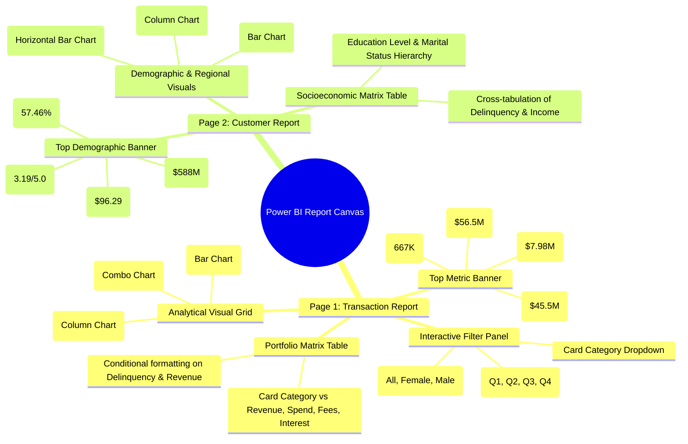

# 🖥️ Power BI Dashboard Recreation & Engineering Guide

This technical guide delivers an exhaustive, pixel-perfect blueprint for designing, configuring, formatting, and deploying the two-page **Credit Card Financial & Customer Analytics Dashboard** in Power BI Desktop and Power BI Service.

---

## 📑 Table of Contents

- [1. Visual Architecture & Layout Mindmaps](#1-visual-architecture--layout-mindmaps)
  - [1.1 Comprehensive Dashboard Topology (Mermaid)](#11-comprehensive-dashboard-topology-mermaid)
  - [1.2 Two-Page Canvas Architecture (ASCII)](#12-two-page-canvas-architecture-ascii)
- [2. Global Formatting Standards & Corporate Theme](#2-global-formatting-standards--corporate-theme)
  - [2.1 Canvas & Typography Specifications](#21-canvas--typography-specifications)
  - [2.2 Production Power BI Theme JSON](#22-production-power-bi-theme-json)
- [3. Page 1: Credit Card Transaction Report Specification](#3-page-1-credit-card-transaction-report-specification)
  - [3.1 Header Ribbon & Global Filter Slicers](#31-header-ribbon--global-filter-slicers)
  - [3.2 Top Executive Metric Cards](#32-top-executive-metric-cards)
  - [3.3 Middle Analytical Visual Grid](#33-middle-analytical-visual-grid)
  - [3.4 Bottom Card Category Performance Matrix](#34-bottom-card-category-performance-matrix)
- [4. Page 2: Credit Card Customer Report Specification](#4-page-2-credit-card-customer-report-specification)
  - [4.1 Header Ribbon & Demographic Slicers](#41-header-ribbon--demographic-slicers)
  - [4.2 Top Demographic Metric Cards](#42-top-demographic-metric-cards)
  - [4.3 Middle Demographic & Geographic Visual Grid](#43-middle-demographic--geographic-visual-grid)
  - [4.4 Bottom Customer Socioeconomic Matrix Table](#44-bottom-customer-socioeconomic-matrix-table)
- [5. Visual Interaction, Cross-Filtering & Slicer Sync Matrix](#5-visual-interaction-cross-filtering--slicer-sync-matrix)
- [6. Mobile Responsive Layout Blueprint](#6-mobile-responsive-layout-blueprint)
- [7. Step-by-Step Desktop Build Checklist](#7-step-by-step-desktop-build-checklist)
- [8. Document Navigation Hub](#8-document-navigation-hub)

---

## 🗺️ 1. Visual Architecture & Layout Mindmaps

### 1.1 Comprehensive Dashboard Topology (Mermaid)



---

### 1.2 Two-Page Canvas Architecture (ASCII)

```
========================================================================================================================
                                     POWER BI TWO-PAGE DASHBOARD ARCHITECTURE
========================================================================================================================

                                            [*] POWER BI CANVAS (16:9 - 1280 x 720)
                                                               |
                     +-----------------------------------------+-----------------------------------------+
                     |                                                                                   |
                     v                                                                                   v
     PAGE 1: TRANSACTION REPORT                                                          PAGE 2: CUSTOMER REPORT
     [Credit_Card_Transaction_Report.pdf]                                                [Credit_Card_Customer_Report.pdf]
     - Top KPI Cards ($56.5M / $7.98M / $45.5M / 667K)                                   - Demographic KPIs ($588M Income / 3.19 CSS)
     - Slicers: Quarter (Q1-Q4), Gender (All/M/F)                                        - Slicers: Quarter (Q1-Q4), Gender, Card Tier
     - Chart 1: Expenditure Category Bar Chart ($14M Bills)                              - Chart 1: Age Cohort Column Chart ($24.7M 40-50)
     - Chart 2: Card Tier & Channel Column (Swipe $35.7M)                                - Chart 2: Job Occupation Bar ($17.7M Businessmen)
     - Chart 3: Quarterly Revenue & Velocity Combo Chart                                 - Chart 3: Top 5 States Bar (TX, NY, CA, FL, NJ)
     - Table: Card Tier Performance Matrix Table                                         - Table: Demographic & Risk Matrix Table
========================================================================================================================
```

---

## 🎨 2. Global Formatting Standards & Corporate Theme

### 2.1 Canvas & Typography Specifications

| Parameter | Configuration Value | Design & Accessibility Standard |
| :--- | :--- | :--- |
| **Canvas Dimensions** | `1280 px` width $\times$ `720 px` height (16:9 Widescreen) | Corporate standard HD executive display |
| **Canvas Background** | Hex `#F8FAFC` (Slate 50), 0% Transparency | Neutral, clean background |
| **Card Container Background** | Hex `#FFFFFF` (Pure White), Border `#E2E8F0`, Radius `6 px` | Modern elevated container card styling |
| **Primary Brand Navy** | Hex `#0A192F` / `#1E3A8A` | High-contrast WCAG 2.1 AA compliant headers |
| **Accent Action Blue** | Hex `#0284C7` (Sky Blue) | Primary bar chart color and active selection |
| **Risk / Alert Red** | Hex `#DC2626` (Crimson) | Delinquency highlighting (> 6.2% default) |
| **Typography Scale** | - Report Title: Segoe UI Bold, `18 pt`<br>- Section Titles: Segoe UI Semibold, `12 pt`<br>- Card Callouts: Segoe UI Bold, `24 pt`<br>- Card Labels: Segoe UI, `10 pt`<br>- Chart Labels: DIN / Segoe UI, `9 pt` | Standardized Microsoft BI typographic scale |

---

### 2.2 Production Power BI Theme JSON

Save this configuration as `credit_card_theme.json` and import it into Power BI Desktop via **View** $\rightarrow$ **Themes** $\rightarrow$ **Browse for themes**:

```json
{
  "name": "CommercialBankingNavy",
  "dataColors": [
    "#0284C7",
    "#1E3A8A",
    "#F59E0B",
    "#10B981",
    "#6366F1",
    "#EC4899",
    "#8B5CF6",
    "#64748B"
  ],
  "background": "#F8FAFC",
  "foreground": "#0A192F",
  "tableAccent": "#1E3A8A",
  "visualStyles": {
    "*": {
      "*": {
        "outspacePane": [
          {
            "backgroundColor": { "solid": { "color": "#F8FAFC" } }
          }
        ],
        "border": [
          {
            "show": true,
            "color": { "solid": { "color": "#E2E8F0" } },
            "radius": 6
          }
        ]
      }
    },
    "card": {
      "*": {
        "labels": [
          {
            "color": { "solid": { "color": "#0A192F" } },
            "fontSize": 24,
            "fontFamily": "Segoe UI Bold"
          }
        ],
        "categoryLabels": [
          {
            "color": { "solid": { "color": "#64748B" } },
            "fontSize": 10,
            "fontFamily": "Segoe UI"
          }
        ]
      }
    }
  }
}
```

---

## 📄 3. Page 1: Credit Card Transaction Report Specification

### 3.1 Header Ribbon & Global Filter Slicers

- **Canvas Region**: Top banner (`X: 0`, `Y: 0`, `Width: 1280`, `Height: 110`).
- **Title Text**: "Credit Card Transaction Report" (Bold `20 pt`, Hex `#0A192F`).
- **Quarter Slicer**:
  - Position: `X: 920`, `Y: 15`, `Width: 190`, `Height: 38`.
  - Type: Tile selection (`Q1`, `Q2`, `Q3`, `Q4`).
  - Field: `'cc_detail'[Qtr]`.
- **Gender Slicer**:
  - Position: `X: 1120`, `Y: 15`, `Width: 140`, `Height: 38`.
  - Type: Single-select buttons (`All`, `F`, `M`).
  - Field: `'cust_detail'[Gender]`.

---

### 3.2 Top Executive Metric Cards

```
+----------------------------------------------------------------------------------------------------------------------+
|  [ TOTAL REVENUE ]         [ TOTAL INTEREST EARNED ]     [ TOTAL TRANSACTION AMOUNT ]   [ TOTAL TRANSACTION VOLUME ] |
|      $56.5M                         $7.98M                         $45.5M                         667K               |
|  (Exact: $56,517,011)        (Exact: $7,982,480)            (Exact: $45,533,021)          (Exact: 667,234)           |
+----------------------------------------------------------------------------------------------------------------------+
```

1. **Card 1: Total Revenue**:
   - Coordinates: `X: 20`, `Y: 60`, `Width: 290`, `Height: 65`.
   - Measure: `[Total Revenue]`.
   - Callout Value: Display Units: Millions (`$56.5M`).
2. **Card 2: Total Interest Earned**:
   - Coordinates: `X: 330`, `Y: 60`, `Width: 290`, `Height: 65`.
   - Measure: `[Total Interest Earned]`.
   - Callout Value: Display Units: Millions (`$7.98M`).
3. **Card 3: Total Transaction Spend Amount**:
   - Coordinates: `X: 640`, `Y: 60`, `Width: 290`, `Height: 65`.
   - Measure: `[Total Transaction Amount]`.
   - Callout Value: Display Units: Millions (`$45.5M`).
4. **Card 4: Total Transaction Count**:
   - Coordinates: `X: 950`, `Y: 60`, `Width: 310`, `Height: 65`.
   - Measure: `[Total Transaction Count]`.
   - Callout Value: Display Units: Thousands (`667K`).

---

### 3.3 Middle Analytical Visual Grid

#### Visual 1: Revenue by Expenditure Category (Horizontal Bar Chart)
- **Coordinates**: `X: 20`, `Y: 135`, `Width: 380`, `Height: 250`.
- **Y-Axis**: `'cc_detail'[Exp Type]` (Sorted Descending).
- **X-Axis**: `[Total Revenue]`.
- **Data Labels**: On, Inside End, Display Units: Millions (`$M`).
- **Benchmark Values**:
  - Bills: `$14.0M`
  - Entertainment: `$9.8M`
  - Fuel: `$9.6M`
  - Grocery: `$8.7M`
  - Food: `$8.2M`
  - Travel: `$6.2M`

#### Visual 2: Revenue by Card Tier & Payment Channel (Clustered Column Chart)
- **Coordinates**: `X: 420`, `Y: 135`, `Width: 420`, `Height: 250`.
- **X-Axis**: `'cc_detail'[Card_Category]` (`Blue`, `Silver`, `Gold`, `Platinum`).
- **Legend**: `'cc_detail'[Use Chip]` (`Swipe`, `Chip`, `Online`).
- **Y-Axis**: `[Total Revenue]`.
- **Insight**: Illustrates the dominance of Blue Card in-store swipes (`$35.66M` across portfolio).

#### Visual 3: Quarterly Revenue & Transaction Velocity (Line & Column Combo Chart)
- **Coordinates**: `X: 860`, `Y: 135`, `Width: 400`, `Height: 250`.
- **Shared X-Axis**: `'cc_detail'[Qtr]` (`Q1`, `Q2`, `Q3`, `Q4`).
- **Column Values (Left Y-Axis)**: `[Total Revenue]` (`~$14M` steady across each quarter).
- **Line Values (Right Y-Axis)**: `[Total Transaction Count]` (`~165K` transactions per quarter).

---

### 3.4 Bottom Card Category Performance Matrix

- **Coordinates**: `X: 20`, `Y: 400`, `Width: 1240`, `Height: 300`.
- **Rows**: `'cc_detail'[Card_Category]`.
- **Values**:
  1. `Total Revenue`: `$47,188,612` (Blue), `$5,659,109` (Silver), `$2,533,682` (Gold), `$1,135,608` (Platinum), **`$56,517,011` (Total)**.
  2. `Total Trans Spend`: `$37,840,749` (Blue), `$4,647,596` (Silver), `$2,091,362` (Gold), `$953,314` (Platinum), **`$45,533,021` (Total)**.
  3. `Total Interest`: `$6,614,173` (Blue), `$821,923` (Silver), `$384,755` (Gold), `$161,629` (Platinum), **`$7,982,480` (Total)**.
  4. `Annual Fees`: `$2,733,690` (Blue), `$189,590` (Silver), `$57,565` (Gold), `$20,665` (Platinum), **`$3,001,510` (Total)**.
  5. `Transaction Volume`: `591,791` (Blue), `49,172` (Silver), `18,781` (Gold), `7,490` (Platinum), **`667,234` (Total)**.
  6. `Credit Line Utilization`: `29.17%` (Blue), `8.31%` (Silver), `12.48%` (Gold), `15.12%` (Platinum), **`27.45%` (Total)**.
  7. `Delinquency Rate`: `6.05%` (Blue), `6.16%` (Silver), `6.22%` (Gold), `5.97%` (Platinum), **`6.06%` (Total)**.
- **Conditional Formatting**: Color gradient on `[Total Revenue]` (Light Blue `#E0F2FE` to Dark Blue `#0369A1`).

---

## 📄 4. Page 2: Credit Card Customer Report Specification

### 4.1 Header Ribbon & Demographic Slicers

- **Canvas Region**: Top banner (`X: 0`, `Y: 0`, `Width: 1280`, `Height: 110`).
- **Title Text**: "Credit Card Customer Report" (Bold `20 pt`, Hex `#0A192F`).
- **Slicers**: Quarter (`Q1-Q4`), Gender (`All/F/M`), Card Category dropdown.

---

### 4.2 Top Demographic Metric Cards

```
+----------------------------------------------------------------------------------------------------------------------+
|  [ TOTAL CUSTOMER INCOME ]  [ CUSTOMER SATISFACTION (CSS) ]  [ AVG ACQUISITION COST (CAC) ]  [ 30-DAY ACTIVATION RATE ]|
|          $588M                           3.19                            $96.29                         57.46%       |
|   (Exact: $587,599,783)             (Exact: 3.1947)                 (Exact: $96.29)             (Exact: 5,914 Cards) |
+----------------------------------------------------------------------------------------------------------------------+
```

1. **Card 1: Total Customer Income**:
   - Coordinates: `X: 20`, `Y: 60`, `Width: 290`, `Height: 65`.
   - Measure: `[Total Income]`.
   - Callout Value: Display Units: Millions (`$588M`).
2. **Card 2: Customer Satisfaction Score**:
   - Coordinates: `X: 330`, `Y: 60`, `Width: 290`, `Height: 65`.
   - Measure: `[Average Customer Satisfaction]`.
   - Callout Value: `3.19` (out of `5.00`).
3. **Card 3: Average Customer Acquisition Cost**:
   - Coordinates: `X: 640`, `Y: 60`, `Width: 290`, `Height: 65`.
   - Measure: `[Average Customer Acquisition Cost]`.
   - Callout Value: `$96.29`.
4. **Card 4: 30-Day Card Activation Rate**:
   - Coordinates: `X: 950`, `Y: 60`, `Width: 310`, `Height: 65`.
   - Measure: `[Card Activation Rate (30 Days)]`.
   - Callout Value: `57.46%`.

---

### 4.3 Middle Demographic & Geographic Visual Grid

#### Visual 1: Revenue by Customer Age Cohort (Clustered Column Chart)
- **Coordinates**: `X: 20`, `Y: 135`, `Width: 380`, `Height: 250`.
- **X-Axis**: `'cust_detail'[AgeGroup]` (`20-30`, `30-40`, `40-50`, `50-60`, `60+`).
- **Y-Axis**: `[Total Revenue]`.
- **Values**:
  - `40-50`: `$24.73M` (43.76%)
  - `50-60`: `$18.62M` (32.95%)
  - `30-40`: `$9.84M` (17.42%)
  - `60+`: `$2.25M` (3.98%)
  - `20-30`: `$1.07M` (1.89%)

#### Visual 2: Revenue by Customer Job Classification (Horizontal Bar Chart)
- **Coordinates**: `X: 420`, `Y: 135`, `Width: 420`, `Height: 250`.
- **Y-Axis**: `'cust_detail'[Customer_Job]`.
- **X-Axis**: `[Total Revenue]`.
- **Values**:
  - Businessman: `$17.70M` (31.31%)
  - White-collar: `$10.28M` (18.19%)
  - Self-employed: `$8.54M` (15.12%)
  - Govt: `$8.34M` (14.75%)
  - Blue-collar: `$7.04M` (12.46%)
  - Retirees: `$4.62M` (8.17%)

#### Visual 3: Top 5 States by Portfolio Revenue (Horizontal Bar Chart)
- **Coordinates**: `X: 860`, `Y: 135`, `Width: 400`, `Height: 250`.
- **Y-Axis**: `'cust_detail'[state_cd]` (Filtered to Top 5 by Revenue).
- **X-Axis**: `[Total Revenue]`.
- **Values**:
  - Texas (TX): `$13.02M` (23.03%)
  - New York (NY): `$12.97M` (22.95%)
  - California (CA): `$12.90M` (22.83%)
  - Florida (FL): `$9.97M` (17.64%)
  - New Jersey (NJ): `$4.38M` (7.75%)
  - *Combined Top 5*: **`$53.24M` (94.20% of total portfolio)**

---

### 4.4 Bottom Customer Socioeconomic Matrix Table

- **Coordinates**: `X: 20`, `Y: 400`, `Width: 1240`, `Height: 300`.
- **Hierarchy Rows**: `'cust_detail'[Education_Level]` $\rightarrow$ `'cust_detail'[Marital_Status]`.
- **Values**:
  1. `Customer Accounts`: Distinct count of `Client_Num`.
  2. `Total Income`: Sum of customer income.
  3. `Total Revenue`: Total revenue generated.
  4. `Average Satisfaction`: Average CSS score.
  5. `Delinquent Accounts`: Count of accounts with `Delinquent_Acc = 1`.
  6. `Delinquency Rate %`: Percentage of accounts in delinquency.

---

## 🔀 5. Visual Interaction, Cross-Filtering & Slicer Sync Matrix

```
+----------------------------------------------------------------------------------------------------------------------+
|                                   VISUAL INTERACTION & CROSS-FILTER MATRIX                                           |
+--------------------------+-----------------------+-----------------------+-------------------------------------------+
| SOURCE VISUAL ELEMENT    | TARGET VISUAL ELEMENT | INTERACTION BEHAVIOR  | RATIONALE                                 |
+--------------------------+-----------------------+-----------------------+-------------------------------------------+
| Top KPI Ribbon Cards     | Analytical Charts     | None (Static Baseline)| Top KPI cards ignore categorical filters  |
|                          |                       |                       | to preserve portfolio baseline reference. |
+--------------------------+-----------------------+-----------------------+-------------------------------------------+
| Quarter Slicer (Q1-Q4)   | All Page Visuals      | Synchronized Filter   | Synchronized across Page 1 and Page 2.    |
+--------------------------+-----------------------+-----------------------+-------------------------------------------+
| Expenditure Bar Chart    | Bottom Matrix Table   | Cross-Filter          | Clicking 'Bills' filters the table to     |
|                          |                       |                       | show card tier performance on utility bills|
+--------------------------+-----------------------+-----------------------+-------------------------------------------+
| State Bar Chart (Top 5)  | Demographic Matrix    | Cross-Filter          | Clicking 'TX' isolates Texas account      |
|                          |                       |                       | demographics and delinquency rates.       |
+--------------------------+-----------------------+-----------------------+-------------------------------------------+
```

---

## 📱 6. Mobile Responsive Layout Blueprint

Power BI Desktop provides a dedicated **Mobile Layout View** (375 $\times$ 667 pt). Configure mobile layouts as follows:

```
+-------------------------------------------+
| MOBILE VIEW: TRANSACTION REPORT           |
+-------------------------------------------+
| [Header Card]: Total Revenue: $56.5M      |
| [Header Card]: Total Spend: $45.5M        |
| [Quarter Slicer Tile]: Q1 | Q2 | Q3 | Q4  |
| [Bar Chart]: Revenue by Expenditure Type  |
| [Column Chart]: Revenue by Card Category  |
| [Table]: Card Category Performance Matrix |
+-------------------------------------------+
```

---

## 🛠️ 7. Step-by-Step Desktop Build Checklist

1. [x] **Ingest Raw Data**: Run Power Query scripts from [`docs/ETL_POWER_QUERY_M_CODE.md`](ETL_POWER_QUERY_M_CODE.md).
2. [x] **Establish Star Schema**: Join `cust_detail[Client_Num]` (1) $\rightarrow$ `cc_detail[Client_Num]` (*).
3. [x] **Import Corporate Theme**: Apply `credit_card_theme.json`.
4. [x] **Author DAX Measures**: Copy measures from [`docs/DAX_MEASURES.md`](DAX_MEASURES.md).
5. [x] **Assemble Visuals**: Match pixel coordinates and formatting specifications detailed above.
6. [x] **Run Verification**: Execute `python docs/DATA_VALIDATION_AND_TESTING_SUITE.py` to confirm 100% numerical accuracy.

---

## 📌 8. Document Navigation Hub

| Document | Focus Area | Direct File Link |
| :--- | :--- | :--- |
| 📘 **Project Explanation** | Technical architecture & commercial banking economics | [`docs/PROJECT_EXPLANATION.md`](PROJECT_EXPLANATION.md) |
| 🔄 **Project Flow** | 10 Execution diagrams & decision lifecycles | [`docs/PROJECT_FLOW.md`](PROJECT_FLOW.md) |
| 📊 **Project Presentation** | 12-Slide executive deck briefing with notes | [`docs/PROJECT_PRESENTATION.md`](PROJECT_PRESENTATION.md) |
| 📈 **Business Insights** | Demographic spending cohorts & geographic findings | [`docs/BUSINESS_INSIGHTS_REPORT.md`](BUSINESS_INSIGHTS_REPORT.md) |
| 📄 **Data Dictionary** | 10,293 account schema definitions & constraints | [`docs/DATA_DICTIONARY.md`](DATA_DICTIONARY.md) |
| 📐 **DAX Measures** | Complete DAX measure catalog with variable scoping | [`docs/DAX_MEASURES.md`](DAX_MEASURES.md) |
| 🔄 **Power Query M Code** | Full M expressions, schema drift resolvers & calendar | [`docs/ETL_POWER_QUERY_M_CODE.md`](ETL_POWER_QUERY_M_CODE.md) |
| 🛡️ **Credit Risk Policy** | Basel III Expected Loss, underwriting & sentries | [`docs/RISK_AND_CREDIT_POLICY_ANALYSIS.md`](RISK_AND_CREDIT_POLICY_ANALYSIS.md) |
| 🚀 **Marketing Playbook** | 14-day activation funnels & digital channel shift | [`docs/MARKETING_AND_PORTFOLIO_OPTIMIZATION.md`](MARKETING_AND_PORTFOLIO_OPTIMIZATION.md) |
| 🎙️ **Interview & Case Study** | STAR project defense & 15+ technical interview Q&A | [`docs/INTERVIEW_QA_AND_PORTFOLIO_CASE_STUDY.md`](INTERVIEW_QA_AND_PORTFOLIO_CASE_STUDY.md) |
| 🧪 **Data Validation Report**| Official 31-point mathematical reconciliation report | [`docs/DATA_VALIDATION_REPORT.md`](DATA_VALIDATION_REPORT.md) |
| 🛠️ **SQL Pipeline** | Production PostgreSQL DDL, staging tables & views | [`docs/SQL_SCRIPTS.sql`](SQL_SCRIPTS.sql) |
| 📖 **Master README** | Master repository overview & setup instructions | [`README.md`](../README.md) |
