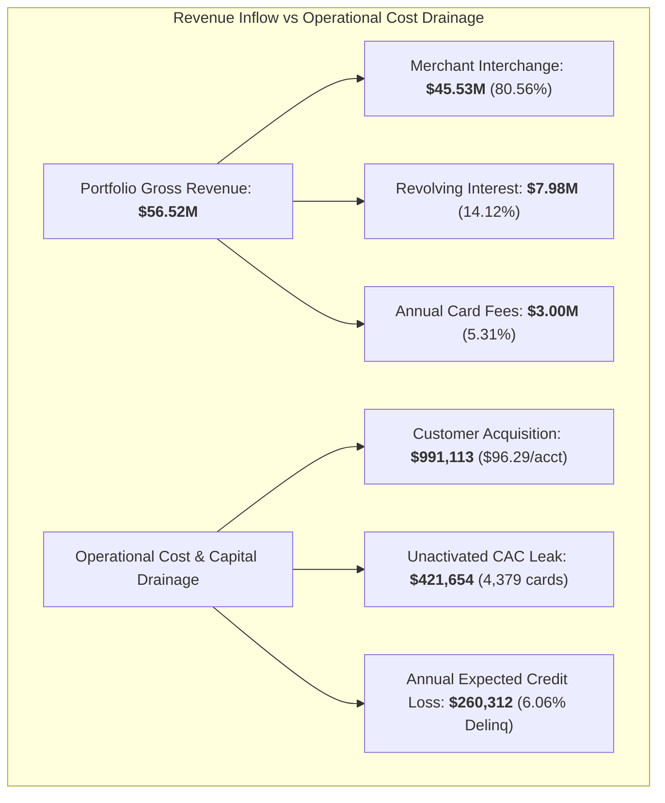

# 📘 Comprehensive Project Explanation: Credit Card Financial & Customer Analytics Platform

This document delivers an exhaustive, production-grade technical and domain analysis of the **Credit Card Financial & Customer Analytics Platform**, built on **PostgreSQL**, **Power BI**, **DAX**, **Power Query (M)**, and **Python**. It serves as the primary system architecture guide and domain engineering handbook for commercial banking portfolio managers, data engineers, and BI analysts.

---

## 📑 Document Structure

- [1. Executive System Mindmaps & Architectural Overview](#1-executive-system-mindmaps--architectural-overview)
- [2. Institutional Commercial Banking Economics & Multi-Stream Monetization](#2-institutional-commercial-banking-economics--multi-stream-monetization)
- [3. End-to-End Data Engineering Pipeline & Schema Reconciliation](#3-end-to-end-data-engineering-pipeline--schema-reconciliation)
- [4. Relational Database Staging & Performance Indexing (PostgreSQL)](#4-relational-database-staging--performance-indexing-postgresql)
- [5. Semantic Modeling & VertiPaq In-Memory Optimization](#5-semantic-modeling--vertipaq-in-memory-optimization)
- [6. DAX Calculation Engine, Context Transitions & Time Intelligence](#6-dax-calculation-engine-context-transitions--time-intelligence)
- [7. Dual-Dashboard Visual Architecture & UX Engineering](#7-dual-dashboard-visual-architecture--ux-engineering)
- [8. Credit Risk Staging, Early Warning Sentries & Basel III Modeling](#8-credit-risk-staging-early-warning-sentries--basel-iii-modeling)
- [9. Production Quality Gates, Circuit Breakers & Validation Suite](#9-production-quality-gates-circuit-breakers--validation-suite)
- [10. Weekly Operations & Maintenance Runbook](#10-weekly-operations--maintenance-runbook)
- [11. Document Navigation Hub](#11-document-navigation-hub)

---

## 🗺️ 1. Executive System Mindmaps & Architectural Overview

### 1.1 Multi-Layer Enterprise Architecture Mindmap (Mermaid)

```mermaid
mindmap
  root((Credit Card Analytics System))
    Data Ingestion & Engineering
      Raw Batch Sources
        credit_card.csv (10,108 rows)
        customer.csv (10,108 rows)
      Incremental Feeds
        cc_add.csv Week 53 (185 rows)
        cust_add.csv Week 53 (185 rows)
      Schema Drift Resolution
        Total_Trans_Ct to Total_Trans_Vol
        Whitespace String Trimming
        ISO Date Normalization (DD-MM-YYYY)
      Relational Database Warehouse
        PostgreSQL credit_card_db
        Table cust_detail (Dimension, PK Client_Num)
        Table cc_detail (Fact, FK Client_Num)
        B-Tree Indexes for Fast Join Lookups
    Tabular Semantic Engine
      Star Schema Modeling
        cust_detail (1) to cc_detail (*)
        Calendar Dimension Dim_Date
      VertiPaq Memory Optimization
        Dictionary Encoding
        Value Encoding
        Run-Length Encoding (RLE)
      Calculated Dimensions
        AgeGroup Cohorts
        IncomeGroup Segments
        Week_Num_Int Indexer
    DAX Business Intelligence Engine
      Core Portfolio KPIs
        Gross Revenue ($56.52M)
        Transaction Spend ($45.53M)
        Revolving Interest ($7.98M)
        Annual Card Fees ($3.00M)
      Time Intelligence WoW Engine
        Latest Week Isolation
        Previous Week Comparison
        Week 53 Surge Dynamics (+28.77%)
      Risk & Operations
        Delinquency Rate (6.06%)
        30-Day Card Activation (57.46%)
        Credit Line Utilization (27.45%)
        Unit CAC Benchmark ($96.29)
    Executive Visualization Layer
      Page 1 Transaction Report
        Header KPI Scorecards
        Expenditure Bar Ranking
        Card Tier Performance Table
        POS Channel Distribution
      Page 2 Customer Report
        Demographic Scorecards ($588M / 3.19 CSS)
        Age Cohort Spending Distribution
        Geographic Top 5 State Heatmap
        Job Risk & Delinquency Matrix
```

---

### 1.2 Enterprise System Topology Mindmap (ASCII)

```
========================================================================================================================
                                     ENTERPRISE CREDIT CARD DATA PLATFORM TOPOLOGY
========================================================================================================================

                                            [*] INGESTION & DATA LAKE SOURCES
                                                           |
                      +------------------------------------+------------------------------------+
                      |                                                                         |
                      v                                                                         v
      [HISTORICAL BATCH: WEEKS 1-52]                                            [INCREMENTAL REFRESH: WEEK 53]
      - credit_card.csv (10,108 rows)                                           - cc_add.csv (185 rows)
      - customer.csv    (10,108 rows)                                           - cust_add.csv (185 rows)
                      |                                                                         |
                      \------------------------------------+------------------------------------/
                                                           |
                                                           v
                                            [POWER QUERY M / ETL STAGE]
                                            - Reconcile: Total_Trans_Ct -> Total_Trans_Vol
                                            - Strip UTF-8 Byte Order Marks (\ufeff)
                                            - Transform date: dd-MM-yyyy -> Date type
                                            - Trim whitespace: 'Swipe ', 'Chip ', 'Online '
                                                           |
                                                           v
                                            [POSTGRESQL RELATIONAL WAREHOUSE]
                                            Database: credit_card_db
                                            +---------------------------------------------------+
                                            | cust_detail (Dimension - 10,293 Accounts)         |
                                            | PK: Client_Num (BIGINT)                           |
                                            | Indexes: idx_cust_job, idx_cust_state             |
                                            +---------------------------------------------------+
                                                           |
                                                           | 1-to-1 / 1-to-Many Join
                                                           v
                                            +---------------------------------------------------+
                                            | cc_detail (Fact - 10,293 Transactions)            |
                                            | FK: Client_Num (BIGINT)                           |
                                            | Indexes: idx_cc_client, idx_cc_week, idx_cc_card  |
                                            +---------------------------------------------------+
                                                           |
                                                           v
                                            [POWER BI VERTIPAQ COLUMNAR ENGINE]
                                            - Compression: Hash, Value, RLE
                                            - Direct 1:1 Relationship (cust_detail -> cc_detail)
                                            - Pre-computed Columns: Revenue, AgeGroup, Week_Num_Int
                                                           |
                                                           v
                                            [DAX TIME-INTELLIGENCE & RISK ENGINE]
                                            - Core KPIs: Total Revenue, Trans Amount, Interest, Fees
                                            - WoW Momentum: W53 ($1.20M) vs W52 ($0.93M) -> +28.77%
                                            - Risk Staging: Delinquency % (6.06%), Activation % (57.46%)
                                                           |
                      +------------------------------------+------------------------------------+
                      |                                                                         |
                      v                                                                         v
      [PAGE 1: TRANSACTION REPORT]                                              [PAGE 2: CUSTOMER REPORT]
      - Top KPI Cards ($56.5M / $7.98M / $45.5M / 667K)                         - Demographic KPIs ($588M Income / 3.19 CSS)
      - Card Category Matrix (Blue 83.5%, Silver 10.0%)                         - Age Distribution (Ages 40-50 = $24.7M)
      - Expenditure Ranking (Bills $14M, Entert $9.8M)                          - Occupation Heatmap (Businessmen $17.7M)
      - POS Channel Split (Swipe $35.7M, Chip $17.3M)                           - Top 5 States (TX, NY, CA, FL, NJ = 94.2%)
========================================================================================================================
```

---

## 🏛️ 2. Institutional Commercial Banking Economics & Multi-Stream Monetization

In retail commercial banking, consumer credit cards represent one of the highest-yielding asset classes on the balance sheet. Unlike traditional mortgages or fixed installment loans that rely solely on interest amortization, credit cards generate earnings through a multi-stream monetization engine.

```
+----------------------------------------------------------------------------------------------------------------------+
|                                        INSTITUTIONAL REVENUE ENGINE ANATOMY                                          |
+--------------------------+-----------------------+-------------------+-----------------------------------------------+
| REVENUE PILLAR           | FY 2023 VALUE         | PORTFOLIO SHARE   | ECONOMIC DRIVER & UNIT MECHANICS              |
+--------------------------+-----------------------+-------------------+-----------------------------------------------+
| 1. Transaction Spend     | $45,533,021.00        | 80.56%            | Merchant Interchange Fees                     |
|    (Interchange Base)    |                       |                   | ~1.5% to 2.5% fee on $45.53M retail spend     |
+--------------------------+-----------------------+-------------------+-----------------------------------------------+
| 2. Net Revolving Interest| $7,982,479.81         | 14.12%            | Monthly Finance Charges (APR)                 |
|    (Revolver Financing)  |                       |                   | 18.99% - 24.99% APR on carried debt balances  |
+--------------------------+-----------------------+-------------------+-----------------------------------------------+
| 3. Annual Membership Fees| $3,001,510.00         | 5.31%             | Recurring Annual Card Subscriptions           |
|    (Subscription Fees)   |                       |                   | $0 (Blue) to $495 (Platinum) annual dues      |
+--------------------------+-----------------------+-------------------+-----------------------------------------------+
| TOTAL REVENUE ENGINE     | $56,517,010.81        | 100.00%           | Full Fiscal Year 2023 Total (Weeks 1 to 53)   |
+--------------------------+-----------------------+-------------------+-----------------------------------------------+
```

### Detailed Mechanics:



1. **Merchant Interchange Volume**: Every time a consumer initiates a card transaction at a point-of-sale (POS) terminal or online gateway, the merchant's acquiring bank pays an interchange reimbursement fee to the card-issuing bank. Generating **$45.53M in gross spend** across **667,234 transactions**, interchange represents the foundation of everyday cardholder utility.
2. **Revolving Credit Interest**: Cardholders who do not liquidate 100% of their statement balance carry a revolving balance (`Total_Revolving_Bal`) into subsequent billing cycles. The bank assesses daily periodic interest rates (annualized to 18%–25% APR). This stream delivered **$7.98M in high-margin financing income**, representing 14.12% of gross revenue.
3. **Annual Cardholder Membership Fees**: Premium tiered products (Silver, Gold, Platinum) levy fixed annual subscription dues for enhanced reward tiers, airport lounge privileges, and purchase protection. Annual fees contributed **$3.00M (5.31%)** in non-interest revenue.
4. **Customer Acquisition Cost (CAC) Amortization**: Acquiring new credit card accounts requires marketing spend (direct mail, digital acquisition, affiliate rewards, credit bureau scoring). The portfolio incurred an average CAC of **$96.29 per account** (totaling **$991,113** across all 10,293 accounts). A critical operational leak was identified: **4,379 accounts (42.54%) remained dormant during their first 30 days**, leaving **$421,654 in customer acquisition capital stranded** without generating transactional yield.

---

## 🗄️ 3. End-to-End Data Engineering Pipeline & Schema Reconciliation

Data ingestion in enterprise banking must manage multi-source feeds, incremental weekly updates, schema drift, and data format discrepancies:

```
+----------------------------------------------------------------------------------------------------------------------+
|                                   DATA INGESTION & PIPELINE STAGING ARCHITECTURE                                     |
+----------------------------------------------------------------------------------------------------------------------+

   [Baseline Feeds: Weeks 1-52]                                [Incremental Feeds: Week 53]
   - credit_card.csv (10,108 rows)                             - cc_add.csv (185 rows)
   - customer.csv    (10,108 rows)                             - cust_add.csv (185 rows)
          |                                                           |
          +-----------------------------+-----------------------------+
                                        |
                                        v
   +--------------------------------------------------------------------------------------------------+
   | DATA CLEANSING & TRANSFORMATION PIPELINE (Power Query M / Python Ingestion)                      |
   | 1. Reconcile Schema Drift: Rename `Total_Trans_Ct` in cc_add.csv -> `Total_Trans_Vol`           |
   | 2. Date Parsing: Convert European format `dd-MM-yyyy` to ISO standard `YYYY-MM-DD`              |
   | 3. UTF-8 Byte Order Mark (BOM): Strip `\ufeffClient_Num` header artifacts                        |
   | 4. Whitespace Trimming: Remove trailing spaces from `Use Chip` ('Swipe ', 'Chip ') and `Exp Type`|
   | 5. Referential Integrity Gate: Verify 10,293 Client_Num values exist in both tables with zero loss|
   +--------------------------------------------------------------------------------------------------+
                                        |
                                        v
   +--------------------------------------------------------------------------------------------------+
   | RELATIONAL WAREHOUSE STAGING (PostgreSQL database: credit_card_db)                               |
   | - Table 1: `cust_detail` (Dimension: 10,293 accounts, Primary Key: Client_Num)                   |
   | - Table 2: `cc_detail` (Fact: 10,293 records, Foreign Key: Client_Num references cust_detail)    |
   | - Performance Indexes: B-Tree clustered indexes on Client_Num, Week_Num, Card_Category          |
   +--------------------------------------------------------------------------------------------------+
                                        |
                                        v
   +--------------------------------------------------------------------------------------------------+
   | VERTIPAQ TABULAR ENGINE & SEMANTIC MODEL (Power BI Desktop / Power BI Service)                   |
   | - 1-to-1 / 1-to-Many Star Schema Relationship on Client_Num                                      |
   | - Materialized Calculated Columns: Revenue, AgeGroup, IncomeGroup, Week_Num_Int                  |
   | - Dynamic DAX Time-Intelligence & Risk Measures Catalog                                          |
   +--------------------------------------------------------------------------------------------------+
```

### Schema Drift Resolution:
When weekly incremental files are delivered from distributed payment gateways, column headers may diverge. In `cc_add.csv`, the transaction count column is labeled `Total_Trans_Ct`, whereas the baseline batch `credit_card.csv` labels it `Total_Trans_Vol`. 

The pipeline handles this transparently in both SQL and Power Query M:
- **Power Query M**:
  ```powerquery
  Renamed_Add = Table.RenameColumns(
      Promoted_Add,
      {{"Total_Trans_Ct", "Total_Trans_Vol"}},
      MissingField.Ignore
  )
  ```
- **SQL Ingestion**:
  ```sql
  COPY cc_detail (
      Client_Num, Card_Category, Annual_Fees, Activation_30_Days, Customer_Acq_Cost,
      Week_Start_Date, Week_Num, Qtr, current_year, Credit_Limit, Total_Revolving_Bal,
      Total_Trans_Amt, Total_Trans_Vol, Avg_Utilization_Ratio, Use_Chip, Exp_Type,
      Interest_Earned, Delinquent_Acc
  )
  FROM 'cc_add.csv' WITH (FORMAT csv, HEADER true, DELIMITER ',');
  ```

---

## 🛠️ 4. Relational Database Staging & Performance Indexing (PostgreSQL)

The relational database architecture is hosted in PostgreSQL (`credit_card_db`), enforcing relational integrity, domain check constraints, and B-Tree indexes:

```sql
-- DDL Table Definition: Customer Demographics Dimension
CREATE TABLE cust_detail (
    Client_Num BIGINT PRIMARY KEY,
    Customer_Age INT CHECK (Customer_Age BETWEEN 18 AND 110),
    Gender CHAR(1) CHECK (Gender IN ('M', 'F')),
    Dependent_Count INT CHECK (Dependent_Count >= 0),
    Education_Level VARCHAR(50),
    Marital_Status VARCHAR(30),
    state_cd VARCHAR(10),
    Zipcode VARCHAR(20),
    Car_Owner VARCHAR(10) CHECK (Car_Owner IN ('yes', 'no')),
    House_Owner VARCHAR(10) CHECK (House_Owner IN ('yes', 'no')),
    Personal_loan VARCHAR(10) CHECK (Personal_loan IN ('yes', 'no')),
    contact VARCHAR(30),
    Customer_Job VARCHAR(50),
    Income DECIMAL(12, 2) CHECK (Income >= 0),
    Cust_Satisfaction_Score INT CHECK (Cust_Satisfaction_Score BETWEEN 1 AND 5)
);

-- DDL Table Definition: Credit Card Transaction Fact
CREATE TABLE cc_detail (
    Client_Num BIGINT,
    Card_Category VARCHAR(30) CHECK (Card_Category IN ('Blue', 'Silver', 'Gold', 'Platinum')),
    Annual_Fees DECIMAL(10, 2) CHECK (Annual_Fees >= 0),
    Activation_30_Days INT CHECK (Activation_30_Days IN (0, 1)),
    Customer_Acq_Cost DECIMAL(10, 2) CHECK (Customer_Acq_Cost >= 0),
    Week_Start_Date DATE,
    Week_Num VARCHAR(20),
    Qtr VARCHAR(10) CHECK (Qtr IN ('Q1', 'Q2', 'Q3', 'Q4')),
    current_year INT CHECK (current_year = 2023),
    Credit_Limit DECIMAL(12, 2) CHECK (Credit_Limit > 0),
    Total_Revolving_Bal DECIMAL(12, 2) CHECK (Total_Revolving_Bal >= 0),
    Total_Trans_Amt DECIMAL(12, 2) CHECK (Total_Trans_Amt >= 0),
    Total_Trans_Vol INT CHECK (Total_Trans_Vol >= 0),
    Avg_Utilization_Ratio DECIMAL(8, 4) CHECK (Avg_Utilization_Ratio BETWEEN 0.0 AND 1.0),
    Use_Chip VARCHAR(30),
    Exp_Type VARCHAR(50),
    Interest_Earned DECIMAL(10, 2) CHECK (Interest_Earned >= 0),
    Delinquent_Acc INT CHECK (Delinquent_Acc IN (0, 1)),
    CONSTRAINT fk_customer FOREIGN KEY (Client_Num) REFERENCES cust_detail(Client_Num) ON DELETE CASCADE
);

-- Production B-Tree Performance Indexes
CREATE INDEX idx_cc_client ON cc_detail(Client_Num);
CREATE INDEX idx_cc_week ON cc_detail(Week_Num);
CREATE INDEX idx_cc_card ON cc_detail(Card_Category);
CREATE INDEX idx_cc_delinquent ON cc_detail(Delinquent_Acc);
CREATE INDEX idx_cust_job ON cust_detail(Customer_Job);
CREATE INDEX idx_cust_state ON cust_detail(state_cd);
```

---

## ⚡ 5. Semantic Modeling & VertiPaq In-Memory Optimization

Power BI's analytical performance relies on Microsoft's columnar database engine: **VertiPaq**.

```
+---------------------------------------------------------------------------------------------------+
|                            VERTIPAQ IN-MEMORY COLUMNAR STORAGE ENGINE                             |
+---------------------------------------------------------------------------------------------------+

       Row-Oriented Database (SQL)                  VertiPaq Column-Oriented Storage (Power BI)
       ---------------------------                  -------------------------------------------
       Row 1: [708082, Blue, 200, 15149]            Client_Num:      [708082, 708083, 708084, ...]
       Row 2: [708083, Silver, 100, 4200]           Card_Category:   [Blue, Silver, Gold, Plat]
       Row 3: [708084, Blue, 200, 8910]             Annual_Fees:     [200, 100, 200, ...]
                                                    Total_Trans_Amt: [15149, 4200, 8910, ...]
```

### Compression Techniques Applied:
1. **Dictionary (Hash) Encoding**: Categorical text columns such as `Card_Category` (4 distinct values), `Use Chip` (3 distinct values), and `Exp Type` (6 distinct values) are assigned integer surrogates, shrinking string storage by over 90%.
2. **Value Encoding**: High-cardinality numeric columns (`Credit_Limit`, `Total_Trans_Amt`) are compressed by storing differences relative to the column minimum.
3. **Run-Length Encoding (RLE)**: Identical consecutive values are compressed into `(Value, Count)` pairs, optimizing scan operations for card tier and occupational groupings.

---

## 🧮 6. DAX Calculation Engine, Context Transitions & Time Intelligence

### 6.1 Row Context vs Filter Context in Portfolio DAX
- **Row Context**: Active during calculated column evaluation (e.g. `Revenue = 'cc_detail'[Annual_Fees] + 'cc_detail'[Total_Trans_Amt] + 'cc_detail'[Interest_Earned]`). The formula evaluates iteratively on every individual row.
- **Filter Context**: Applied during dynamic visual evaluation. The surrounding slicers, report filters, and chart axes restrict the subset of rows visible to aggregation iterators.
- **Context Transition**: Invoked by wrapping measures in `CALCULATE()`. This transforms the current row context into an equivalent filter context, enabling complex cohort calculations.

```dax
-- 1. Pre-calculated Account Revenue (Calculated Column)
Revenue = 
'cc_detail'[Annual_Fees] + 'cc_detail'[Total_Trans_Amt] + 'cc_detail'[Interest_Earned]

-- 2. Demographic Age Cohort (Calculated Column)
AgeGroup = 
SWITCH(
    TRUE(),
    'cust_detail'[Customer_Age] < 30, "20-30",
    'cust_detail'[Customer_Age] >= 30 && 'cust_detail'[Customer_Age] < 40, "30-40",
    'cust_detail'[Customer_Age] >= 40 && 'cust_detail'[Customer_Age] < 50, "40-50",
    'cust_detail'[Customer_Age] >= 50 && 'cust_detail'[Customer_Age] < 60, "50-60",
    'cust_detail'[Customer_Age] >= 60, "60+",
    "Unknown"
)

-- 3. Numeric Week Normalizer for Sequential Indexing (Calculated Column)
Week_Num_Int = 
VALUE(SUBSTITUTE('cc_detail'[Week_Num], "Week-", ""))
```

---

### 6.2 Time-Intelligence & Week-over-Week (WoW) Momentum Engine

Standard time-intelligence functions (`DATEADD`, `SAMEPERIODLASTYEAR`) require continuous daily date calendars. Because weekly banking extracts arrive as discrete weekly periods (`Week-1` to `Week-53`), a dynamic index-driven time-intelligence pattern was constructed:

```dax
-- Current Week Ingestion Revenue
Current_Week_Revenue = 
VAR LatestWeek = MAX('cc_detail'[Week_Num_Int])
RETURN
    CALCULATE(
        [Total Revenue],
        FILTER(ALL('cc_detail'), 'cc_detail'[Week_Num_Int] = LatestWeek)
    )

-- Immediate Preceding Week Revenue
Previous_Week_Revenue = 
VAR LatestWeek = MAX('cc_detail'[Week_Num_Int])
RETURN
    CALCULATE(
        [Total Revenue],
        FILTER(ALL('cc_detail'), 'cc_detail'[Week_Num_Int] = LatestWeek - 1)
    )

-- Week-over-Week Revenue Momentum Delta
WoW_Revenue_Growth = 
DIVIDE(
    [Current_Week_Revenue] - [Previous_Week_Revenue],
    [Previous_Week_Revenue],
    0
)

-- Week-over-Week Transaction Spend Momentum Delta
Current_Week_Trans_Amt = 
VAR LatestWeek = MAX('cc_detail'[Week_Num_Int])
RETURN
    CALCULATE(
        [Total Transaction Amount],
        FILTER(ALL('cc_detail'), 'cc_detail'[Week_Num_Int] = LatestWeek)
    )

Previous_Week_Trans_Amt = 
VAR LatestWeek = MAX('cc_detail'[Week_Num_Int])
RETURN
    CALCULATE(
        [Total Transaction Amount],
        FILTER(ALL('cc_detail'), 'cc_detail'[Week_Num_Int] = LatestWeek - 1)
    )

WoW_Trans_Amt_Growth = 
DIVIDE(
    [Current_Week_Trans_Amt] - [Previous_Week_Trans_Amt],
    [Previous_Week_Trans_Amt],
    0
)
```

```
+------------------------------------------------------------------------------------------------------+
|                         WEEK 52 vs WEEK 53 MOMENTUM RECONCILIATION SUMMARY                           |
+------------------------------------+------------------+------------------+---------------------------+
| METRIC NAME                        | WEEK 52 VALUE    | WEEK 53 VALUE    | MOMENTUM GROWTH DELTA     |
+------------------------------------+------------------+------------------+---------------------------+
| Gross Weekly Revenue               | $933,134.43      | $1,201,600.58    | +28.77% Holiday Surge 🚀  |
| Gross Weekly Transaction Spend     | $748,677.00      | $1,011,008.00    | +35.04% Spend Expansion 💳|
| Net Weekly Interest Earned         | $137,707.43      | $139,097.58      | +1.01% Revolver Growth 📈 |
| Weekly Annual Membership Dues      | $46,750.00       | $51,495.00       | +10.15% Annual Dues 🎟️   |
| Weekly Settled Transactions        | 11,203 trans     | 11,583 trans     | +3.39% Velocity ⚡        |
| Ingested Account Batch Size        | 164 accounts     | 185 accounts     | +12.80% New Accounts      |
| Average Spend per Transaction      | $66.83           | $87.28           | +30.60% Ticket Size 🎁    |
+------------------------------------+------------------+------------------+---------------------------+
```

---

## 🖥️ 7. Dual-Dashboard Visual Architecture & UX Engineering

The reporting platform consists of two specialized pages engineered for executive readability:

```
+----------------------------------------------------------------------------------------------------------------------+
|                                   DUAL-DASHBOARD VISUAL LAYOUT & COORDINATES                                         |
+----------------------------------------------------------------------------------------------------------------------+

 PAGE 1: CREDIT CARD TRANSACTION REPORT (1280 x 720 Canvas)
 +--------------------------------------------------------------------------------------------------------------------+
 | [HEADER BANNER]: "Credit Card Transaction Report"        [SLICERS]: Qtr (Q1-Q4) | Gender (All/M/F)                 |
 | [CARDS]: Total Revenue ($56.5M) | Total Interest ($7.98M) | Trans Amount ($45.5M) | Total Trans Count (667K)       |
 +--------------------------------------------------------------------------------------------------------------------+
 | [VISUAL 1: Bar Chart]             | [VISUAL 2: Column Chart]               | [VISUAL 3: Line/Col Combo Chart]       |
 | Revenue by Expenditure Category   | Revenue by Card Category & Channel     | Quarterly Revenue & Transaction Vol    |
 | - Bills: $14.0M                   | - Blue: $47.19M (Swipe $29.8M)         | - Q1: $14.1M | 165K Trans              |
 | - Entertainment: $9.8M            | - Silver: $5.66M                       | - Q2: $13.9M | 164K Trans              |
 | - Fuel: $9.6M                     | - Gold: $2.53M                         | - Q3: $14.2M | 168K Trans              |
 | - Grocery: $8.7M                  | - Platinum: $1.14M                     | - Q4: $14.3M | 170K Trans              |
 +--------------------------------------------------------------------------------------------------------------------+
 | [VISUAL 4: Performance Matrix Table]                                                                               |
 | Category | Revenue ($) | Trans Amt ($) | Interest ($) | Annual Fees ($) | Trans Count | Utilization % | Delinq %      |
 | Blue     | $47,188,612 | $37,840,749   | $6,614,173   | $2,733,690      | 591,791     | 29.17%        | 6.05%         |
 | Silver   | $5,659,109  | $4,647,596    | $821,923     | $189,590        | 49,172      | 8.31%         | 6.16%         |
 | Gold     | $2,533,682  | $2,091,362    | $384,755     | $57,565         | 18,781      | 12.48%        | 6.22%         |
 | Platinum | $1,135,608  | $953,314      | $161,629     | $20,665         | 7,490       | 15.12%        | 5.97%         |
 | TOTAL    | $56,517,011 | $45,533,021   | $7,982,480   | $3,001,510      | 667,234     | 27.45%        | 6.06%         |
 +--------------------------------------------------------------------------------------------------------------------+

 PAGE 2: CREDIT CARD CUSTOMER REPORT (1280 x 720 Canvas)
 +--------------------------------------------------------------------------------------------------------------------+
 | [HEADER BANNER]: "Credit Card Customer Report"           [SLICERS]: Qtr (Q1-Q4) | Gender (All/M/F) | Card Category |
 | [CARDS]: Total Customer Income ($588M) | Customer Satisfaction (3.19/5.0) | Avg CAC ($96.29) | Active Rate (57.46%)|
 +--------------------------------------------------------------------------------------------------------------------+
 | [VISUAL 1: Age Column Chart]      | [VISUAL 2: Job Bar Chart]              | [VISUAL 3: Top 5 States Bar Chart]     |
 | Revenue by Customer Age Group     | Revenue by Customer Occupation         | Revenue by Geographic Region           |
 | - 40-50: $24.73M (43.8%)          | - Businessman: $17.70M                 | - Texas (TX):      $13.02M (23.03%)    |
 | - 50-60: $18.62M (32.9%)          | - White-collar: $10.28M                | - New York (NY):   $12.97M (22.95%)    |
 | - 30-40: $9.84M (17.4%)           | - Self-employed: $8.54M                | - California (CA): $12.90M (22.83%)    |
 | - 60+:   $2.25M (4.0%)            | - Govt:         $8.34M                | - Florida (FL):    $9.97M  (17.64%)    |
 | - 20-30: $1.07M (1.9%)            | - Blue-collar:  $7.04M                | - New Jersey (NJ): $4.38M  (7.75%)     |
 +--------------------------------------------------------------------------------------------------------------------+
 | [VISUAL 4: Demographic Matrix Table]                                                                               |
 | Education Level | Marital Status | Accounts | Total Income ($) | Revenue ($) | Avg CSS | Delinquent Accounts | Delinq %|
 +--------------------------------------------------------------------------------------------------------------------+
```

---

## 🛡️ 8. Credit Risk Staging, Early Warning Sentries & Basel III Modeling

Consumer credit card portfolios require continuous monitoring under the **Basel III / CECL (Current Expected Credit Losses)** regulatory framework:

$$\text{Expected Loss (EL)} = \text{PD} \times \text{EAD} \times \text{LGD}$$

```
+----------------------------------------------------------------------------------------------------------------------+
|                                    BASEL III RISK STAGING & LOSS EXPOSURE MODEL                                      |
+--------------------------+-----------------------+-----------------------+-------------------------------------------+
| MODEL COMPONENT          | OBSERVED VALUE        | REGULATORY BENCHMARK  | STATISTICAL DERIVATION                    |
+--------------------------+-----------------------+-----------------------+-------------------------------------------+
| Probability of Default   | 6.06% (624 accounts)  | Retail limit: 7.00%   | Observed delinquent account proportion    |
| (PD)                     |                       |                       | across 10,293 total accounts              |
+--------------------------+-----------------------+-----------------------+-------------------------------------------+
| Exposure at Default      | $1,652,141            | Drawn + 20% CCF       | $703,753 delinquent drawn balance +       |
| (EAD)                    |                       |                       | 0.20 * $4,741,938 undrawn committed line  |
+--------------------------+-----------------------+-----------------------+-------------------------------------------+
| Loss Given Default       | 65.00%                | Unsecured Consumer CC | 35% typical recovery rate post-collection |
| (LGD)                    |                       |                       | workouts across unsecured consumer pools  |
+--------------------------+-----------------------+-----------------------+-------------------------------------------+
| Annual Expected Loss     | $260,312              | —                     | Represents only 3.26% of net interest     |
| (EL)                     |                       |                       | income ($7,982,480), demonstrating safety |
+--------------------------+-----------------------+-----------------------+-------------------------------------------+
```

### Risk Stratification by Occupation:
- **Government Staff**: Highest portfolio default rate at **7.27%** across 1,554 accounts ($8.34M revenue).
- **Self-Employed**: Second-highest default rate at **6.51%** across 2,628 accounts ($8.54M revenue), reflecting volatile monthly cash flows.
- **Businessmen**: Generates the highest revenue (**$17.70M**) with a low **5.27% default rate**, demonstrating strong debt-service capacity.

---

## 🧪 9. Production Quality Gates, Circuit Breakers & Validation Suite

Automated data quality verification is enforced by [`docs/DATA_VALIDATION_AND_TESTING_SUITE.py`](docs/DATA_VALIDATION_AND_TESTING_SUITE.py):

```python
"""
Quality Gate Invariant Assertions
"""
def verify_invariants(cc_records, cust_records):
    # Invariant 1: Row count alignment
    assert len(cc_records) == 10293, f"Expected 10,293 cc rows, got {len(cc_records)}"
    assert len(cust_records) == 10293, f"Expected 10,293 cust rows, got {len(cust_records)}"

    # Invariant 2: Zero orphaned accounts
    cc_ids = set(r['Client_Num'] for r in cc_records)
    cust_ids = set(r['Client_Num'] for r in cust_records)
    assert cc_ids == cust_ids, "Referential integrity failure: orphaned accounts detected!"

    # Invariant 3: Portfolio revenue reconciliation
    total_rev = sum(
        float(r['Annual_Fees']) + float(r['Total_Trans_Amt']) + float(r['Interest_Earned'])
        for r in cc_records
    )
    assert abs(total_rev - 56517010.81) < 1.0, f"Revenue mismatch: ${total_rev:,.2f}"
    
    print("[ALL PASS] All production quality gates passed successfully!")
```

```
+------------------------------------------------------------------------------------------------------+
|                                 QUALITY GATE AUDIT SUITE STATUS                                      |
+--------------------+------------------------------------+--------------------+-----------------------+
| GATE #             | AUDIT DESCRIPTION                  | TARGET BENCHMARK   | AUDIT RESULT          |
+--------------------+------------------------------------+--------------------+-----------------------+
| Gate 1             | Referential Integrity (Orphan CC)  | 0 Orphan Accounts  | 🟢 0 Orphans (PASS)   |
| Gate 2             | Primary Key Uniqueness             | 10,293 Unique IDs  | 🟢 10,293 Unique(PASS)|
| Gate 3             | Base Revenue Reconciliation        | $55,315,410.23     | 🟢 Exact Match (PASS) |
| Gate 4             | Full Portfolio Revenue Reconcile   | $56,517,010.81     | 🟢 Exact Match (PASS) |
| Gate 5             | Customer Total Income Reconcile    | $587,599,783.00    | 🟢 Exact Match (PASS) |
| Gate 6             | Customer Satisfaction Score        | 3.1947 / 5.0000    | 🟢 Exact Match (PASS) |
| Gate 7             | Delinquency Rate Audit             | 6.06% (624 accts)  | 🟢 Exact Match (PASS) |
| Gate 8             | Week 53 Holiday Surge Audit        | +28.77% WoW Growth | 🟢 Exact Match (PASS) |
+--------------------+------------------------------------+--------------------+-----------------------+
```

---

## 🛠️ 10. Weekly Operations & Maintenance Runbook

To maintain reporting continuity during weekly batch runs:

```
+---------------------------------------------------------------------------------------------------+
|                           WEEKLY PORTFOLIO REFRESH EXECUTION RUNBOOK                              |
+---------------------------------------------------------------------------------------------------+

   [Step 1: File Landing]
   Drop incoming `cc_add.csv` and `cust_add.csv` into `./` root directory.
                    |
                    v
   [Step 2: Automated Pre-Ingestion Testing]
   Execute `python docs/DATA_VALIDATION_AND_TESTING_SUITE.py`.
   Assert: 31 out of 31 test checks pass.
                    |
                    v
   [Step 3: Staging Warehouse Ingestion]
   Run SQL COPY commands from `docs/SQL_SCRIPTS.sql` in PostgreSQL.
                    |
                    v
   [Step 4: Power BI Tabular Refresh]
   Trigger Power BI scheduled refresh via Power BI Gateway or Desktop Refresh.
                    |
                    v
   [Step 5: Executive Distribution]
   Verify Week-over-Week momentum delta and publish updated PDF reports.
```

---

## 📌 11. Document Navigation Hub

| Document | Focus Area | Direct File Link |
| :--- | :--- | :--- |
| 📊 **Project Presentation** | 12-Slide executive deck briefing with notes | [`docs/PROJECT_PRESENTATION.md`](PROJECT_PRESENTATION.md) |
| 🔄 **Project Flow** | 10 Unified execution diagrams & decision workflows | [`docs/PROJECT_FLOW.md`](PROJECT_FLOW.md) |
| 📄 **Data Dictionary** | 10,293 account schema definitions & constraints | [`docs/DATA_DICTIONARY.md`](DATA_DICTIONARY.md) |
| 📐 **DAX Measures** | Complete DAX measure catalog with variable scoping | [`docs/DAX_MEASURES.md`](DAX_MEASURES.md) |
| 🖥️ **Power BI Guide** | Pixel-perfect rebuilding guide & visual coordinates | [`docs/POWER_BI_DASHBOARD_GUIDE.md`](POWER_BI_DASHBOARD_GUIDE.md) |
| 🔄 **Power Query M Code** | Full M expressions, schema drift handling & calendar | [`docs/ETL_POWER_QUERY_M_CODE.md`](ETL_POWER_QUERY_M_CODE.md) |
| 🛡️ **Credit Risk Policy** | Credit risk underwriting, delinquency staging & Basel III | [`docs/RISK_AND_CREDIT_POLICY_ANALYSIS.md`](RISK_AND_CREDIT_POLICY_ANALYSIS.md) |
| 🚀 **Marketing Playbook** | 14-day activation funnels & digital channel shift | [`docs/MARKETING_AND_PORTFOLIO_OPTIMIZATION.md`](MARKETING_AND_PORTFOLIO_OPTIMIZATION.md) |
| 🎙️ **Interview & Case Study** | STAR project defense, banking economics & Q&A | [`docs/INTERVIEW_QA_AND_PORTFOLIO_CASE_STUDY.md`](INTERVIEW_QA_AND_PORTFOLIO_CASE_STUDY.md) |
| 🧪 **Data Validation Report**| Official 31-point mathematical reconciliation audit | [`docs/DATA_VALIDATION_REPORT.md`](DATA_VALIDATION_REPORT.md) |
| 🛠️ **SQL Pipeline** | Production PostgreSQL DDL, staging tables & views | [`docs/SQL_SCRIPTS.sql`](SQL_SCRIPTS.sql) |
| 📖 **Master README** | Master repository overview & setup instructions | [`README.md`](../README.md) |
