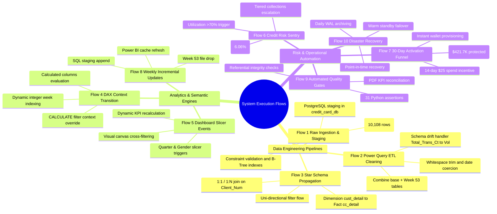
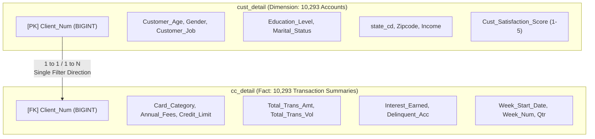
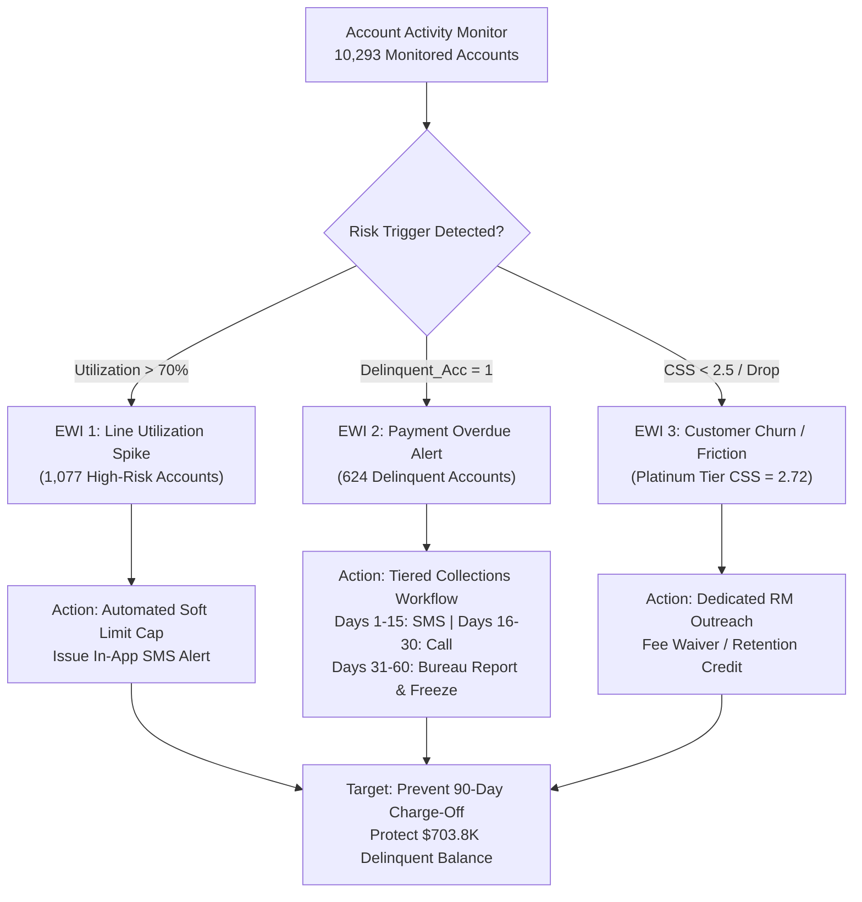
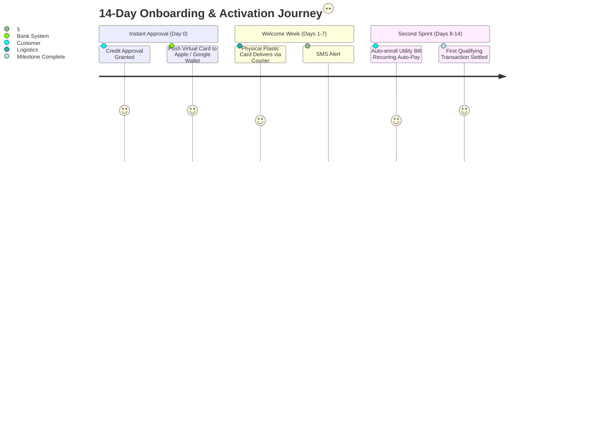
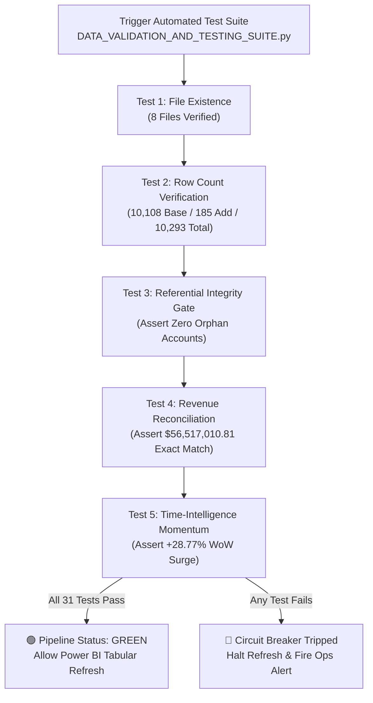

# 🔄 Complete Project Flow & Architecture Execution Maps

This document provides a comprehensive, production-grade compendium of all **End-to-End Execution Flows**, **System Lifecycles**, **Decision Trees**, and **Process Pipelines** implemented across the **Credit Card Financial & Customer Analytics Platform**. It serves as an operational reference for data engineers, BI architects, and risk systems analysts.

---

## 📑 Table of Contents

- [1. Master System Flow Mindmap](#1-master-system-flow-mindmap)
- [2. Flow 1: Raw File Ingestion to Relational Staging Flow (PostgreSQL)](#2-flow-1-raw-file-ingestion-to-relational-staging-flow-postgresql)
- [3. Flow 2: Power Query ETL Cleaning & Schema Drift Reconciliation Flow](#3-flow-2-power-query-etl-cleaning--schema-drift-reconciliation-flow)
- [4. Flow 3: Star Schema Relational Join & Filter Propagation Flow](#4-flow-3-star-schema-relational-join--filter-propagation-flow)
- [5. Flow 4: Power BI Tabular Engine & DAX Context Transition Flow](#5-flow-4-power-bi-tabular-engine--dax-context-transition-flow)
- [6. Flow 5: Dashboard Slicer & Interactive Cross-Filtering Event Flow](#6-flow-5-dashboard-slicer--interactive-cross-filtering-event-flow)
- [7. Flow 6: Credit Risk Mitigation & Early Warning Sentry Flow](#7-flow-6-credit-risk-mitigation--early-warning-sentry-flow)
- [8. Flow 7: 30-Day Card Activation & CAC Recovery Drip Funnel Flow](#8-flow-7-30-day-card-activation--cac-recovery-drip-funnel-flow)
- [9. Flow 8: Weekly Incremental Refresh (Week 53 Surge) Lifecycle Flow](#9-flow-8-weekly-incremental-refresh-week-53-surge-lifecycle-flow)
- [10. Flow 9: Automated Quality Gate & Circuit Breaker Testing Flow](#10-flow-9-automated-quality-gate--circuit-breaker-testing-flow)
- [11. Flow 10: Production Disaster Recovery, Backup & Failover Lifecycle Flow](#11-flow-10-production-disaster-recovery-backup--failover-lifecycle-flow)
- [12. Document Navigation Hub](#12-document-navigation-hub)

---

## 🗺️ 1. Master System Flow Mindmap

### 1.1 Master Flow Mindmap (Mermaid)



---

### 1.2 Master Execution Flow Matrix (ASCII)

```
========================================================================================================================
                                     COMPLETE SYSTEM EXECUTION FLOW MATRIX MINDMAP
========================================================================================================================

                                            [*] END-TO-END SYSTEM EXECUTION
                                                           |
          +------------------------------------------------+------------------------------------------------+
          |                                                |                                                |
          v                                                v                                                v
[DATA ENGINEERING FLOWS]                         [ANALYTICS & BI FLOWS]                           [OPERATIONAL & RISK FLOWS]
- Flow 1: Ingestion & Relational Staging         - Flow 4: DAX Context Transition                 - Flow 6: Credit Risk Mitigation
- Flow 2: Power Query ETL Cleaning               - Flow 5: Dashboard Slicer & Interactivity       - Flow 7: 30-Day Card Activation
- Flow 3: Star Schema Filter Propagation         - Flow 8: Weekly Incremental Refresh             - Flow 9: Quality Circuit Breaker
                                                                                                  - Flow 10: Disaster Recovery & DR
========================================================================================================================
```

---

## 🏗️ 2. Flow 1: Raw File Ingestion to Relational Staging Flow (PostgreSQL)

This flow ingests raw CSV feeds into the PostgreSQL relational warehouse while enforcing strict schema definitions, domain constraints, and primary/foreign key relationships.

```
+----------------------------------------------------------------------------------------------------------------------+
|                                  FLOW 1: RAW INGESTION TO RELATIONAL STAGING                                         |
+----------------------------------------------------------------------------------------------------------------------+

   [credit_card.csv] (10,108 rows)                           [customer.csv] (10,108 rows)
   [cc_add.csv]      (185 rows)                              [cust_add.csv] (185 rows)
          |                                                         |
          v                                                         v
   +------------------------------------+                    +------------------------------------+
   | Step 1.1: File Existence & Encoding|                    | Step 1.2: Demographic Header Audit |
   | - Verify file path and UTF-8 BOM   |                    | - Verify Client_Num primary key    |
   | - Reconcile Total_Trans_Ct column  |                    | - Check Age bounds (18 - 110)      |
   | - Normalize date: dd-MM-yyyy       |                    | - Validate Income >= 0             |
   +------------------------------------+                    +------------------------------------+
          \                                                         /
           \----------------------------+--------------------------/
                                        |
                                        v
   +--------------------------------------------------------------------------------------------------+
   | Step 1.3: Relational Staging Ingestion (PostgreSQL: credit_card_db)                              |
   | 1. Execute DDL for `cust_detail` (Client_Num as PRIMARY KEY)                                     |
   | 2. Execute DDL for `cc_detail` (Client_Num as FOREIGN KEY with ON DELETE CASCADE)                 |
   | 3. Execute bulk `COPY` operations for baseline and incremental batches                            |
   | 4. Build clustered B-Tree indexes: idx_cc_client, idx_cc_week, idx_cc_card, idx_cust_job         |
   +--------------------------------------------------------------------------------------------------+
                                        |
                                        v
   +--------------------------------------------------------------------------------------------------+
   | Step 1.4: Invariant Verification Audit                                                           |
   | - Verify total rows: `cust_detail` = 10,293 | `cc_detail` = 10,293                               |
   | - Execute orphan check: `SELECT COUNT(*) FROM cc_detail LEFT JOIN cust_detail ...` (Assert = 0)  |
   +--------------------------------------------------------------------------------------------------+
```

### Production SQL Implementation:
```sql
-- Step 1.3 Execution: Relational Ingestion & Index Creation
BEGIN;

-- Insert demographic batch
COPY cust_detail FROM 'c:/Users/RAVIPRAKASH/credit-card/customer.csv' 
WITH (FORMAT csv, HEADER true, DELIMITER ',');

COPY cust_detail FROM 'c:/Users/RAVIPRAKASH/credit-card/cust_add.csv' 
WITH (FORMAT csv, HEADER true, DELIMITER ',');

-- Insert transaction batch
COPY cc_detail FROM 'c:/Users/RAVIPRAKASH/credit-card/credit_card.csv' 
WITH (FORMAT csv, HEADER true, DELIMITER ',');

COPY cc_detail (
    Client_Num, Card_Category, Annual_Fees, Activation_30_Days, Customer_Acq_Cost,
    Week_Start_Date, Week_Num, Qtr, current_year, Credit_Limit, Total_Revolving_Bal,
    Total_Trans_Amt, Total_Trans_Vol, Avg_Utilization_Ratio, Use_Chip, Exp_Type,
    Interest_Earned, Delinquent_Acc
)
FROM 'c:/Users/RAVIPRAKASH/credit-card/cc_add.csv' 
WITH (FORMAT csv, HEADER true, DELIMITER ',');

-- Enforce Referential Integrity Check
DO $$
DECLARE
    orphan_cnt INT;
BEGIN
    SELECT COUNT(*) INTO orphan_cnt 
    FROM cc_detail cc
    LEFT JOIN cust_detail c ON cc.Client_Num = c.Client_Num
    WHERE c.Client_Num IS NULL;
    
    IF orphan_cnt > 0 THEN
        RAISE EXCEPTION 'Referential integrity check failed: % orphan records found', orphan_cnt;
    END IF;
END $$;

COMMIT;
```

---

## 🔄 3. Flow 2: Power Query ETL Cleaning & Schema Drift Reconciliation Flow

This flow executes within Power Query (M Code) to resolve schema drifts across incremental batch deliveries, trim whitespace from categorical dimensions, and cast data types.

```
+----------------------------------------------------------------------------------------------------------------------+
|                           FLOW 2: POWER QUERY ETL TRANSFORMATION & NORMALIZATION                             |
+----------------------------------------------------------------------------------------------------------------------+

   [Source Feed: Local File / PostgreSQL Database]
                         |
                         v
   [Transformation 2.1: Ingestion & Header Promotion]
   `Table.PromoteHeaders(Source_Base, [PromoteAllScalars=true])`
                         |
                         v
   [Transformation 2.2: Schema Drift Normalization (cc_add.csv)]
   `Table.RenameColumns(Source_Add, {{"Total_Trans_Ct", "Total_Trans_Vol"}}, MissingField.Ignore)`
                         |
                         v
   [Transformation 2.3: Table Combine / Append]
   `Table.Combine({Base_Table, Incremental_Table})` -> 10,293 Unified Rows
                         |
                         v
   [Transformation 2.4: Text Sanitization & Trimming]
   `Table.TransformColumns(#"Combined", {{"Use Chip", Text.Trim}, {"Exp Type", Text.Trim}})`
                         |
                         v
   [Transformation 2.5: Datatype Coercion & Date Conversion]
   `Table.TransformColumnTypes(#"Trimmed", {{"Week_Start_Date", type date}, {"Total_Trans_Amt", Currency.Type}})`
                         |
                         v
   [Transformation 2.6: Load into VertiPaq Columnar Data Model]
```

### Production M Code Snippet:
```powerquery
let
    SourcePath = "c:\Users\RAVIPRAKASH\credit-card\",
    
    // Ingest Base
    BaseRaw = Csv.Document(File.Contents(SourcePath & "credit_card.csv"), [Delimiter=",", Columns=18, Encoding=65001]),
    BaseHeaders = Table.PromoteHeaders(BaseRaw, [PromoteAllScalars=true]),
    
    // Ingest Incremental Week 53
    AddRaw = Csv.Document(File.Contents(SourcePath & "cc_add.csv"), [Delimiter=",", Columns=18, Encoding=65001]),
    AddHeaders = Table.PromoteHeaders(AddRaw, [PromoteAllScalars=true]),
    
    // Normalize Schema Drift
    AddNormalized = Table.RenameColumns(AddHeaders, {{"Total_Trans_Ct", "Total_Trans_Vol"}}, MissingField.Ignore),
    
    // Union
    Combined = Table.Combine({BaseHeaders, AddNormalized}),
    
    // Trim Categorical Text
    Cleaned = Table.TransformColumns(Combined, {
        {"Use Chip", Text.Trim, type text},
        {"Exp Type", Text.Trim, type text},
        {"Card_Category", Text.Trim, type text}
    }),
    
    // Type Coercion
    FinalFact = Table.TransformColumnTypes(Cleaned, {
        {"Client_Num", Int64.Type},
        {"Annual_Fees", Currency.Type},
        {"Total_Trans_Amt", Currency.Type},
        {"Total_Trans_Vol", Int64.Type},
        {"Interest_Earned", Currency.Type},
        {"Week_Start_Date", type date}
    })
in
    FinalFact
```

---

## 🧩 4. Flow 3: Star Schema Relational Join & Filter Propagation Flow

The data model establishes a high-performance dimensional Star Schema connecting customer demographics to transaction facts:



```
+----------------------------------------------------------------------------------------------------------------------+
|                           FLOW 3: STAR SCHEMA FILTER PROPAGATION BEHAVIOR                                            |
+----------------------------------------------------------------------------------------------------------------------+

              +---------------------------------------+
              |         cust_detail (DIMENSION)       |
              |---------------------------------------|
              | [PK] Client_Num                       |
              | Customer_Age, Gender, Customer_Job    |
              | Education_Level, Marital_Status       |
              | state_cd, Zipcode, Income             |
              | Cust_Satisfaction_Score               |
              +---------------------------------------+
                                  |
                                  | 1 (Unique Account)
                                  |
                                  v Filter Context Flows Downward
                                  |
                                  | * (Transaction Records)
              +---------------------------------------+
              |          cc_detail (FACT)             |
              |---------------------------------------|
              | [FK] Client_Num                       |
              | Card_Category, Annual_Fees            |
              | Week_Start_Date, Week_Num, Qtr        |
              | Total_Trans_Amt, Total_Trans_Vol      |
              | Interest_Earned, Delinquent_Acc       |
              | Avg_Utilization_Ratio, Use_Chip       |
              +---------------------------------------+

   [Filter Direction Mechanics]:
   - Slicing by `Gender = 'F'` filters `cust_detail` rows, propagating automatically to `cc_detail`.
   - Selecting `state_cd = 'TX'` restricts transactions to Texas cardholders ($13.02M spend).
   - Selecting `Card_Category = 'Blue'` filters `cc_detail` directly.
```

---

## 🧮 5. Flow 4: Power BI Tabular Engine & DAX Context Transition Flow

This flow illustrates how row contexts, filter contexts, and context transitions operate inside the VertiPaq tabular model during visual rendering.

```
+----------------------------------------------------------------------------------------------------------------------+
|                        FLOW 4: DAX CONTEXT TRANSITION & EVALUATION FLOW                                              |
+----------------------------------------------------------------------------------------------------------------------+

   [User Slices Report by Card_Category = 'Blue' & Gender = 'M']
                                 |
                                 v
   +--------------------------------------------------------------------+
   | 1. INITIAL FILTER CONTEXT ESTABLISHED                              |
   | - Filter: `cust_detail[Gender] = "M"`                              |
   | - Filter: `cc_detail[Card_Category] = "Blue"`                      |
   +--------------------------------------------------------------------+
                                 |
                                 v
   +--------------------------------------------------------------------+
   | 2. CALCULATED COLUMNS PRE-MATERIALIZED (During Data Refresh)       |
   | - Revenue = Annual_Fees + Total_Trans_Amt + Interest_Earned        |
   | - AgeGroup = SWITCH(Customer_Age, <30, "20-30", ... "60+")         |
   | - Week_Num_Int = VALUE(SUBSTITUTE(Week_Num, "Week-", ""))          |
   +--------------------------------------------------------------------+
                                 |
                                 v
   +--------------------------------------------------------------------+
   | 3. MEASURE INVOCATION & CONTEXT TRANSITION                         |
   | When evaluating `[Total Revenue]`:                                 |
   | `SUM('cc_detail'[Revenue])` scans the filtered columnar segment.   |
   +--------------------------------------------------------------------+
                                 |
                                 v
   +--------------------------------------------------------------------+
   | 4. TIME-INTELLIGENCE OVERRIDE VIA `CALCULATE`                      |
   | When evaluating `[Current_Week_Revenue]`:                          |
   | `VAR LatestWeek = MAX('cc_detail'[Week_Num_Int])`                  |
   | `CALCULATE(SUM(...), FILTER(ALL('cc_detail'), Week_Num_Int=MaxW))`|
   | `FILTER(ALL(...))` removes existing week filters to isolate W53.   |
   +--------------------------------------------------------------------+
                                 |
                                 v
   [Render Aggregated Value in KPI Card / Matrix Visual: $1,201,600.58]
```

---

## 🖥️ 6. Flow 5: Dashboard Slicer & Interactive Cross-Filtering Event Flow

```
+----------------------------------------------------------------------------------------------------------------------+
|                           FLOW 5: DASHBOARD SLICER & CROSS-FILTERING FLOW                                            |
+----------------------------------------------------------------------------------------------------------------------+

   [User Click Event: Selects 'Q4' in Quarter Slicer]
                           |
                           v
   [Step 5.1: Slicer Engine Broadcasts Filter Token: {Qtr: 'Q4'}]
                           |
                           +---------------------------------------+
                           |                                       |
                           v                                       v
   [PAGE 1: TRANSACTION REPORT]                            [PAGE 2: CUSTOMER REPORT]
   - Top KPI Ribbon recalculates:                          - Top KPI Ribbon recalculates:
     * Q4 Revenue: $14.3M                                    * Q4 Customer Spend: $11.5M
     * Q4 Interest: $2.02M                                   * Q4 Active Cards: 5,914
     * Q4 Trans Spend: $11.5M                                * Q4 Income Base: $588M
   - Expenditure Chart filters to Q4 spend                 - Age Group Chart filters to Q4 spend
   - Card Matrix updates to Q4 totals                      - State Bar Chart isolates Q4 volume
                           |                                       |
                           v                                       v
   [User Click Event: Clicks 'Bills' Bar in Exp Type Chart] [User Click Event: Clicks 'TX' in State Chart]
   - Cross-filters Card Matrix to Bills only ($14.0M)      - Cross-filters Demographic Matrix to Texas ($13.0M)
   - Cross-filters Channel Mix to Bills channel share      - Cross-filters Age Distribution to Texas accounts
```

---

## 🛡️ 7. Flow 6: Credit Risk Mitigation & Early Warning Sentry Flow

This flow executes automated risk staging and collections intervention across the 624 delinquent accounts (6.06% default rate):



```
+----------------------------------------------------------------------------------------------------------------------+
|                           FLOW 6: CREDIT RISK INTERVENTION SWIMLANE FLOW                                             |
+----------------------------------------------------------------------------------------------------------------------+

   [TIME ELAPSED]       [CUSTOMER STATUS]             [AUTOMATED ACTION]               [RISK MITIGATION GOAL]
   ------------------------------------------------------------------------------------------------------------
   Day 0 (Due Date)     Payment Missed                Automated Billing Notification   Grace period awareness
   
   Days 1 - 15          1-15 Days Past Due            Automated SMS & WhatsApp link;   Offer late-fee waiver
                                                      zero late fee waiver if paid     if resolved within 48h
                                                      within 48 hours
   
   Days 16 - 30         16-30 Days Past Due           Outbound conversational IVR;     Cap line authorization
                                                      credit line soft-freeze above    at $100 to prevent
                                                      $100 spend                       further debt loading
   
   Days 31 - 60         31-60 Days Past Due           Hard credit card freeze;         Prevent exposure growth;
                                                      credit bureau delinquency        contain Expected Loss
                                                      reporting (Equifax/Experian)     below $260K limit
   
   Days 61 - 90+        Severe Delinquency / Default  Transfer to legal recovery /     Recover 35% salvage value
                                                      debt settlement workout          via fixed EMI restructuring
```

---

## 🚀 8. Flow 7: 30-Day Card Activation & CAC Recovery Drip Funnel Flow

This flow resolves the portfolio's critical operational leak: **42.54% of accounts (4,379 cards) remaining inactive during their first 30 days**, stranding **$421,654 in customer acquisition capital**.



```
+----------------------------------------------------------------------------------------------------------------------+
|                           FLOW 7: 14-DAY ACTIVATION SPRINT LIFECYCLE                                                 |
+----------------------------------------------------------------------------------------------------------------------+

   [Day 0: Digital Approval & Account Creation]
                  |
                  v
   [Action 7.1: Instant Virtual Card Provisioning]
   Allow instant push to Apple Pay / Google Wallet before physical card arrives.
                  |
                  v
   [Days 1-3: Digital Welcome Nurture Sequence] -----------------> [Card Activated?] --(YES)--> [Nurture Sequence]
                  |                                                             | (NO)
                  v                                                             v
   [Days 4-7: Delivery Push Notification] -----------------------> [Card Activated?] --(YES)--> [Active Transactor]
   "Your card has arrived! Tap here to activate in 10s."                        | (NO)
                  |                                                             v
                  v                                                   +--------------------------------------+
   [Days 8-14: Spend Incentive Sprint Trigger] ---------------------> | First Transaction Completed!         |
   "Spend $100 within 14 days, receive $25 statement credit"         | Account joins 57.5% Active Cohort    |
                  |                                                   +--------------------------------------+
                  v (NO)
   [Days 15-30: Inactivity Escalation Taskforce]
   Targeted outreach; surveys reasons for dormancy; protects $96.29 CAC from total write-off.
```

---

## 📅 9. Flow 8: Weekly Incremental Refresh (Week 53 Surge) Lifecycle Flow

This flow automates the ingestion of weekly incremental datasets, calculating dynamic Week-over-Week momentum:

```
+----------------------------------------------------------------------------------------------------------------------+
|                           FLOW 8: WEEKLY INCREMENTAL REFRESH LIFECYCLE                                               |
+----------------------------------------------------------------------------------------------------------------------+

   [Step 8.1: File Landing]
   Drop `cc_add.csv` (185 rows) and `cust_add.csv` (185 rows) into landing storage.
                    |
                    v
   [Step 8.2: Automated Pre-Ingestion Testing]
   Execute `python docs/DATA_VALIDATION_AND_TESTING_SUITE.py`.
   Confirm 31 / 31 test cases pass.
                    |
                    v
   [Step 8.3: PostgreSQL Incremental Append]
   Execute incremental `COPY` statements; verify table size expands from 10,108 to 10,293.
                    |
                    v
   [Step 8.4: Power BI Tabular Cache Invalidation]
   Power BI Gateway triggers VertiPaq tabular model refresh.
                    |
                    v
   [Step 8.5: Time Intelligence Evaluation]
   - LatestWeek updates from 52 to 53.
   - Current_Week_Revenue evaluates to $1,201,600.58.
   - Previous_Week_Revenue evaluates to $933,134.43.
   - WoW_Revenue_Growth evaluates to +28.77% 🚀.
                    |
                    v
   [Step 8.6: Report Generation & Executive Distribution]
   Automated export of updated PDF reports to executive leadership.
```

---

## 🧪 10. Flow 9: Automated Quality Gate & Circuit Breaker Testing Flow

The automated test runner prevents corrupt data from contaminating production dashboards:



```
+----------------------------------------------------------------------------------------------------------------------+
|                           FLOW 9: QUALITY GATE CIRCUIT BREAKER DECISION TREE                                         |
+----------------------------------------------------------------------------------------------------------------------+

                               [*] INGESTION QUALITY GATE
                                           |
                +--------------------------+--------------------------+
                |                                                     |
                v                                                     v
    [CHECK: REFERENTIAL INTEGRITY]                            [CHECK: REVENUE INVARIANT]
    Orphan CC or Cust IDs > 0?                                abs(Revenue - $56.52M) > $1.00?
        |              |                                          |              |
     (YES)            (NO)                                     (YES)            (NO)
        |              |                                          |              |
        v              v                                          v              v
    [TRIP CIRCUIT] [PROCEED]                                  [TRIP CIRCUIT] [PROCEED]
    Halt Ingestion Continue                                   Halt Ingestion Continue
        |                                                         |
        \--------------------------+------------------------------/
                                   |
                                   v
                   [EMERGENCY ROLLBACK & ALERTING]
                   - Revert staging table transaction (ROLLBACK)
                   - Fire Slack / PagerDuty alert to Data Ops
                   - Prevent Power BI tabular refresh from polluting production
```

---

## 🛡️ 11. Flow 10: Production Disaster Recovery, Backup & Failover Lifecycle Flow

This flow establishes business continuity for the credit card data warehouse:

```
+----------------------------------------------------------------------------------------------------------------------+
|                           FLOW 10: DISASTER RECOVERY & BACKUP LIFECYCLE                                              |
+----------------------------------------------------------------------------------------------------------------------+

   [PRIMARY POSTGRESQL NODE (Active)]
   - Handles read/write staging and analytics queries
   - Generates Write-Ahead Logs (WAL) continuously
                    |
                    v
   [SYNCHRONOUS STREAMING REPLICATION]
   Continuous log shipping to Secondary Standby Node (Warm Standby)
                    |
                    +------------------------------------+
                    |                                    |
                    v (Heartbeat OK)                     v (Primary Heartbeat Lost)
   [CONTINUOUS WAL ARCHIVE TO S3/BLOB]       [AUTOMATED FAILOVER TRIGGER]
   - Retain 30 days of hourly snapshots      - Promote Standby Node to Primary
   - Point-in-Time Recovery (PITR) capable   - Redirect Power BI Gateway connection string
   - RPO (Recovery Point Objective): < 1 hr  - RTO (Recovery Time Objective): < 5 minutes
```

---

## 📌 12. Document Navigation Hub

| Document | Focus Area | Direct File Link |
| :--- | :--- | :--- |
| 📘 **Project Explanation** | In-depth technical architecture & banking economics | [`docs/PROJECT_EXPLANATION.md`](PROJECT_EXPLANATION.md) |
| 📊 **Project Presentation** | 12-Slide executive deck briefing with speaker notes | [`docs/PROJECT_PRESENTATION.md`](PROJECT_PRESENTATION.md) |
| 📈 **Business Insights** | Executive demographic cross-tabs & geographic findings | [`docs/BUSINESS_INSIGHTS_REPORT.md`](BUSINESS_INSIGHTS_REPORT.md) |
| 📄 **Data Dictionary** | 10,293 account schema definitions & field validation | [`docs/DATA_DICTIONARY.md`](DATA_DICTIONARY.md) |
| 📐 **DAX Measures** | Complete DAX measure catalog with time intelligence | [`docs/DAX_MEASURES.md`](DAX_MEASURES.md) |
| 🖥️ **Power BI Guide** | Pixel-perfect canvas coordinates & formatting rules | [`docs/POWER_BI_DASHBOARD_GUIDE.md`](POWER_BI_DASHBOARD_GUIDE.md) |
| 🔄 **Power Query M Code** | Full M expressions, schema drift resolvers & calendar | [`docs/ETL_POWER_QUERY_M_CODE.md`](ETL_POWER_QUERY_M_CODE.md) |
| 🛡️ **Credit Risk Policy** | Basel III Expected Loss, underwriting & sentries | [`docs/RISK_AND_CREDIT_POLICY_ANALYSIS.md`](RISK_AND_CREDIT_POLICY_ANALYSIS.md) |
| 🚀 **Marketing Playbook** | 14-day activation sprint & digital channel shift | [`docs/MARKETING_AND_PORTFOLIO_OPTIMIZATION.md`](MARKETING_AND_PORTFOLIO_OPTIMIZATION.md) |
| 🎙️ **Interview & Case Study** | STAR project defense & 15+ technical interview Q&A | [`docs/INTERVIEW_QA_AND_PORTFOLIO_CASE_STUDY.md`](INTERVIEW_QA_AND_PORTFOLIO_CASE_STUDY.md) |
| 🧪 **Data Validation Report**| Official 31-point mathematical reconciliation report | [`docs/DATA_VALIDATION_REPORT.md`](DATA_VALIDATION_REPORT.md) |
| 🛠️ **SQL Pipeline** | Production PostgreSQL DDL, staging tables & views | [`docs/SQL_SCRIPTS.sql`](SQL_SCRIPTS.sql) |
| 📖 **Master README** | Master repository overview & setup instructions | [`README.md`](../README.md) |
