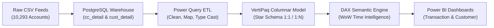

# 📊 Project Presentation: Credit Card Financial & Customer Analytics

**Project Title**: Credit Card Weekly Financial & Customer Analytics Dashboard  
**Audience**: Executive Committee, Head of Retail Lending, Portfolio Operations & Risk Management  
**Reporting Period**: Fiscal Year 2023 (Weeks 1 to 53)  
**Monitored Portfolio**: 10,293 Accounts | 667,234 Transactions  
**Tech Stack**: Power BI Desktop / Service, PostgreSQL, DAX, Power Query  

---

## 🗺️ Presentation Overview Mindmap

```
====================================================================================================
                        EXECUTIVE PRESENTATION STRUCTURE MINDMAP
====================================================================================================

                               [*] CREDIT CARD PORTFOLIO BRIEFING
                                                |
         +--------------------------------------+--------------------------------------+
         |                                      |                                      |
         v                                      v                                      v
[PART 1: FINANCIAL OVERVIEW]           [PART 2: SEGMENTATION & CHANNELS]      [PART 3: RISK & ROADMAP]
- Slide 1: Executive Title             - Slide 5: Card Tier Economics         - Slide 9: Technical Architecture
- Slide 2: Objectives & Problem        - Slide 6: Channel & Payment Methods   - Slide 10: Risk & Delinquency Sentries
- Slide 3: Portfolio KPI Scorecard     - Slide 7: Demographic Engines         - Slide 11: Strategic Growth Plan
- Slide 4: Week 53 Holiday Surge       - Slide 8: Geographic Concentration    - Slide 12: Knowledge Repository
====================================================================================================
```

---

## 📽️ Part 1: Strategic & Financial Overview

### Slide 1: Title & Executive Summary
```
+---------------------------------------------------------------------------------------------------+
|                        CREDIT CARD FINANCIAL & CUSTOMER ANALYTICS                                 |
|                        Weekly Portfolio Intelligence & Growth Strategy                            |
|                                                                                                   |
|   Key Highlights:                                                                                 |
|   • Gross Portfolio Revenue:  $56.52M ($56,517,011)                                               |
|   • Total Transaction Spend:  $45.53M (667K Transactions)                                         |
|   • Net Interest Earnings:    $7.98M                                                              |
|   • Week 53 Holiday Surge:    +28.77% WoW Revenue Expansion                                       |
|                                                                                                   |
|   Powered by Power BI, PostgreSQL, DAX & Power Query                                              |
+---------------------------------------------------------------------------------------------------+
```
> **Speaker Notes**:  
> Welcome, leadership team. Today we present an end-to-end financial intelligence solution that monitors our retail credit card portfolio across 53 weeks. Generating over \$56.5M in revenue across 10,290+ accounts, this platform bridges relational data engineering, dynamic time-intelligence modeling, and interactive dashboards to empower data-driven decisions across risk, marketing, and card operations.

---

### Slide 2: Strategic Business Objectives & Problem Statement
```
+---------------------------------------------------------------------------------------------------+
|                        STRATEGIC OBJECTIVES & PROBLEM STATEMENT                                   |
+-----------------------------------+---------------------------------------------------------------+
| Problem / Pain Point              | Strategic Solution Delivered                                  |
+-----------------------------------+---------------------------------------------------------------+
| 1. Delayed Weekly Performance     | Automated weekly data refresh and dynamic DAX time            |
|    Visibility                     | intelligence computing Week-over-Week (WoW) revenue trends.   |
|                                   |                                                               |
| 2. Dormant Account CAC Waste      | 30-day activation tracking isolating 42.5% inactive accounts  |
|    ($96.29 Avg Acquisition Cost)  | to trigger timely re-engagement spend promotions.             |
|                                   |                                                               |
| 3. Hidden Delinquency Clusters    | Cross-filtering reveals that Government (7.27%) and           |
|    in Key Employment Groups       | Self-Employed (6.51%) segments require early payment alerts.  |
|                                   |                                                               |
| 4. Premium Card Churn Risk        | Identifies that Platinum cardholders report low satisfaction  |
|    (Low Satisfaction Score)       | (2.72 / 5.0) vs Blue (3.20 / 5.0), driving targeted revamp.   |
+-----------------------------------+---------------------------------------------------------------+
```
> **Speaker Notes**:  
> Historically, retail credit card reporting suffered from multi-week lag times, masking dormant accounts and high-utilization delinquency risks. This project delivers an automated, near real-time operational dashboard that highlights growth opportunities while protecting loan portfolio health.

---

### Slide 3: Full-Year Portfolio KPI Scorecard
```
+---------------------------------------------------------------------------------------------------+
|                             ANNUAL PORTFOLIO KPI SCORECARD (FY 2023)                              |
+------------------------------------+----------------------------------+---------------------------+
| METRIC NAME                        | FY 2023 VALUE                    | STATUS / BENCHMARK        |
+------------------------------------+----------------------------------+---------------------------+
| Gross Portfolio Revenue            | $56,517,011 (~$56.52M)           | 🟢 Strong Outperformance  |
| Total Transaction Spend            | $45,533,021 (~$45.53M)           | 🟢 Steady Daily Utility   |
| Net Interest Earnings              | $7,982,480 (~$7.98M)             | 🟢 High-Margin Revolving  |
| Annual Membership Fees             | $3,001,510 (~$3.00M)             | 🟡 Moderate Expansion     |
| Settled Transactions               | 667,234 transactions             | 🟢 High Velocity          |
| Total Monitored Accounts           | 10,293 active accounts           | 🟢 Stable Customer Base   |
| Portfolio Delinquency Rate         | 6.06% (624 accounts)             | 🟡 Prudent Monitoring     |
| 30-Day Card Activation Rate        | 57.46% (5,914 accounts)          | 🔴 Action Required        |
| Average Credit Utilization         | 27.45%                           | 🟢 Healthy (<30% Limit)   |
| Average Acquisition Cost (CAC)     | $96.29 per account               | 🟢 Cost-Efficient Acq     |
| Average Customer Satisfaction      | 3.19 / 5.00                      | 🟡 Moderate Retention     |
+------------------------------------+----------------------------------+---------------------------+
```
> **Speaker Notes**:  
> Our full-year revenue closed at \$56.52M, driven primarily by \$45.53M in gross spend and \$7.98M in net interest earnings. While portfolio credit utilization remains conservative at 27.45%, our 30-day activation rate of 57.46% represents an immediate opportunity to unlock dormant account value.

---

### Slide 4: Week 53 Holiday Surge & Week-over-Week Momentum
```
+---------------------------------------------------------------------------------------------------+
|                        WEEK 52 VS WEEK 53 MOMENTUM (YEAR-END SURGE)                               |
+------------------------------------+------------------+------------------+------------------------+
| METRIC                             | WEEK 52          | WEEK 53          | WoW MOMENTUM DELTA     |
+------------------------------------+------------------+------------------+------------------------+
| Weekly Gross Revenue               | $933,134.43      | $1,201,600.58    | +28.77% Surge 🚀       |
| Weekly Transaction Spend           | $748,677.00      | $1,011,008.00    | +35.04% Expansion 💳   |
| Weekly Net Interest Earned         | $137,707.43      | $139,097.58      | +1.01% Increase 📈     |
| Weekly Annual Fees Collected       | $46,750.00       | $51,495.00       | +10.15% Increase 🎟️   |
| Weekly Transaction Count           | 11,203 trans     | 11,583 trans     | +3.39% Velocity ⚡     |
| Weekly Ingested Batch Size         | 164 accounts     | 185 accounts     | +12.80% Batch Delta    |
+------------------------------------+------------------+------------------+------------------------+
```
> **Speaker Notes**:  
> Week 53 recorded a remarkable year-end holiday spend surge. Revenue expanded by +28.77% WoW, reaching \$1.202M in a single week (vs \$933.1K in Week 52), while transaction spend surged +35.04% to \$1.011M (vs \$748.7K in Week 52). This demonstrates strong seasonal elasticity and spending momentum entering the new fiscal year.

---

## 💳 Part 2: Portfolio Segmentation & Channels

### Slide 5: Card Category Segmentation & Tier Economics
```
+---------------------------------------------------------------------------------------------------+
|                              CARD CATEGORY REVENUE & RISK BREAKDOWN                               |
+-----------+--------------------+---------------+--------------------+-------------+---------------+
| CARD TIER | GROSS REVENUE ($)  | SHARE (%)     | TRANS SPEND ($)    | DELINQUENCY | SATISFACTION  |
+-----------+--------------------+---------------+--------------------+-------------+---------------+
| Blue      | $47,188,612        | 83.49%        | $37,840,749        | 6.05%       | 3.20 / 5.0    |
| Silver    | $5,659,109         | 10.01%        | $4,647,596         | 6.16%       | 3.22 / 5.0    |
| Gold      | $2,533,682         | 4.48%         | $2,091,362         | 6.22%       | 3.05 / 5.0    |
| Platinum  | $1,135,608         | 2.01%         | $953,314           | 5.97%       | 2.72 / 5.0 ⚠️ |
| Total     | $56,517,011        | 100.00%       | $45,533,021        | 6.06%       | 3.19 / 5.0    |
+-----------+--------------------+---------------+--------------------+-------------+---------------+
```
> **Speaker Notes**:  
> The Blue card tier is our primary revenue engine, contributing 83.49% (\$47.19M) of portfolio revenue. While Silver and Gold perform reliably, Platinum presents an urgent retention issue: cardholders pay high annual fees but report a satisfaction score of only 2.72/5.0, signaling poor perceived benefit value.

---

### Slide 6: Expenditure Channel & Payment Method Distribution
```
+---------------------------------------------------------------------------------------------------+
|                             EXPENDITURE CATEGORY & CHANNEL SPLIT                                  |
+-----------------------------------+---------------------------------------------------------------+
| Spend Category Breakdown          | Point-of-Sale Payment Method Share                            |
+-----------------------------------+---------------------------------------------------------------+
| • Bills & Utilities: $14.00M (24.8%)| • Magnetic Swipe: $35.66M (63.10%)                           |
| • Entertainment:     $9.78M (17.3%) |   Dominant in-person retail method                            |
| • Fuel & Transport:  $9.59M (17.0%) |                                                               |
| • Groceries:         $8.73M (15.5%) | • EMV Chip Dip:   $17.34M (30.68%)                           |
| • Food & Dining:     $8.38M (14.8%) |   Contactless & secure in-store dip                           |
| • Travel:            $6.04M (10.7%) |                                                               |
|                                   | • Online / Web:   $3.52M (6.22%) ⚠️                           |
| Total: $56.52M Revenue Base       |   Significantly below 25% industry digital benchmark          |
+-----------------------------------+---------------------------------------------------------------+
```
> **Speaker Notes**:  
> Everyday necessities—bills, entertainment, fuel, and groceries—account for over 74% of revenue. However, our payment method analysis reveals that online e-commerce spend represents only 6.22% of transactions. Accelerating digital card adoption and virtual card issuance represents our single largest near-term growth opportunity.

---

### Slide 7: Demographic & Socioeconomic Segmentation
```
+---------------------------------------------------------------------------------------------------+
|                              DEMOGRAPHIC ENGINES & OCCUPATIONAL RISK                              |
+-----------------------------------+---------------------------------------------------------------+
| Age Cohort Revenue Contribution   | Occupational Distribution & Default Propensity                |
+-----------------------------------+---------------------------------------------------------------+
| • Ages 40–50: $24.73M (43.76%) 🌟 | • Businessman:     $17.70M (31.31%) | 5.27% Delinquency       |
|   Core demographic revenue engine | • White-Collar:    $10.28M (18.19%) | 5.56% Delinquency       |
| • Ages 50–60: $18.62M (32.95%)    | • Self-Employed:   $8.54M  (15.12%) | 6.51% Delinquency ⚠️    |
| • Ages 30–40: $9.84M  (17.42%)    | • Government:      $8.34M  (14.75%) | 7.27% Delinquency 🚨    |
| • Ages 60+:   $2.25M  (3.98%)     | • Blue-Collar:     $7.04M  (12.46%) | 5.48% Delinquency       |
| • Ages 20–30: $1.07M  (1.89%)     | • Retirees:        $4.62M  (8.17%)  | 6.26% Delinquency       |
|                                   |                                                               |
| Gender Split:                     | Education Engine:                                             |
| • Male:   $30.93M (54.73%, 4,306) | • Graduates generate $22.79M (40.32% of total portfolio)      |
| • Female: $25.59M (45.27%, 5,987) | • High School holders generate $11.43M (20.23%)               |
+-----------------------------------+---------------------------------------------------------------+
```
> **Speaker Notes**:  
> Customers aged 40 to 60 represent over 76.7% of total portfolio revenue. Professionally, Businessmen and White-Collar workers drive healthy volumes with low delinquency. Conversely, Government Employees and Self-Employed cardholders exhibit delinquency rates above 6.5%, requiring tailored credit limits and proactive alert workflows.

---

### Slide 8: Geographic Revenue Concentration (Top 5 States)
```
+---------------------------------------------------------------------------------------------------+
|                             GEOGRAPHIC CONCENTRATION (TOP 5 STATES)                               |
+------+--------------------+-----------------------+-----------------------------------------------+
| RANK | STATE              | GROSS REVENUE ($)     | PORTFOLIO SHARE (%)                           |
+------+--------------------+-----------------------+-----------------------------------------------+
| 1    | Texas (TX)         | $13,016,914           | 23.03%                                        |
| 2    | New York (NY)      | $12,968,410           | 22.95%                                        |
| 3    | California (CA)    | $12,903,264           | 22.83%                                        |
| 4    | Florida (FL)       | $9,969,077            | 17.64%                                        |
| 5    | New Jersey (NJ)    | $4,380,829            | 7.75%                                         |
+------+--------------------+-----------------------+-----------------------------------------------+
| --   | Combined Top 5     | $53,238,494           | 94.20% (Heavy Geographic Concentration)       |
| --   | Remaining States   | $3,278,517            | 5.80% (Untapped Regional Expansion Potential) |
+------+--------------------+-----------------------+-----------------------------------------------+
```
> **Speaker Notes**:  
> Over 94% of portfolio revenue is concentrated in just five states: Texas, New York, California, Florida, and New Jersey. While these markets provide robust stability, expanding acquisition into adjacent Tier-2 metropolitan areas will mitigate regional concentration risk.

---

## 🏗️ Part 3: Architecture, Risk & Strategic Roadmap

### Slide 9: Technical Architecture & Business Intelligence Pipeline
```
+---------------------------------------------------------------------------------------------------+
|                        ENTERPRISE DATA & ANALYTICS ARCHITECTURE                                   |
+---------------------------------------------------------------------------------------------------+
```

> **Speaker Notes**:  
> The technical pipeline ingests raw banking feeds into PostgreSQL staging tables with B-tree index seeks. Power Query standardizes column headers and data types. Data is then loaded into Power BI's VertiPaq engine, where DAX measures compute Week-over-Week momentum and risk metrics in sub-second response times.

---

### Slide 10: Risk Management, Delinquency & Activation Sentries
```
+---------------------------------------------------------------------------------------------------+
|                        PORTFOLIO RISK PROFILE & EARLY WARNING SENTRIES                            |
+-----------------------------------+---------------------------------------------------------------+
| Risk Lever                        | Current Metrics & Monitoring Trigger                          |
+-----------------------------------+---------------------------------------------------------------+
| Portfolio Delinquency Rate        | • 6.06% across 624 accounts ($11.8M revolving balance exposure|
|                                   | • Trigger: Sentry alerts if segment delinquency climbs > +0.5%|
|                                   |                                                               |
| High-Risk Segments                | • Govt Staff (7.27%) & Self-Employed (6.51%)                  |
|                                   | • Sentry: Automated soft SMS reminder 5 days before due date  |
|                                   |                                                               |
| Credit Line Utilization Trigger   | • Portfolio Average: 27.45%                                   |
|                                   | • Trigger: Accounts with utilization > 70% placed on watchlist|
|                                   |                                                               |
| Inactive New Cards (CAC Loss)     | • 42.54% of accounts inactive in first 30 days                |
|                                   | • Incurred acquisition loss: $96.29 CAC per dormant account   |
+-----------------------------------+---------------------------------------------------------------+
```
> **Speaker Notes**:  
> Our overall delinquency is 6.06%, within acceptable credit boundaries, but Government employees and self-employed accounts drive higher risk. Placing accounts exceeding 70% credit utilization on an early-warning alert list allows us to intervene before accounts become non-performing loans.

---

### Slide 11: Strategic Growth Plan & Actionable Recommendations
```
+---------------------------------------------------------------------------------------------------+
|                                 5-POINT STRATEGIC ACTION PLAN                                     |
+----+------------------------------+-------------------------------+-------------------------------+
| #  | INITIATIVE                   | TARGET COHORT                 | EXPECTED BUSINESS OUTCOME     |
+----+------------------------------+-------------------------------+-------------------------------+
| 1  | 14-Day Activation Incentive  | Inactive Cards (Days 1–30)    | Lift activation from 57%->70% |
|    | ($25 credit on $100 spend)   | (4,379 unactivated accounts)  | Recover $420K+ in wasted CAC  |
+----+------------------------------+-------------------------------+-------------------------------+
| 2  | Platinum Benefit Overhaul    | Platinum Tier Cardholders     | Lift CSS from 2.72 to >3.8    |
|    | (Lounge access, fee waiver)  | ($1.14M Revenue)              | Halve premium account churn   |
+----+------------------------------+-------------------------------+-------------------------------+
| 3  | Digital Spend Campaign       | Online Shoppers               | Double digital share from     |
|    | (Apple Pay, e-commerce 5%)   | (Currently only 6.22% spend)  | 6.2% to 12.0% (+$3.2M spend)  |
+----+------------------------------+-------------------------------+-------------------------------+
| 4  | Early Delinquency Reminders  | Govt & Self-Employed Cohorts  | Reduce portfolio delinquency  |
|    | (5-day pre-due SMS alerts)   | (7.27% & 6.51% default rates) | from 6.06% to < 5.00%         |
+----+------------------------------+-------------------------------+-------------------------------+
| 5  | Geographic Expansion         | High-growth Tier 2 States     | Diversify beyond TX/NY/CA/FL  |
|    | (Targeted digital marketing) | (Outside the Top 5 states)    | Build 10%+ revenue buffer     |
+----+------------------------------+-------------------------------+-------------------------------+
```
> **Speaker Notes**:  
> Implementing these five initiatives will directly lift active card engagement, mitigate delinquency losses, and double our digital transaction share. Each recommendation addresses a quantified finding in our reporting.

---

### Slide 12: Knowledge Repository & Documentation Links

```
+---------------------------------------------------------------------------------------------------+
|                         PROJECT DOCUMENTATION & ARTIFACT DIRECTORY                                |
+------------------------------------+--------------------------------------------------------------+
| DOCUMENT                           | DESCRIPTION                                                  |
+------------------------------------+--------------------------------------------------------------+
| 📘 PROJECT_EXPLANATION.md          | Complete technical walkthrough, retail banking mechanics.    |
| 🔄 PROJECT_FLOW.md                 | 10 End-to-end execution diagrams, data lifecycles, decisions. |
| 📊 PROJECT_PRESENTATION.md         | 12-Slide executive deck briefing with notes & scorecards.    |
| 📈 BUSINESS_INSIGHTS_REPORT.md     | Executive findings, cohort drill-downs, and recommendations. |
| 📄 DATA_DICTIONARY.md              | Full schema definitions, constraints, validation protocols.  |
| 📐 DAX_MEASURES.md                 | Mathematical formulas for Revenue, Delinquency, WoW engine.  |
| 🖥️ POWER_BI_DASHBOARD_GUIDE.md     | Pixel-perfect visual coordinates, formatting rules & theme.  |
| 🔄 ETL_POWER_QUERY_M_CODE.md       | Power Query M scripts, schema drift handling & calendar.     |
| 🛡️ RISK_AND_CREDIT_POLICY_ANALYSIS | Basel III Expected Loss, underwriting & collections sentries.|
| 🚀 MARKETING_AND_PORTFOLIO_OPTI... | 14-Day activation sprint, digital shift & tier upgrades.     |
| 🎙️ INTERVIEW_QA_AND_PORTFOLIO...  | STAR project defense & 15+ technical interview Q&A.          |
| 🧪 DATA_VALIDATION_REPORT.md       | 31-point mathematical reconciliation report (100% verified). |
| 🐍 DATA_VALIDATION_AND_TESTING...  | Automated Python test suite verifying all metrics & PDFs.    |
| 🛠️ SQL_SCRIPTS.sql                | PostgreSQL DDL, COPY commands, quality gates, and views.     |
| 📖 README.md                       | Master GitHub project readme with dashboard screenshots.     |
+------------------------------------+--------------------------------------------------------------+
```
> **Speaker Notes**:  
> All underlying SQL DDL scripts, DAX measure calculations, data dictionaries, automated Python test runners, and architectural diagrams are cataloged in the repository for full auditability and engineering reproduction. Thank you.

---

## 📌 Document Links & Navigation

| Document | Focus Area | Direct File Link |
| :--- | :--- | :--- |
| 📘 **Project Technical Explanation** | Deep-dive into banking economics, interchange mechanics, and SQL/DAX | [`docs/PROJECT_EXPLANATION.md`](PROJECT_EXPLANATION.md) |
| 🔄 **Project Operational & System Flows** | Complete catalog of 10 end-to-end data pipelines and decision flows | [`docs/PROJECT_FLOW.md`](PROJECT_FLOW.md) |
| 📈 **Business Insights Report** | High-yield demographics, channel performance, and risk roadmaps | [`docs/BUSINESS_INSIGHTS_REPORT.md`](BUSINESS_INSIGHTS_REPORT.md) |
| 📄 **Data Dictionary** | 10,293 account schema definitions, field metadata, and validation rules | [`docs/DATA_DICTIONARY.md`](DATA_DICTIONARY.md) |
| 📐 **DAX Measure Catalog** | Mathematical formulations for Revenue, Delinquency, and Time-Intelligence | [`docs/DAX_MEASURES.md`](DAX_MEASURES.md) |
| 🖥️ **Power BI Dashboard Guide** | Pixel-perfect canvas coordinates, formatting rules, and theme JSON | [`docs/POWER_BI_DASHBOARD_GUIDE.md`](POWER_BI_DASHBOARD_GUIDE.md) |
| 🔄 **Power Query M Code Specification** | Full M expressions, schema drift resolvers, and calendar generator | [`docs/ETL_POWER_QUERY_M_CODE.md`](ETL_POWER_QUERY_M_CODE.md) |
| 🛡️ **Credit Risk Policy Analysis** | Basel III Expected Loss (EL), underwriting, and early warning sentries | [`docs/RISK_AND_CREDIT_POLICY_ANALYSIS.md`](RISK_AND_CREDIT_POLICY_ANALYSIS.md) |
| 🚀 **Marketing & Portfolio Optimization** | 14-day activation funnels, digital channel shift, and tier bridges | [`docs/MARKETING_AND_PORTFOLIO_OPTIMIZATION.md`](MARKETING_AND_PORTFOLIO_OPTIMIZATION.md) |
| 🎙️ **Interview Q&A & Portfolio Case Study** | STAR project defense and 15+ deep technical interview questions & answers | [`docs/INTERVIEW_QA_AND_PORTFOLIO_CASE_STUDY.md`](INTERVIEW_QA_AND_PORTFOLIO_CASE_STUDY.md) |
| 🧪 **Data Validation Report** | Official 31-point mathematical reconciliation report proving 100% accuracy | [`docs/DATA_VALIDATION_REPORT.md`](DATA_VALIDATION_REPORT.md) |
| 🛠️ **SQL Data Warehouse Pipeline** | Relational DDL, staging tables, B-tree indexes, and automated audit checks | [`docs/SQL_SCRIPTS.sql`](SQL_SCRIPTS.sql) |
| 📖 **Master README** | Project overview, visual showcases, and quickstart setup guide | [`README.md`](../README.md) |

